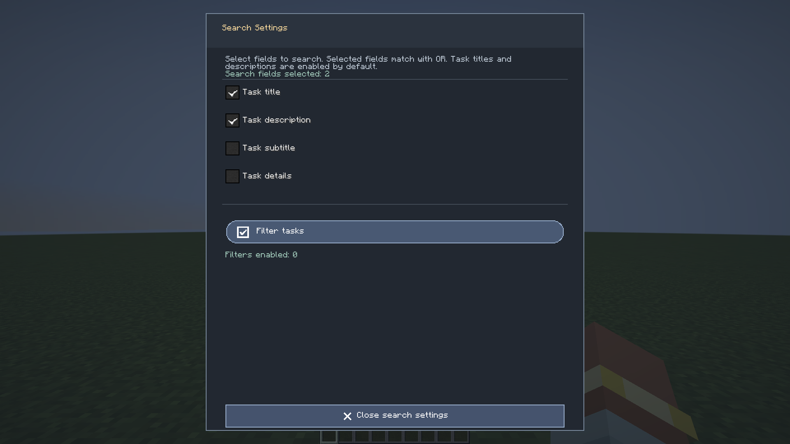
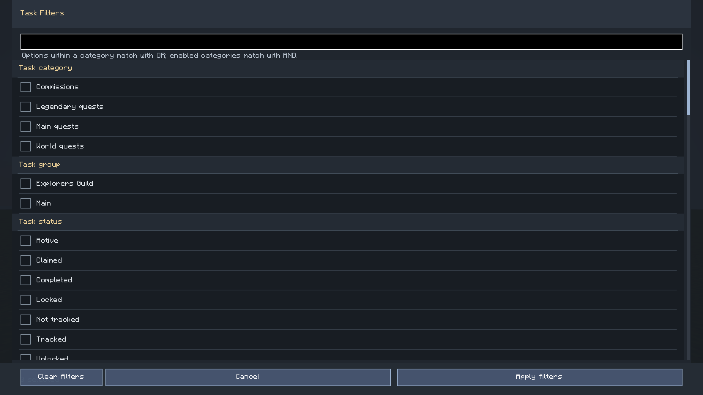
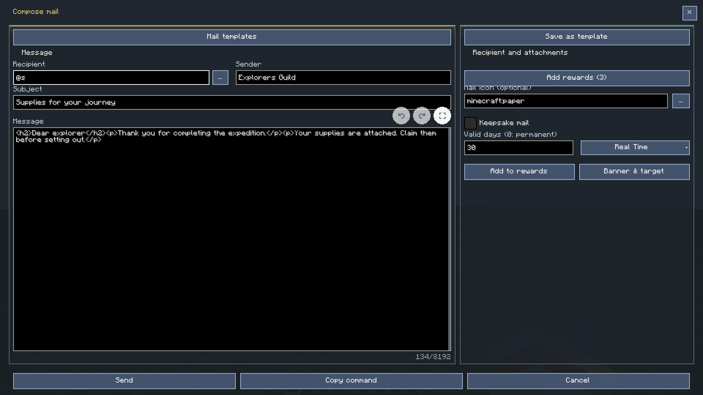
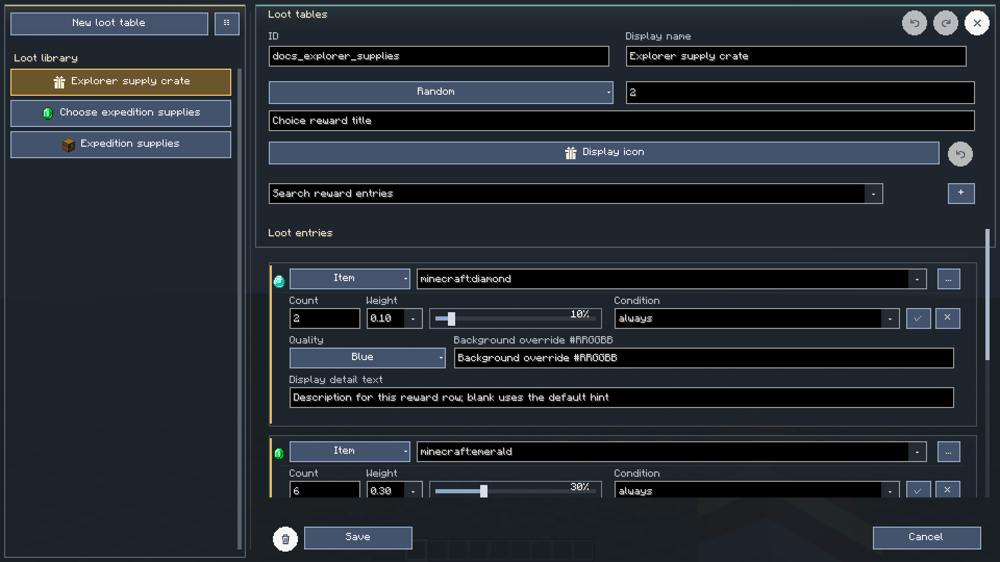
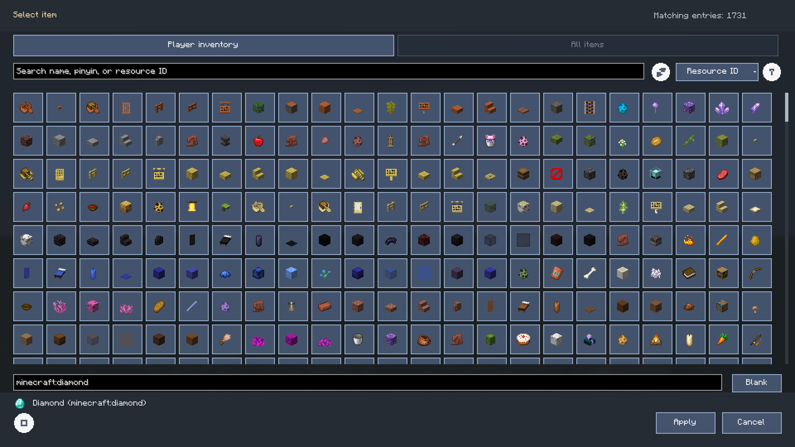
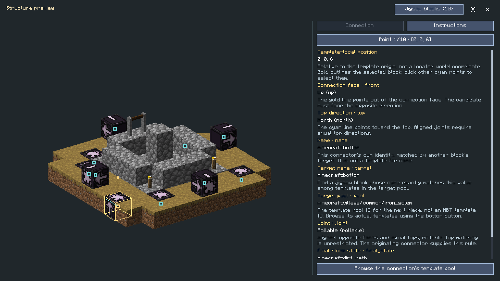
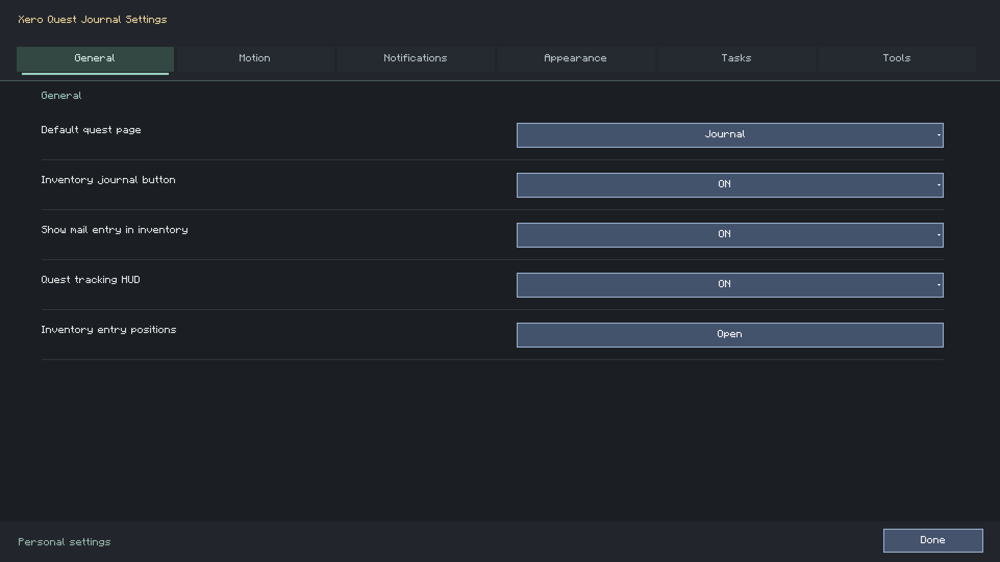

# Xero Quest Journal

[简体中文](README.md) | **English** · [Documentation](docs/en/README.md) · [1080p interface gallery](docs/en/interface-gallery.md)

A native Minecraft quest journal with visual authoring, chapter timelines, rewards,
mail, anecdote records, and reusable structure previews.

**Current mod version: 0.2.1.** The Chinese and English documentation
describe the same shared feature set. Images on this page are actual English client captures
at **1920×1080**, taken after resource loading and interface transitions settle.


## Downloads And Compatibility

Choose the JAR that matches both your Minecraft version and loader.

| Minecraft | Loader | Java | Release file |
| --- | --- | --- | --- |
| 1.20.1 | Forge | 17 | `xero_quest_journal-forge-1.20.1-0.2.1.jar` |
| 1.20.1 | Fabric + Fabric API | 17 | `xero_quest_journal-fabric-1.20.1-0.2.1.jar` |
| 1.21.1 | NeoForge | 21 | `xero_quest_journal-neoforge-1.21.1-0.2.1.jar` |
| 1.21.1 | Fabric + Fabric API | 21 | `xero_quest_journal-fabric-1.21.1-0.2.1.jar` |

[Download 0.2.1](https://github.com/XTDPotato/xero_quest_journal/releases/tag/v0.2.1).
The release also contains an organized bundle and `SHA256SUMS.txt`.
Install one matching core JAR per instance. Multiplayer installations need matching client
and server builds. Complete authoring currently targets a local integrated server.

26.1, 26.2 and 26.3 have development projects and partial adapters; their complete migration
remains unfinished and they have no installable release here.
See [testing and compatibility](docs/en/testing-and-compatibility.md) for tested loader versions,
build commands, and the limits of the evidence.

## Start Playing

1. Place the matching JAR in the instance's `mods` directory. Fabric also requires the
   corresponding Fabric API.
2. Enter a world and press `J` for the quest journal or `F8` for the mailbox.
3. Select a category, expand a group, and click a task to read its conditions and rewards.
4. Use Track to follow a task. A completed task with unclaimed rewards stays in progress
   until its rewards are claimed.
5. Open personal settings with `/xero_quest open settings`. Key bindings can also be changed
   in Minecraft's controls.

| Action | Default entry |
| --- | --- |
| Quest journal | `J`, inventory shortcut, `/xero_quest open journal` |
| Mailbox / new message | `F8` / `F7` |
| Overview | `/xero_quest open overview` |
| Anecdote book | `/xero_quest open anecdotes` |
| Settings | `/xero_quest open settings` |
| A specific task | `/xero_quest open task <id>` |
| Change quest category | Category tabs or `Q` / `E`, while a text field has no input focus |

Quest completion chat includes a gold **[Open quest]** link on its own line.
Unread indicators, completion, tracking, and reward claims are separate states.

## What You Can Author

| Area | Capabilities |
| --- | --- |
| Tasks | Categories, groups, prerequisites, descriptions, subtitles, custom icons and visible controls |
| Conditions | Inventory holding, acquisition, submission, kills, world targets, custom counters, scripts and logical groups |
| Rewards | Items, experience, commands, functions, scripts, effects, loot tables and reward graphs |
| Journey | Chapter tabs, task cards and links, chapter-local appearance, backgrounds, music and task membership |
| Node graphs | Events, predicates, branches, actions, delays, typed variables and numeric calculations |
| Scripts | Purpose-specific reference, examples, line numbers, syntax diagnostics and draft preservation |
| Mail | Attachments, favorites, expiration, claims, protected deletion, templates and composition |
| Anecdotes | Independent entries, multiple records, discovery/locking, completion stickers and configurable rewards |
| Resources | Searchable item/image selection, sorting, explicit Apply, zoomable previews and candidate recycling |
| Structures | Java NBT scenes, actual start-pool templates, jigsaw connector inspection and pool browsing |
| Presentation | Reward quality/backgrounds, full-screen settings, configurable animation and inventory anchors |

The [player and author guide](docs/en/guide.md) explains each workflow, where edits are saved,
and which controls require author permission.

## Read, Search And Inspect

Search can include task titles, descriptions, subtitles and internal content.
The search settings menu stays open until closed. Filters narrow the results by categories,
reward types/items, completion conditions, targets and related properties.





Click a completion condition to inspect its requirements. Item conditions expose the requested
item and its detail/source view. Task and mail rewards sit at the bottom of their detail panes.
Reward quality changes card presentation; it does not change the real item's attributes.


## Journey And Anecdotes

The journey is a chapter timeline with task cards, links, a draggable chapter progress marker
and a selected-tab underline that defaults to 3 GUI pixels and is adjustable from 1 to 5.
Clicking a task opens a detail popup; its explicit
navigation button opens the full journal.


Author mode adds timeline editing, task membership and chapter-local appearance.
The pencil enters editing; the pencil with an X leaves editing.
The checklist button selects chapter tasks. Appearance changes support multi-selection,
dragging, width/height handles and proportional resizing with live preview.


The anecdote book keeps independent entries and multiple records. Discovery can be controlled
by nodes, completed records remain readable, and the reward page displays completion stickers.
See [anecdote authoring](docs/en/anecdotes.md) for file fields and node examples.


## Visual Rules And JavaScript

Use the event graph for event/condition/action behavior, and the unlock graph for task
prerequisites. Their connections have different meanings.


The built-in JavaScript engine evaluates the program's final value. A predicate succeeds
only when that value is Boolean `true`. Graph context fields are strings:

```javascript
eventType === "click" && Number(experienceLevel) >= 10;
```

File conditions expose numeric `experienceLevel` and coordinates:

```javascript
experienceLevel >= 10 && dimension === "minecraft:overworld";
```

Use an immediately invoked function for multiline predicates with `return`.
The reference distinguishes built-in JS, KubeJS and Minecraft functions, and includes
all 15 shared examples.


[JavaScript reference](docs/en/javascript.md) · [Predicate nodes](docs/en/trigger-conditions.md)
· [Variables and inventory shortcuts](docs/en/variables-and-inventory.md)

## Mail, Loot And Resources

Mail uses its own list/detail view and attachment editor.
Reward claims are server-authoritative; changing definitions does not rewrite already frozen rewards.




Loot tables have separate **ID**, **display name**, mode and **roll count** fields.
In random mode, roll count controls how many selections occur; each entry's count controls
how much that selection awards. The table's external icon is configured separately.
Entries support a custom `detailText`, preserved in frozen choice metadata.
Contents and choice views show search only when their original list exceeds 10 entries.
Inspect buttons let you read a candidate without selecting or claiming it.



The shared item/image picker supports search, ascending/descending ordering, metadata,
smooth scrolling and an explicit Apply step. Full-screen previews support zoom and pan.



## Structures And Jigsaw Blocks

World structure IDs, encoded location conditions and imported NBT filenames have separate roles.
A world structure's preview browser reads its actual start pool when available.
The jigsaw inspector highlights connectors in the model and explains `name`, `target`, `pool`,
orientation, `joint`, final replacement and version-specific priorities.



The key match is **A.target = B.name**, with opposite connection faces.
The inspector previews individual templates; actual assembly, collision and processors belong
to Minecraft's generator. See the [complete jigsaw tutorial](docs/en/candidate-selectors-and-jigsaw.md),
including a datapack pool example and the 1.20.1/1.21.1 folder differences.

## Create Your First Task

In a local world with administrator permission:

```text
/xero_quest edit_mode @s true
/xero_quest open journal
```

Use the task context menu to create/edit tasks, conditions and rewards.
For a file-based example, place this in `config/xero_quest/groups/first_logs.json`:

```json
{
  "id": "first_logs",
  "uid": "first-logs-v1",
  "title": "Gather logs",
  "description": "Keep 16 logs in your inventory, then claim your reward.",
  "type": "world",
  "icon": "minecraft:oak_log",
  "defaultUnlocked": true,
  "trackable": true,
  "rewardMode": "manual",
  "triggers": [
    {"type": "item_hold", "item": "#minecraft:logs", "count": 16}
  ],
  "rewards": [
    {"type": "item", "item": "minecraft:diamond", "count": 2, "quality": "rare"}
  ]
}
```

```text
/xero_quest reload
/xero_quest open task first_logs
```

`item_hold` checks current inventory. `item_acquire` counts new acquisition events while
eligible. `item_submit` requires submission and consumes the requested items.
See [reward and condition configuration](docs/en/rewards-and-conditions.md) for matching,
logical conditions, qualities, loot weights and claim behavior.

## Settings, Shortcuts And History

Settings use six full-screen tabs: General, Motion, Notifications, Appearance, Tasks and Tools.
Personal options apply locally; server-owned options retain permission checks.
Inventory task/mail shortcuts have independent visibility and visual anchor/offset controls.
Supported JEI/REI/EMI integration provides dedicated entries.




Saved authoring operations have server-side undo/redo history, with conflict checks and
per-editor state. This changes definitions, not awarded items or player progress.
The separate appearance-editor regression still has an unresolved undo assertion;
see [history scope](docs/en/task-edit-undo.md) and [current verification](docs/en/testing-and-compatibility.md).

## Build And Verification

Build the root NeoForge target with Java 21:

```powershell
.\gradlew.bat build
```

Other production targets:

```powershell
# Java 17
.\gradlew.bat buildSelected "-Pmc_target=1.20.1" "-Ploader=forge"
.\gradlew.bat buildSelected "-Pmc_target=1.20.1" "-Ploader=fabric"
# Java 21
.\gradlew.bat buildSelected "-Pmc_target=1.21.1" "-Ploader=fabric"
```

Run the two 1.20.1 builds sequentially: Fabric's adaptation uses the Forge-generated sources.
The build checks the 5,000,000-byte core JAR limit and media dependency isolation.
Client workflows run through separate explicit test tasks.

Four production builds and several focused client regressions passed on October 18, 2026.
The complete journey browsing regression and broad creation regression have unresolved
assertions. Screenshots document visible UI states and are not a claim that every feature,
platform combination or remote multiplayer scenario passed testing.

[Compatibility, reproduction commands and limitations](docs/en/testing-and-compatibility.md).

## Documentation And License

Start with the [English documentation center](docs/en/README.md) or
[中文文档中心](docs/README.md). The [interface gallery](docs/en/interface-gallery.md)
connects full-resolution screenshots to their entry points and workflows.
All command paths/permissions and shared JS examples are included in the references.

Source code is licensed under [MIT](LICENSE). Minecraft, loaders, libraries and media retain
their respective rights. This project is independent of Mojang and Microsoft.
