# Xero Quest Journal

**Minecraft 1.20.1 / 1.21.1 · Forge / NeoForge / Fabric · 原生任务日志与可视化编辑器**

项目采用单仓库、单模组 ID 的多加载器布局。当前完整构建基线仍是
Minecraft 1.21.1 NeoForge。Forge 1.20.1、Fabric 1.20.1 和 Fabric 1.21.1
已接入共享功能，2026-10-13 各移植版本通过 33 项客户端/集成服务器专项回归。
两个 Fabric 发布 JAR 另通过生产专用服务器初始化检查；服务器保持 `eula=false`，
未验证远端联机。26.1–26.3 已建立 Java 25 工程并验证原生存档适配层，
完整渲染、输入与运行时迁移尚未完成，暂无可安装包。
每个游戏版本/加载器使用独立 JAR。详见 [版本矩阵](docs/porting-matrix.md)
和 [Fabric 验证报告](docs/fabric-verification.md)。

2026-10-17 多版本预览 16（模组版本 `0.2.0`）：概览分类区的“逸闻纪事”入口紧跟“游逸旅文”，
使用独立图标并直接打开逸闻纪事书册。此前版本还包含奖励编辑器本地化物品 tooltip、
虚拟化图标/物品选择器、空奖励快捷添加、自引用前置修复和任务解锁图定位。
四个已完成平台均含逸闻纪事与相关作者功能，并补齐 1920×1080 界面截图。
详细状态见 [本轮验证](docs/release-verification-2026-10-17.md)；
常见界面、入口与操作见 [中文 1080p 界面图鉴](docs/interface-gallery.md)。

Xero Quest Journal 面向整合包作者、地图作者与喜欢任务引导的玩家，把任务列表、章节历程、世界目标、奖励和邮箱放在一套原生游戏界面中。作者可以在本地世界内编辑任务，也可以用 JSON、HTML 或 XML 配置任务文件。

核心模组保持轻量，媒体解码使用可选后端；任务完成、奖励领取和玩家进度由服务端处理。

> 当前源码版本为 **0.2.0 开发预览版**。新的界面图鉴全部采用中文、原生 1920×1080 截图；
> 历史验证与本次验证分开记录。26.1–26.3 尚无完整可安装包。

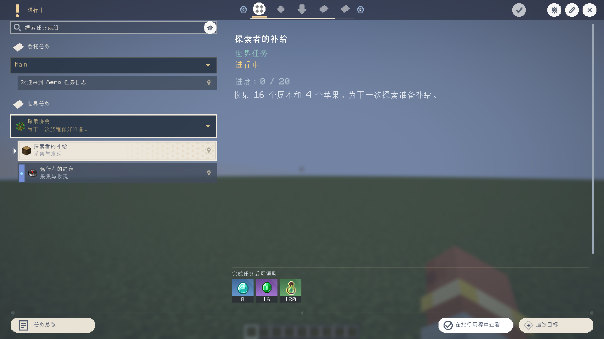

## 导航

- [功能一览](#功能一览)
- [界面与截图](#界面与截图)
- [中文 1080p 界面图鉴：常见界面、入口和操作](docs/interface-gallery.md)
- [任务修改与删除的撤销/重做](docs/task-edit-undo.md)
- [2026-10-17 多版本构建与回归](docs/release-verification-2026-10-17.md)
- [全部命令](docs/commands.md)
- [JavaScript 编写参考与示例](docs/javascript.md)
- [判断节点详解](docs/trigger-conditions.md)
- [节点字段、物品栏入口与 REI 收藏](docs/visual-graph-and-inventory-shortcuts.md)
- [安装和开始使用](#安装和开始使用)
- [任务文件示例](#任务文件示例)
- [标签与物品数据](#标签与物品数据)
- [奖励品质与背景](#奖励品质与背景)
- [自动生成任务](#自动生成任务)
- [性能设计](#性能设计)
- [从源码构建](#从源码构建)
- [项目结构](#项目结构)
- [验证和已知限制](#验证和已知限制)
- [文档与许可](#文档与许可)

## 功能一览

| 模块 | 已接入的能力 |
| --- | --- |
| 任务日志 | 分类、分组折叠、搜索、选中详情、滚动、任务追踪 |
| 新任务提示 | 任务行右上角未读红点，打开详情清除；右上角支持一键全部已读 |
| 总览 | 推荐任务、分类入口、可配置背景 |
| 旅行历程 | 章节标签、主线与支线、任务详情弹窗、当前章节独立外观、多选拖动与尺寸编辑 |
| 任务规则 | 持有、累计获取、提交、击杀、方块交互、进度、地点、脚本与组合条件 |
| 解锁关系 | 前置任务 DAG、可视化连线、节点移动、循环检查、撤销与重做 |
| 事件节点 | 任务控件事件图、条件与动作节点、连线、属性编辑 |
| 脚本编辑 | 分用途参考、可追加示例、行号、语法检查、文件冲突保护；节点文字块双击编辑、内容可折叠 |
| 可视化字段 | 节点字段直点选择、拼音搜索，长按拖出变量；玩家目标显式标记 |
| 背包入口 | 任务/邮件独立开关和九宫格锚点，可拖拽、吸附并设置相对偏移 |
| JEI / REI / EMI | 16×16 专属任务/邮件图标入口，避免重复背包按钮；REI 收藏可添加与移除 |
| 模组设置 | 全屏常规/动画/通知/外观/任务/工具标签，100ms 内容切换 |
| 奖励 | 物品、经验、命令、函数、脚本、效果、战利品与奖励节点图；任务/邮件底部展示 |
| 品质卡片 | 灰、绿、蓝、紫、金、红六档品质，可选背景色覆盖 |
| 邮箱 | 未读、收藏、附件、单封与批量领取、保护性删除、邮件编辑 |
| 自动任务 | 按进度、可获取物品与敌对生物生成；支持不同奖励模式 |
| 地点目标 | 指定坐标、结构、群系，支持维度过滤与标签 |
| 结构场景 | Java NBT 预览、场景进入与返回、部分触发器与恢复逻辑 |
| 媒体 | 图片及基础音频；视频和扩展音频通过可选后端提供 |
| 本地化 | 简体中文与英文，作者文本可使用翻译键 |
| 搜索筛选 | 标题/描述/副标题/任务内部范围，分类、奖励类型/物品、完成条件与目标筛选 |
| 变量计算 | 数字/字符串、玩家/队伍共享、任务进度变量、加减乘除与常见科学函数 |
| 背景编辑 | 热点事件、传说人物和章节背景共用实时预览，支持缩放模式、偏移、音乐 |

## 界面与截图

[完整中文界面图鉴](docs/interface-gallery.md) 按 16 类操作展示常见界面，
包括任务、搜索、条件、奖励、邮件、战利品、章节编辑、背景、节点、
JS、变量、图标、富文本、回收站、设置、动画、物品栏、模板和位置目标。
下列为主要界面的选图；原图均可点开查看。

### 任务总览

推荐任务与分类入口集中展示，支持作者设置背景。总览负责导航，完整任务操作仍在任务详情内完成。

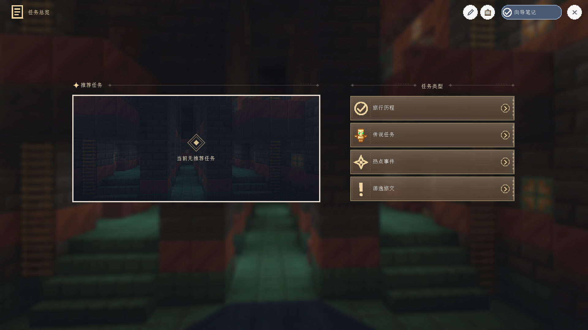

### 全屏设置与脚本参考

设置使用顶部六个标签，下面展示对应选项。常规设置可分别启用任务/邮件背包入口，
进入可视摆放界面并按九宫格锚点设置偏移。左上锚点的 `(0,0)` 就是屏幕左上。
安装 REI 时还可管理书本/纸张快捷收藏。个人偏好无需作者模式；
服务器分页和作者主题仍需管理员权限。重复的按键、文件夹和动画编辑入口已合并。
切换标签使用 100ms 动画；关闭动画或减弱动态时立即切换。

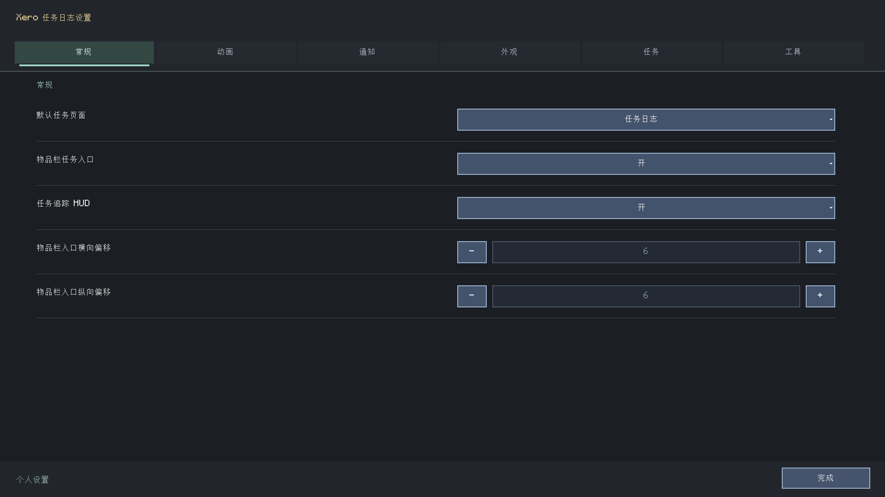

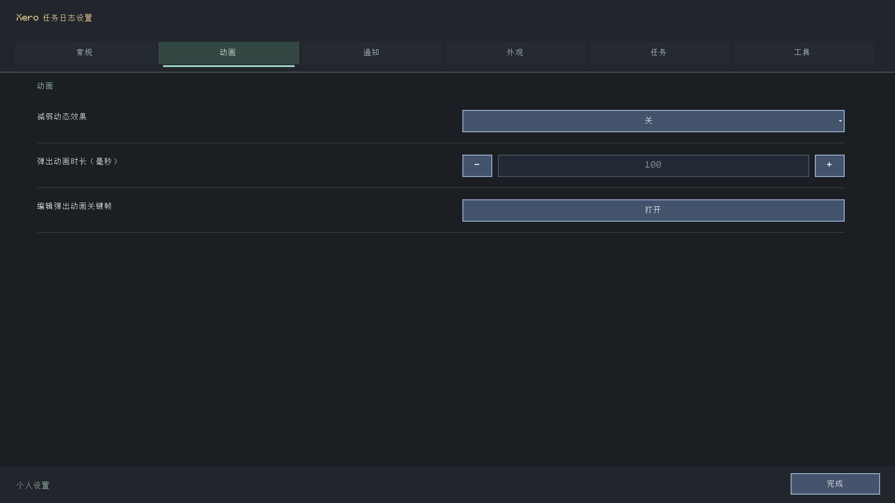

事件图中选择“JavaScript”后打开代码编辑器，可以同时阅读字段参考和用途对应的示例。
代码区、参考区、底部错误信息独立裁剪。保存先检查语法；追加示例保留现有草稿。

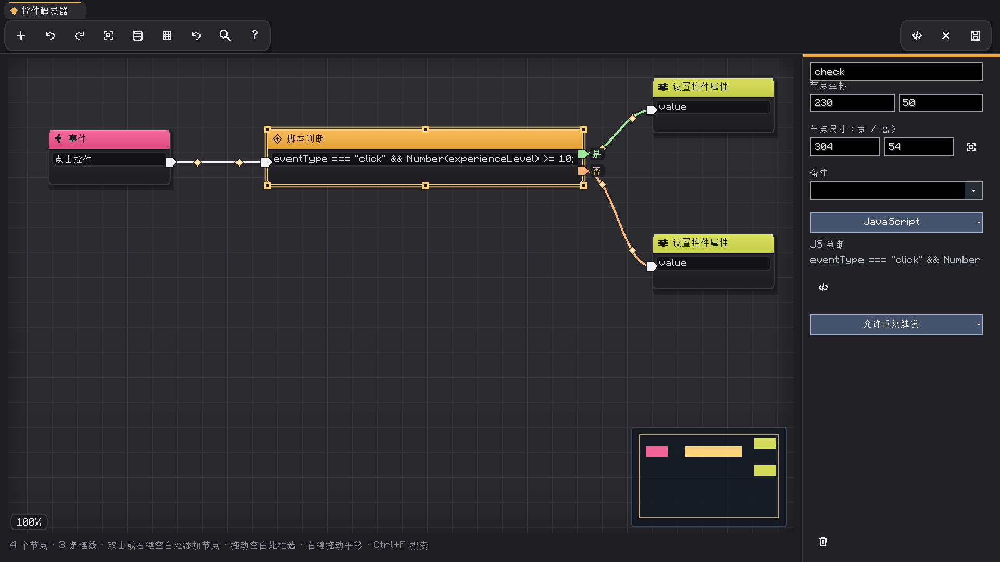

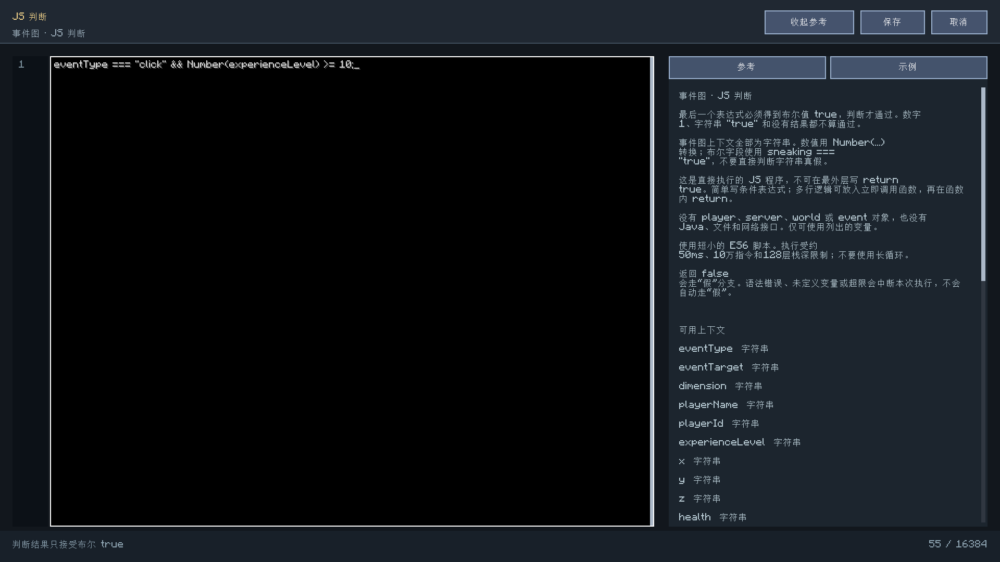

内置判断最后必须得到布尔 `true`；不能直接写顶层 `return true`。
事件图字段都是字符串，例如 `Number(experienceLevel) >= 10;`。
文件条件中的等级和坐标是数值。完整语法、真假分支、一次执行、错误行为和奖励动作见
[JavaScript 参考](docs/javascript.md) 与 [判断节点详解](docs/trigger-conditions.md)。

### 旅行历程

章节以可滚动时间线组织，主线卡片与支线节点保留连接关系。
外观编辑只影响当前章节：左侧实时预览，右侧编辑属性，可多选后一起移动、
调宽高或等比例缩放。浏览时点击任务先打开详情弹窗，底部按钮再进入日志。

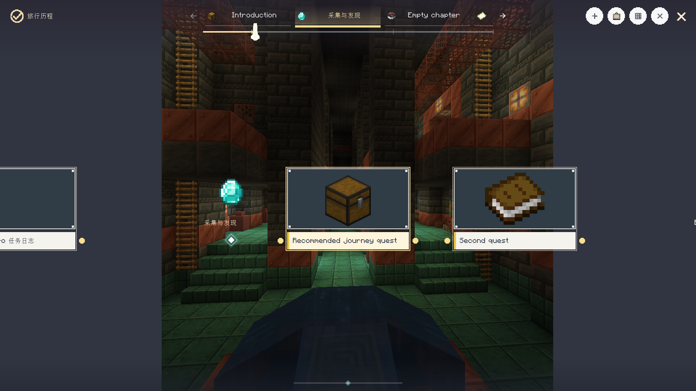

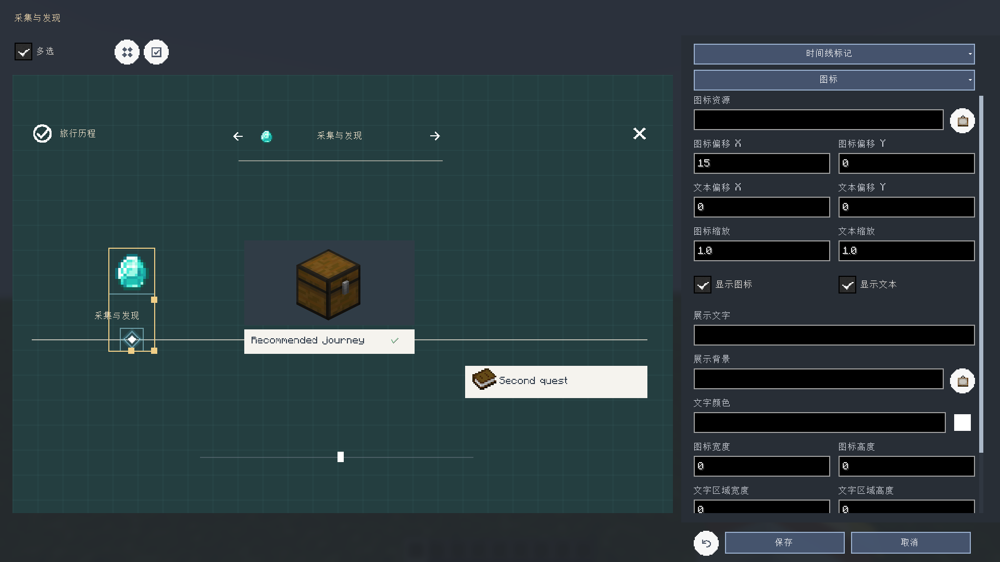

### 新任务红点

新加入目录的任务在任务行右上角显示红点。只浏览列表不会清除未打开任务的提示；打开对应详情后标记已读。首次同步将旧目录作为基线，不把全部已有任务标红。

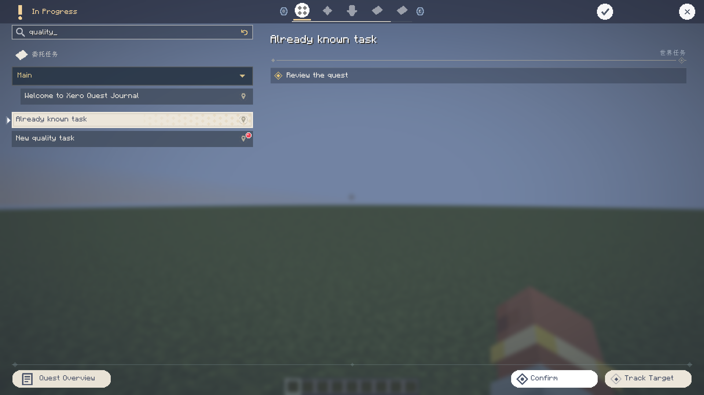

右上角“领取全部奖励”左侧的勾选图标可以一键清除全部新任务红点。此操作只改变当前玩家的未读状态，不领取奖励、不完成任务，也不清除其他玩家的提示。

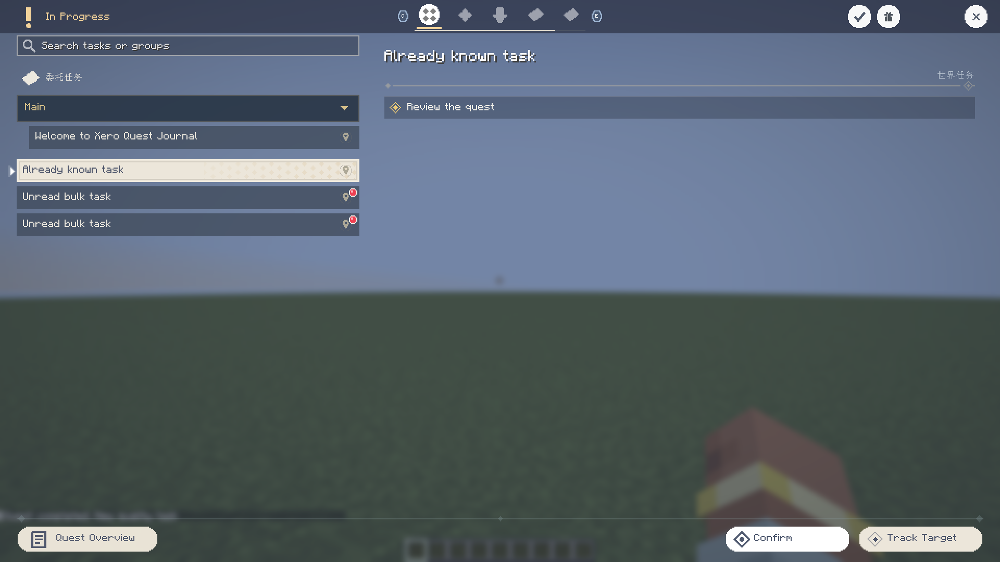

### 奖励展示与品质编辑

卡片宽度 34 GUI 像素、高度 38 GUI 像素；图标区和底部数字区分开。下面示例依次为紫色经验瓶、红色品质钻石、使用自定义绿色背景的绿宝石。

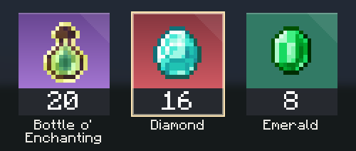

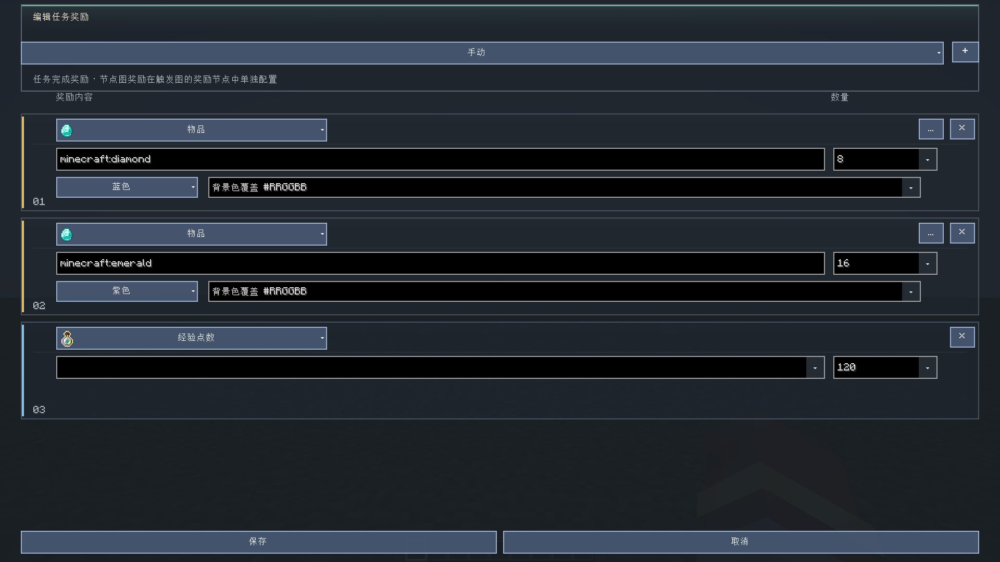

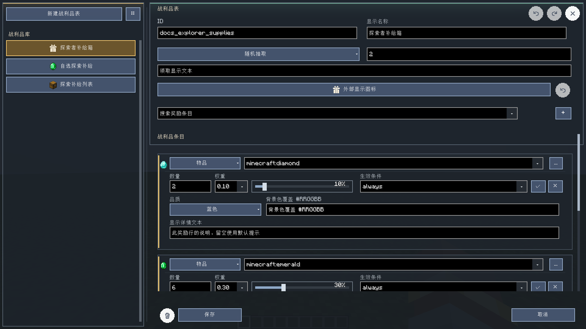

### 任务节点图与解锁图

事件节点图和任务前置解锁图是两种不同的编辑工具：前者配置事件/条件/动作，后者编辑任务之间的前置关系。

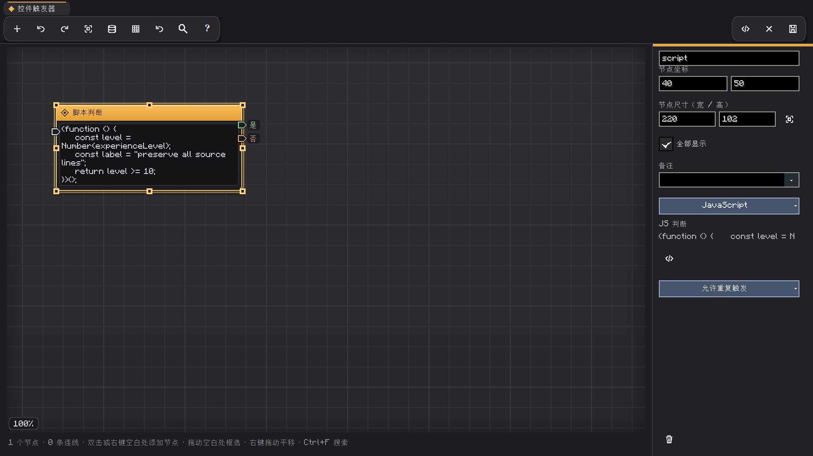

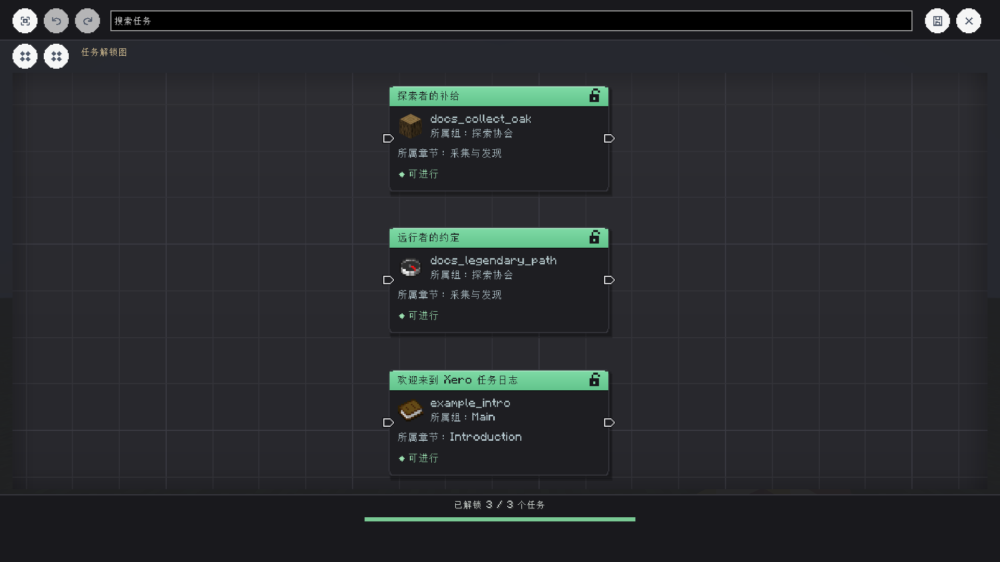

### 邮箱与标签选择

邮箱提供独立的邮件列表和详情；物品选择器可列出运行时加载的原版、模组和数据包物品标签。

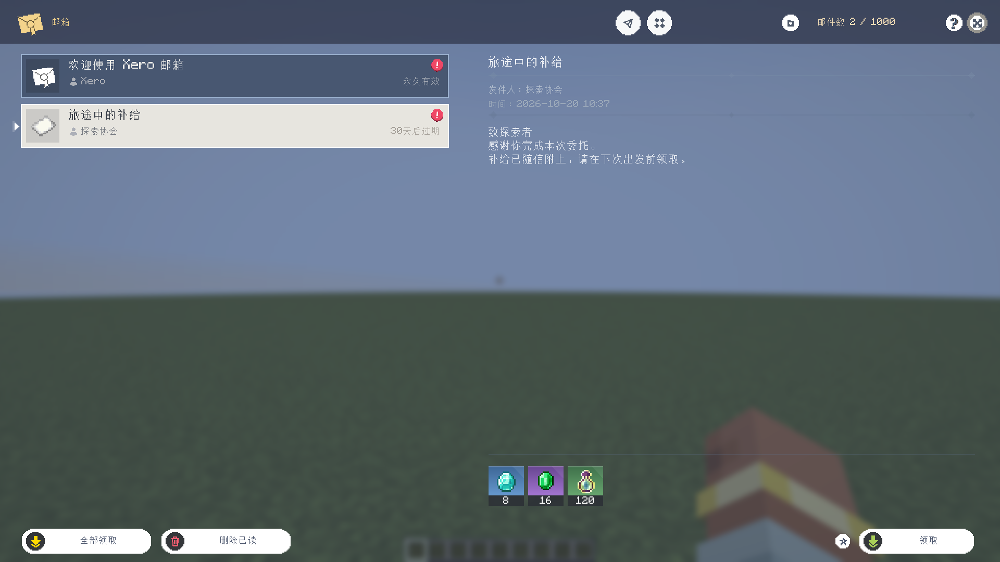

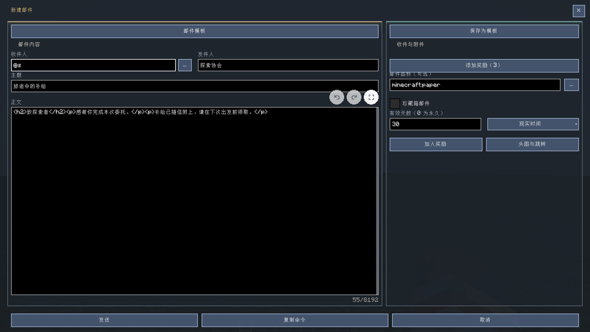

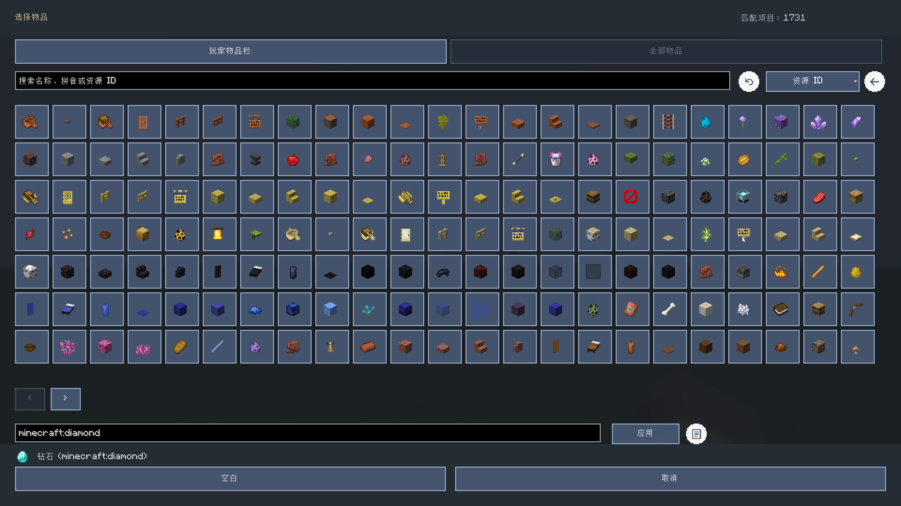

更多截图与来源说明见 [截图索引](docs/images/README.md)。

## 安装和开始使用

| 项目 | 要求 |
| --- | --- |
| Minecraft / 加载器 | 1.20.1 Forge 47.3.0 或 Fabric；1.21.1 NeoForge 21.1.233 或 Fabric |
| Java | 1.20.1 使用 Java 17；1.21.1 使用 Java 21 |
| Fabric | 还需对应 Minecraft 版本的 Fabric API；精确测试版本见版本矩阵 |
| 核心文件 | [0.2.0 多版本预览 16](https://github.com/XTDPotato/xero_quest_journal/releases/tag/v0.2.0-multiversion-preview.16) 中与 Minecraft/加载器完全匹配的单个 JAR |
| 许可 | MIT，第三方依赖保留各自许可 |

1. 从 [多版本预览 16 Release](https://github.com/XTDPotato/xero_quest_journal/releases/tag/v0.2.0-multiversion-preview.16) 选择与游戏版本、加载器相匹配的核心 JAR，放入实例的 `mods` 目录。
2. 多人环境下，客户端与服务端应安装相互匹配的版本。当前网络协议为 **10**；相同的显示版本不保证不同开发构建之间的协议兼容，旧 Release 的 `0.1.0` 与当前源码的 `0.2.0` 应分别核对。
3. 启动游戏并进入世界，默认按 `J` 打开任务日志，按 `F8` 打开邮箱、`F7` 打开新邮件。
4. 任务目录默认位于 `config/xero_quest/groups/`，编辑后使用 `/xero_quest reload` 重载。
5. 本地集成服务器中，拥有管理员权限的玩家可以开启编辑模式。远端客户端作者编辑仍有限制。

Release 同时提供四个 `0.2.0` 独立安装包和按版本/加载器归类的合集 ZIP。
每个实例只安装一个核心 JAR。不要将源码 ZIP、验证报告或测试世界放入 `mods`。

### 常用操作

| 操作 | 入口 |
| --- | --- |
| 打开任务日志 | `J` / 物品栏任务入口 |
| 打开邮箱 | `F8` / 物品栏邮件入口 |
| 打开新邮件 | `F7` |
| 切换任务分类 | 顶部分类标签、`Q` / `E` |
| 查找任务 | 日志搜索框 |
| 追踪任务 | 任务详情右下角追踪按钮 |
| 编辑任务、组、章节 | 管理员编辑模式中的右键菜单 |
| 配置完成条件 | 任务管理菜单中的完成条件编辑 |
| 配置奖励 | 任务奖励编辑器 |
| 清除全部任务红点 | 右上角“领取全部奖励”左侧的勾选图标 |

按键可以通过 Minecraft 控制设置修改。输入框获得焦点时，界面会避免把文字输入误当成分类切换。

## 任务文件示例

在 `config/xero_quest/groups/collect_logs.json` 创建一个木头收集任务：

```json
{
  "id": "collect_logs",
  "uid": "collect-logs-v1",
  "title": "收集木头",
  "description": "收集任意树种的原木，共 16 个。",
  "type": "world",
  "icon": "minecraft:oak_log",
  "defaultUnlocked": true,
  "trackable": true,
  "rewardMode": "manual",
  "triggers": [
    {"type": "item_acquire", "item": "#minecraft:logs", "count": 16}
  ],
  "rewards": [
    {
      "type": "item",
      "item": "minecraft:diamond",
      "count": 2,
      "quality": "mythic",
      "background": ""
    }
  ]
}
```

重载：

```text
/xero_quest reload
/xero_quest open task collect_logs
```

`item_acquire` 统计解锁期间的新获取事件。若希望直接检查背包当前数量，改为 `item_hold`；若需要提交并消耗物品，使用 `item_submit`。

HTML/XML 也能表达相同任务：

```xml
<quest id="collect_logs" uid="collect-logs-v1" name="收集木头"
       type="world" icon="minecraft:oak_log" reward-mode="manual">
  <content>收集任意树种的原木，共 16 个。</content>
  <trigger type="item_acquire" target="#minecraft:logs" count="16"/>
  <rewards>
    <reward type="item" item="minecraft:diamond" count="2" quality="mythic"/>
  </rewards>
</quest>
```

同一个任务 ID 不要同时出现在多个文件中。文件格式与存档位置详见 [使用指南](docs/guide.md)。

## 标签与物品数据

| 目标形式 | 作用 | 示例 |
| --- | --- | --- |
| 物品 ID | 匹配同一个注册物品，忽略组件差异 | `minecraft:oak_log` |
| 物品标签 | 匹配标签内任意物品，可跨种类累计 | `#minecraft:logs` |
| 编码物品栈 | 精确匹配物品和组件，忽略数量 | 从背包选择生成的 `xqj-stack:` 值 |
| 特定模型目标 | 为已有适配的战术物品保留模型身份 | `xqj-model:` 值 |

- 标签来自当前游戏的注册表，不限于写死的原版列表。
- 模组木头是否包含在 `#minecraft:logs` 中，由模组或数据包是否将它加入该标签决定。
- `#log` 不是本模组定义的“所有木头”通配符。应使用选择器中实际存在的完整标签 ID。
- 拾取、制作和烧炼条件使用真实 `ItemStack` 匹配，组件数据不会因为转成普通物品 ID 而丢失。
- 精确匹配可能受耐久、附魔、弹药和 `custom_data` 变化影响；只关心种类时优先使用 ID 或标签。
- 标签可以用于检测条件，不能直接作为“发放任意标签物品”的固定奖励。

> 累计获取不是防刷经济凭证：丢弃后重新拾取也可能累计。作者应根据整合包经济设计选择持有、提交或其他条件。

## 奖励品质与背景

| 显示 | `quality` |
| --- | --- |
| 自动 | 留空 / `auto` |
| 灰色 | `common` |
| 绿色 | `uncommon` |
| 蓝色 | `rare` |
| 紫色 | `epic` |
| 金色 | `legendary` |
| 红色 | `mythic` |

`quality` 控制任务奖励卡片，不会修改真实物品的攻击力、附魔、原生稀有度或其他属性。

`background` 是可选的 `#RRGGBB` 覆盖色。显示优先级为：

```text
明确的 background 颜色 > 明确的 quality > 物品自身 Minecraft 稀有度
```

为避免“选了红色却仍显示旧绿色”的混淆，**编辑器中切换品质会清除旧背景覆盖**。随后仍可输入新的背景覆盖色。


奖励在完成时冻结。之后编辑任务源文件，不会回写已经取得的历史奖励。更多奖励类型、失败回执和溢出处理见 [奖励与完成条件](docs/奖励与条件配置.md)。

## 自动生成任务

管理员可以按全部内容或模组命名空间生成任务：

```text
/xero_quest generate
/xero_quest generate minecraft tier
/xero_quest generate create recipe 2
/xero_quest generate create output 16
/xero_quest generate all none
```

`create` 示例需要已安装 Create。生成器根据实际安装的注册内容分析候选任务，并在后台按组保存与加载；重新生成不会覆盖已经存在的任务 ID。

| 模式 | 行为 |
| --- | --- |
| `tier` | 按难度给予经验及部分物品 |
| `recipe` | 物品任务优先给予配方材料，无可用配方时回退难度奖励 |
| `output` | 物品任务给予其目标物品，数量由 1～64 的倍率参数决定 |
| `none` | 不生成奖励 |

例如 `create output 16` 中，安山合金对应的任务可奖励安山合金 16 个，而不是把 `RECIPE` 模式的材料奖励偷偷改成产物奖励。`output` 不为进度和击杀任务推测一个目标物品。

## 性能设计

大任务量不只靠分页：

- **任务列表虚拟化**：只为可见行及小缓冲区创建界面控件。
- **异步检索**：工作线程缓存纯文本与拼音索引，主线程分帧采样；输入防抖，最新查询优先，旧结果不覆盖新输入。
- **关联映射**：组与章节改用集合/映射查找，分类列表单次分桶，不逐任务嵌套扫描全部组与章节。
- **空间索引**：历程和解锁图按视口筛选节点与连线候选。
- **完整关系保留**：视口外数据仍存在，可继续平移、缩放和编辑。
- **局部更新**：解锁图拖动时处理移动节点及相关连线，结束后重建索引。
- **缓存**：搜索结果、部分布局、已读目录基线按状态或版本更新。
- **端点查找**：事件图通过节点 ID 映射查找连线两端，减少重复扫描。

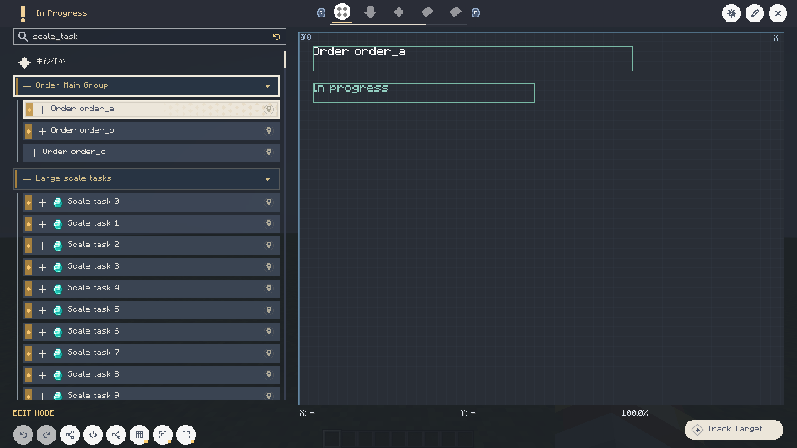

已有 1,200 任务回归曾记录最多 18 个物化列表行控件和 5 个可见历程节点。这是特定测试场景下的工作量结果，**不是 FPS 保证**，也不代表整合包中的脚本、服务端判定或渲染没有其他热点。

首次大目录搜索需要建立索引，期间保留列表并显示搜索状态图标。后续查询复用索引；目录、语言或连接改变时重建。设计取舍见 [异步搜索 ADR](docs/adr/0001-asynchronous-journal-search.md)。

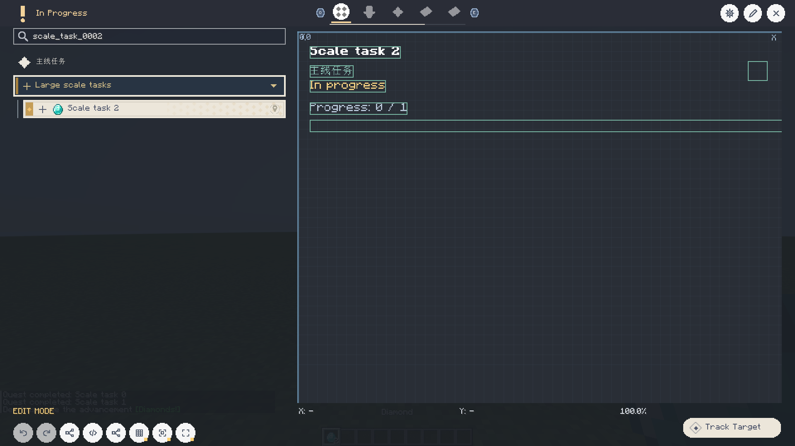

## 从源码构建

使用 Java 21；Gradle Wrapper 已包含在仓库中。

Windows：

```powershell
java -version
.\gradlew.bat build compileSmokeJava --no-daemon
```

Linux / macOS：

```bash
java -version
chmod +x gradlew
./gradlew build compileSmokeJava --no-daemon
```

如果 `JAVA_HOME` 指向其他 Java 版本，请先将它改为本机的 JDK 21 安装目录。

构建输出：

```text
build/libs/xero_quest_journal-0.2.0.jar
build/libs/xero_quest_journal-0.2.0-sources.jar
```

`build` 包含核心 JAR 的 **5,000,000 字节上限检查**与可选媒体依赖隔离检查。它不会自动运行真实客户端 smoke 测试。

多版本构建（1.20.1 使用 Java 17，1.21.1 使用 Java 21）：

```powershell
.\gradlew.bat buildSelected "-Pmc_target=1.20.1" "-Ploader=forge"
.\gradlew.bat buildSelected "-Pmc_target=1.20.1" "-Ploader=fabric"
.\gradlew.bat buildSelected "-Pmc_target=1.21.1" "-Ploader=fabric"
```

Fabric 输出位于 `platforms/fabric/<版本>/build/libs`；安装时还需对应版本的 Fabric API。
1.21.1 的可读源码另打包为 `build/distributions/*-mojmap-sources.zip`，
源码 ZIP 不用于安装。下载缓慢时可在独立 Fabric 命令后加 `-PuseDownloadMirror`，
将游戏资源与库下载切至 BMCLAPI；Maven 已配置阿里云等镜像。

本项目配置了腾讯 Gradle 镜像与国内 Maven 镜像；若所在网络无法访问，可以在 `gradle/wrapper/gradle-wrapper.properties` 和 Gradle 仓库配置中切换下载源。不要删除必需的解析或脚本依赖来压缩体积。

### 可选媒体

普通任务与图片不需要额外媒体模组；基础音频使用内置解码器。视频及扩展格式可使用本地 FFmpeg、受限版本的 MediaPlayer 适配或独立 Xero Quest Media。

```powershell
.\gradlew.bat build verifyMediaAddonPackaging -Pmedia_platform=windows-x86_64 --no-daemon
```

媒体后端构建和安装细节见 [媒体模组安装](docs/媒体模组安装.md)。5 MB 限制针对核心 JAR，不包括可选原生媒体库。第三方媒体许可说明见 [MEDIA-NOTICES](docs/MEDIA-NOTICES.txt)。

## 项目结构

```text
src/
  main/java/xtdpotato/xero_quest_journal/
    client/                原生界面、HUD、选择器、布局与媒体前端
    core/io/               任务文件、作者编辑、生成与配置存取
    core/model/            任务、条件、奖励、模板和节点图模型
    core/network/          目录、进度与操作网络协议
    core/runtime/          条件判定、奖励、追踪、结构与事件执行
    core/mailbox/          邮件与附件业务
  main/resources/          模组描述、图标、语言、默认数据与着色器
  media/                   可选媒体后端源码
  smoke/                   真实客户端回归及测试夹具
platforms/
  neoforge/1.21.1/         当前完整 NeoForge 平台入口和元数据
  fabric/1.20.1/           Fabric 旧版网络和 Minecraft API 适配
  fabric/1.21.1/           Fabric 事件、网络、持久化、输入和渲染钩子
  fabric/shared-build.gradle  Fabric 共享源码生成及构建
  forge/1.20.1/            Forge 完整功能适配
  */26.1..26.3/             26.x 分版本适配目录
  shared/26/               Java 25 / Gradle 9 启动器与原生存档适配层
docs/
  images/                  README 使用的项目截图
  guide.md                 玩家与作者指南
  architecture.md          数据流与模块职责
  testing.md               验证方法、证据和已知失败
tools/                     图标生成与独立检查工具
```

缓存、日志、测试世界、构建产物、本机配置和其他游戏的参考图片不上传到源码仓库。

## 验证和已知限制

四个已完成目标和本轮作者工具复验见 [版本矩阵](docs/porting-matrix.md)、
[Fabric 报告](docs/fabric-verification.md)、[Forge 报告](docs/forge-1.20.1-verification.md)
及 [本轮验证](docs/authoring-verification.md)。以下保留 2026-10-09 的历史专项摘要：

| 验证 | 范围 |
| --- | --- |
| `build` / `compileSmokeJava` | 核心编译、打包体积、媒体隔离、测试源码编译 |
| `locationItemTest` | 地点、标签跨树种累计、组件精确匹配、数据奖励、快照 |
| `generateTasksTest` | 自动任务、可达配方、`OUTPUT 16`、`RECIPE` 兼容 |
| `rewardQualityTest` | 红点与单项/批量已读、按钮布局、六档品质、背景覆盖、存档/协议和截图像素检查 |
| `claimReceiptTest` | 部分领取、满背包确认、取消、领取结果与防重复弹窗 |
| `journalOrderTest` | 1,200 任务、异步搜索、最新输入优先、清空恢复与可见行物化 |

仍有明确限制：

- 历史失败与后续修复复验按日期记录，不能把旧截图或旧失败当作最新结果，详见各版本验证报告。
- 未完成独立组队模组、远端协同编辑、完整资源分发和所有结构场景隔离需求。
- 脚本运行有预算和接口限制，但不是可运行不可信作者代码的通用安全沙箱。
- 奖励物品与玩家存档不是跨文件原子事务；异常断电等情况仍可能需要管理员核对。
- 没有对所有平台、模组组合、多人服务器和帧率进行完整验收。
- “附近任务自动接取”的独立任务生命周期仍未实现，不把追踪按钮当作接取状态。

## 文档与许可

| 文档 | 内容 |
| --- | --- |
| [使用指南](docs/guide.md) | 目录组织、日常操作、作者流程、备份与故障定位 |
| [背景与旅行历程编辑](docs/background-and-journey-editor.md) | 背景缩放与音乐、背景节点、章节切换事件、可视化尺寸编辑及任务弹窗 |
| [中文 1080p 界面图鉴](docs/interface-gallery.md) | 常见界面全屏截图、入口、操作、保存和预览行为 |
| [预览 5 发布验证](docs/release-verification-2026-10-16.md) | 本次四平台构建、客户端回归、安装包与未覆盖范围 |
| [全部命令](docs/commands.md) | 四个根命令、71 条共享路径及 Forge 状态命令、逸闻纪事、参数、权限与示例 |
| [JavaScript 参考](docs/javascript.md) | 文件与事件图类型、返回值、奖励 API、编辑器、15 个示例 |
| [判断节点详解](docs/trigger-conditions.md) | 可视化与 JS 条件、连线、真假/异常、一次执行 |
| [节点字段与背包入口](docs/visual-graph-and-inventory-shortcuts.md) | 快速编辑、字段选择/拖拽、目标玩家、相对锚点与 REI 收藏 |
| [本轮验证](docs/authoring-verification.md) | 设置、脚本、四目标复验与发布边界 |
| [奖励与完成条件](docs/奖励与条件配置.md) | 条件、物品数据、奖励品质、脚本及命令 |
| [架构说明](docs/architecture.md) | 定义、玩家状态、网络、虚拟化和媒体拆分 |
| [测试与验证](docs/testing.md) | 运行命令、已验证范围和残余风险 |
| [媒体模组安装](docs/媒体模组安装.md) | 可选后端、平台和编码限制 |
| [截图索引](docs/images/README.md) | 截图来源和场景 |
| [更新记录](CHANGELOG.md) | 当前开发快照的变更摘要 |

项目源码遵循 [MIT License](LICENSE)。Minecraft、NeoForge 及第三方库/媒体的权利属于各自权利人；本仓库的许可不会替代它们的使用或分发条款。本项目不是 Mojang 或 Microsoft 官方产品。
