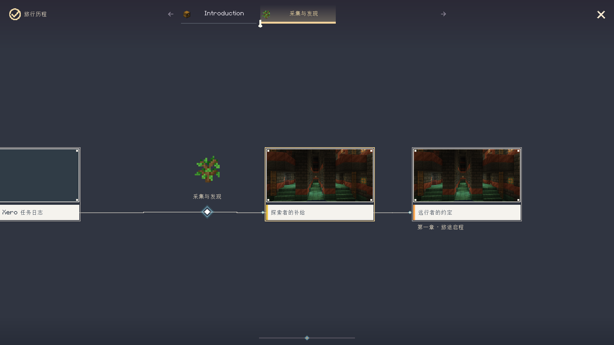

# 中文文档中心

**简体中文** | [English](en/README.md) · [项目首页](../README.md) · [英文首页](../README.en.md)

本文档对应 **0.2.6** 的共享功能。先按自己的目标选择入口，
再阅读对应参考；截图展示实际客户端界面，验证结论按日期和范围单独记录。

## 安装与开始

| 目标 | 阅读 |
| --- | --- |
| 选择游戏版本、加载器和 Java | [版本矩阵](porting-matrix.md) |
| 安装后第一次使用 | [玩家与作者指南](guide.md) |
| 按界面找功能 | [中文 1080p 界面图鉴](interface-gallery.md) |
| 查当前版本发布验证 | [0.2.6 验证记录](release-verification-0.2.6.md) |
| 调整拾取提示位置与避让小地图 | [通知设置与拾取提示](interface-gallery.md#14-设置与动画) |
| 找命令、参数、权限 | [全部命令](commands.md) |
| 核对当前构建与未通过项 | [0.2.6 验证记录](release-verification-0.2.6.md) |
| 检查生成任务、背包容量与条件弹窗 | [2026-10-19 修复验证](generator-and-objective-verification-2026-10-18.md) |

已提供 Forge/Fabric 1.20.1、NeoForge/Fabric 1.21.1 四种安装包。
每个实例选择与游戏和加载器匹配的一个 JAR；Fabric 另装匹配的 Fabric API。
1.20.1 使用 Java 17，1.21.1 使用 Java 21。26.1–26.3 的完整移植仍未完成。

## 按工作流程查找

| 你要做什么 | 入口与说明 |
| --- | --- |
| 阅读、搜索、追踪和领取任务 | `J` → 分类/任务列表 → 右侧详情；[指南](guide.md) |
| 配置搜索范围和过滤条件 | 搜索框旁设置菜单；[图鉴](interface-gallery.md#2-搜索与筛选) |
| 使用统一搜索面板和解锁图缩略图 | [搜索筛选与解锁图](task-search-and-unlock-graph.md)（开发中） |
| 选择溢想模式、结构指引和模板分组 | [生成与模板库](generation-and-template-library.md)（开发中） |
| 编辑任务和完成条件 | 管理员开启编辑模式 → 任务右键菜单；[条件参考](奖励与条件配置.md) |
| 编写 JS 条件和奖励 | [JavaScript 完整参考](javascript.md) |
| 连接事件、判断与动作 | [判断节点](trigger-conditions.md) |
| 拖出字段、设置变量和计算 | [节点字段与变量](visual-graph-and-inventory-shortcuts.md) |
| 编辑当前章节的外观和背景 | [旅行历程与背景编辑](background-and-journey-editor.md) |
| 发邮件、配置附件和战利品 | [命令](commands.md)、[奖励与条件](奖励与条件配置.md) |
| 编辑逸闻条目、记录和贴纸 | [逸闻纪事](anecdotes.md) |
| 查看结构与拼图连接点 | [结构选择与拼图教程](candidate-selectors-and-jigsaw.md) |
| 恢复已保存修改或误删除 | [撤销与重做范围](task-edit-undo.md) |
| 设置背包入口与相对坐标 | [可视化入口摆放](visual-graph-and-inventory-shortcuts.md) |
| 使用视频或扩展音频 | [可选媒体安装](媒体模组安装.md) |

## 两类读者的最短路径

玩家：

1. 按 `J` 打开任务，选择一项并阅读目标。
2. 完成条件可点击查看；奖励在详情底部。
3. 已完成但未领取的任务保留在进行中；领取后才进入已完成。
4. 用追踪按钮导航；任务完成聊天的金色链接可直接返回任务。
5. 邮件在 `F8`，个人设置在 `/xero_quest open settings`。

作者：

1. 在有管理员权限的本地世界执行 `/xero_quest edit_mode @s true`。
2. 从任务右键菜单编辑属性、条件和奖励；先做一个小任务，再扩展为章节。
3. 用解锁图设置任务前置，用事件图配置事件与动作。
4. 需要 JS 时先确认环境：文件条件、图内判断、奖励脚本和 KubeJS 规则不同。
5. 保存后核对实际玩家进度与奖励；编辑定义不会撤回已经发放的物品。

## 双语与截图

游戏界面语言跟随 Minecraft 语言设置。作者填写的章节、邮件、任务名称属于内容；
需要多语言时使用已支持的翻译键或为内容准备对应文本。
切换客户端语言不会自动翻译作者写入的任意字符串。

新版中英文图鉴使用同一组演示任务分别进入 `zh_cn`、`en_us` 客户端截取。
图片保持原生 **1920×1080**，不以放大小图、裁剪图或修改图片文字冒充对应语言界面。
截图清单记录场景、语言、实际窗口尺寸、时间和 SHA256；
查看 [截图来源与索引](images/README.md)。

## 配置与安全保存

主要内容位于游戏/服务器的 `config/xero_quest/`：

| 目录 | 内容 |
| --- | --- |
| `groups/` | 任务、任务组、章节等定义 |
| `scripts/` | 条件与奖励脚本，使用相对 `.js` 路径 |
| `structures/` | 导入的 Java NBT 场景与相关设置 |
| `anecdotes/` | 独立逸闻条目与记录 |
| `task_types/` | 作者可编辑的任务分类 |
| `history/` | 部分作者操作的磁盘历史/备份 |

玩家完成进度与奖励回执在世界存档中，和定义文件不是同一份数据。
修改前备份配置目录及世界存档。文件指纹冲突意味着数据已改变，应重新打开后核对。

## 验证边界

四目标构建、部分客户端专项和截图生成各有独立结论。
完整创建流程的 `context-copy_id` 点击检查、连续旅行历程的外观撤销检查仍有未通过项；
不能用截图数量或一次构建通过替代全部功能验收。
远端协同编辑和完整 26.x 移植仍有明确限制。

详细历史见 [当日验证](release-verification-2026-10-18.md)、
[Forge 验证](forge-1.20.1-verification.md)、[Fabric 验证](fabric-verification.md)。
英文读者可看 [English verification summary](en/testing-and-compatibility.md)。
