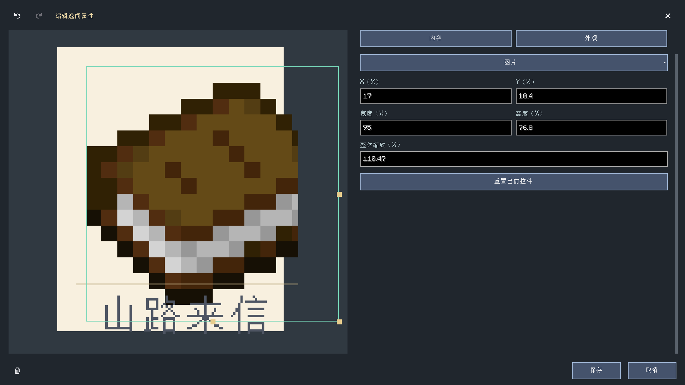
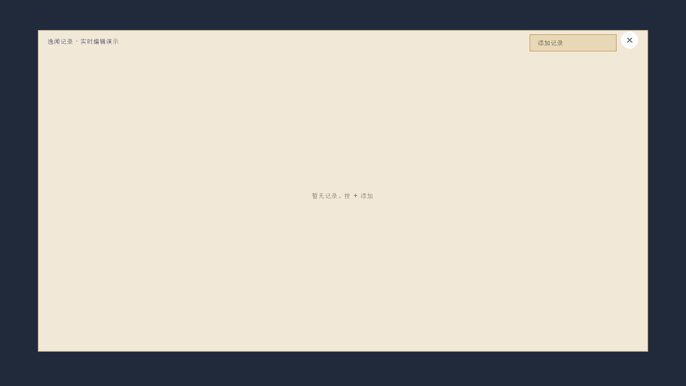

# 逸闻纪事：条目、记录与贴纸

**简体中文** | [English](en/anecdotes.md) · [使用指南](guide.md) · [命令](commands.md)

逸闻纪事是独立的双页书册，不是普通任务分类。
从任务总览的“逸闻纪事”按钮或 `/xero_quest open anecdotes` 打开。
`/xero_anecdote @s` 只播放通知横幅，不等同于打开书册或登记记录完成。


## 界面操作

左侧为逸闻条目卡片，右侧为当前条目的多条记录。
卡片悬停放大，按住缩小；必须在同一项目内松开才选择。
卡片区和记录区分别平滑滚动。未发现条目是否显示由条目设置决定。

作者模式下右键条目/记录进入对应编辑入口。
一个条目可以有多条记录，完成后仍保留在书册里。
右上角奖励页固定每行四枚、每页十枚贴纸；新贴纸按完成顺序缩小进入，
十枚贴满后缩小清页并归零，再继续播放后续记录。清页不删除已完成记录。
右页始终显示印签进度、说明和奖励，空页面也显示，不依赖选择贴纸。
十条完成记录对应一次奖励；采用第十条记录所属条目的奖励，默认 50 个钻石。
领取按钮在有可领取奖励时变红，必须在同一按钮内松开；服务端保存领取回执。
背包满时拒绝领取，已领取批次不重复发奖。


作者模式下可打开奖励页“编辑”，分别选中票券、奖励物品组或领取按钮。
右页提供 X/Y/缩放的精确数值输入并实时预览；拖动位置按 8 个画布单位吸附，
按住 Shift 可临时自由移动。滚轮缩放、数字修改、拖动都支持撤销/重做；
保存后写入当前奖励条目的 `rewardLayout`。


## 文件与字段

每个条目独立存放于 `config/xero_quest/anecdotes/<id>.json`。

| 字段 | 含义 |
| --- | --- |
| `id` | 条目 ID，和文件引用配合使用 |
| `title` | 条目标题 |
| `cardText` | 左侧卡片底部文字；过长时适配显示 |
| `icon` | 条目图像/物品引用 |
| `heading` | 右侧记录标题 |
| `records` | 记录数组，最多 32 条，ID 在同条目内唯一 |
| `defaultDiscovered` | 默认是否已发现 |
| `hideWhenLocked` | 未发现时是否隐藏 |
| `order` | 显示顺序值 |
| `rewards` | 条目奖励，使用任务奖励字段格式 |
| `cardLayout` | 当前条目独立的背景、图片和文字几何与颜色；旧文件继承默认布局 |
| `rewardLayout` | 奖励页票券、物品组、领取按钮的位置与缩放；旧文件使用默认布局 |

## 实时外观编辑



新建或编辑条目采用左侧预览、右侧内容/外观标签页。内容输入与图片选择实时更新预览。
在预览中点选背景、图片或文字，右侧同步切换到该控件的属性：

- 拖动控件主体移动；右边中点改宽度，底边中点改高度，右下角等比例缩放。
- X/Y、宽度、高度按卡片尺寸的百分比保存，缩放以百分比输入；字体大小可直接输入数字。
- 背景可选图片和颜色，文字可改颜色；颜色支持 `#RRGGBB` 或 `#RRGGBBAA`。
- 右侧长表单平滑滚动并裁剪，底部操作不会被盖住。窗口变化保留草稿和布局。
- 撤销/重做按钮与 `Ctrl+Z`、`Ctrl+Y` 覆盖文字、属性和整次拖动；取消或关闭不提交草稿。
- 实际书册与预览共用绘制代码。修改记录/奖励不会覆盖已保存的卡片外观。



布局示例（可以放入条目 JSON 的 `cardLayout`）：

```json
{
  "background": {"x": 0, "y": 0, "width": 100, "height": 100, "scale": 1},
  "image": {"x": 7, "y": 4, "width": 86, "height": 68.8, "scale": 1},
  "text": {"x": 4, "y": 81, "width": 92, "height": 16, "scale": 1},
  "backgroundImage": "",
  "backgroundColor": "#F8F0DF",
  "textColor": "#4F5664",
  "fontSize": 9
}
```

## PNG 素材目录

所有新增装饰都为 PNG。书页为 1800×1000，标题便签 1024×240，
贴纸底图 192×192，印签飘带 512×256，票券 768×160，分类及选择器图标 64×64。

- [书册与贴纸素材目录](../src/main/resources/assets/xero_quest_journal/textures/gui/anecdote)
- [分类、刷新、全屏和排序图标目录](../src/main/resources/assets/xero_quest_journal/textures/gui/navigation)
- [PNG 绘制脚本](../tools/Generate-AnecdoteAssets.ps1)
- [参考图地图水印提取脚本](../tools/Extract-AnecdoteWatermark.ps1)

客户端复验入口（Java 21）：`./gradlew.bat runClient -PanecdoteAuthoringTest`。
包含拖动/数值调整、保存/网络回读、关闭按钮、翻译、贴纸清页与奖励回执；
PNG 另检查非透明像素数量，避免空白图标进入产物。

记录字段为 `id`、`title`、`body`、`completedIcon`。
未设置/空奖励数组会沿用模型默认奖励：50 个金色品质钻石；
作者应明确检查并设置适合自己任务的奖励。

```json
{
  "id": "mountain_letter",
  "title": "山路来信",
  "cardText": "山路来信",
  "icon": "minecraft:book",
  "heading": "来自远方的问候",
  "defaultDiscovered": false,
  "hideWhenLocked": false,
  "order": 10,
  "records": [
    {
      "id": "meeting",
      "title": "初次相遇",
      "body": "你在山路上遇到了一位旅人。",
      "completedIcon": "minecraft:compass"
    }
  ],
  "rewards": [
    {"type": "item", "item": "minecraft:diamond", "count": 2, "quality": "rare"}
  ]
}
```

## 用节点解锁与完成

在实际任务控件事件图中使用专用动作节点。选择器显示逸闻名称与记录名称，旁边会显示名称和稳定 ID 供核对：

```json
{"id":"discover_letter","type":"discover_anecdote","x":220,"y":40,
 "data":{"target":"mountain_letter"}}
```

```json
{"id":"finish_meeting","type":"complete_anecdote","x":220,"y":140,
 "data":{"entry":"mountain_letter","record":"meeting"}}
```

将动作连接到实际事件/判断分支并保存所属图与任务。完成动作会验证逸闻和记录，
若逸闻尚未发现则先解锁，再仅登记一次记录完成并同步页面。若剧情需要在记录完成前
单独解锁，可显式使用发现节点。动作不作为普通可继续串接的序列节点；并行动作不要依赖执行顺序。
重复/无效目标会按运行时结果处理，不用于无限补发奖励。

发现状态、记录完成时间和未读状态写入玩家世界进度。
修改条目内容与清除玩家完成记录不是同一个操作。
文件编辑与奖励发放仍需遵守现有权限和回执规则。

编辑模式下在逸闻条目属性的“编辑条目奖励”中调整奖励；纪事工具栏不再显示独立加号。
逸闻奖励页以缩放书本浮层显示，背景仍可看到逸闻纪事；关闭使用书本合拢动画。
领取按钮嵌在票券右侧布局内，票券中段裁短 30% 以适配当前页面宽度。
票券内物品可悬浮预览并点击打开统一物品详情窗口。

在奖励页编辑模式中，点击右页的“编辑”按钮可以调整票券、物品组和领取按钮。
点选控件后拖动移动，滚轮微调大小；撤销/重做按钮和 Ctrl+Z/Ctrl+Y 管理布局草稿。
保存后只修改当前奖励来源逸闻条目的布局，各控件位置有票券边界约束。


