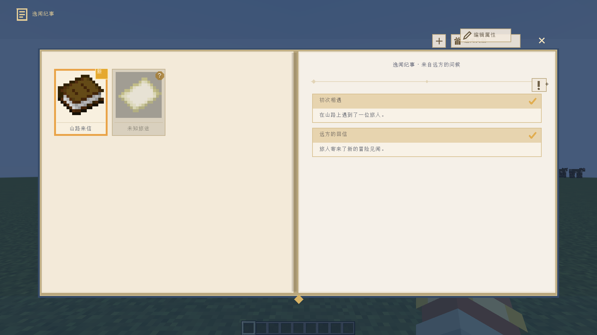
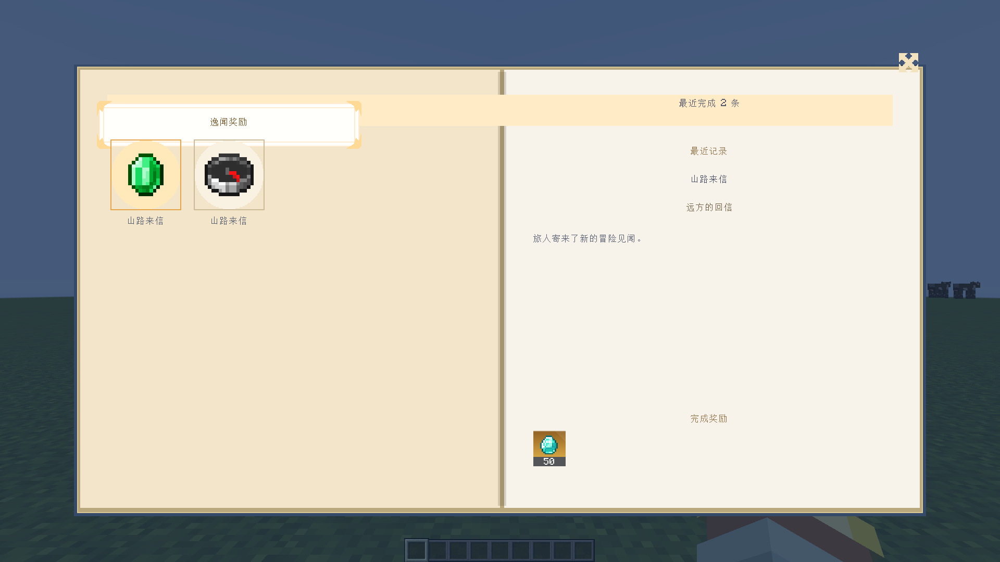

# 逸闻纪事：条目、记录与贴纸

**简体中文** | [English](en/anecdotes.md) · [使用指南](guide.md) · [命令](commands.md)

逸闻纪事是独立的双页书册，不是普通任务分类。
从任务总览的“逸闻纪事”按钮或 `/xero_quest open anecdotes` 打开。
`/xero_anecdote @s` 只播放通知横幅，不等同于打开书册或登记记录完成。



## 界面操作

左侧为逸闻条目卡片，右侧为当前条目的多条记录。
卡片悬停放大，按住缩小；必须在同一项目内松开才选择。
卡片区和记录区分别平滑滚动。未发现条目是否显示由条目设置决定。

作者模式下右键条目/记录进入对应编辑入口。
一个条目可以有多条记录，完成后仍保留在书册里。
右上角奖励页展示完成记录的贴纸；新贴纸按序缩放进入，展示结束后标为已阅。



## 文件与字段

每个条目独立存放于 `config/xero_quest/anecdotes/<id>.json`。

| 字段 | 含义 |
| --- | --- |
| `id` | 条目 ID，和文件引用配合使用 |
| `title` | 条目标题 |
| `cardText` | 左侧卡片底部文字；过长时适配显示 |
| `icon` | 条目图像/物品引用 |
| `heading` | 右侧记录标题 |
| `records` | 记录数组，最多 32 条，ID 在同条目内唯一 |
| `defaultDiscovered` | 默认是否已发现 |
| `hideWhenLocked` | 未发现时是否隐藏 |
| `order` | 显示顺序值 |
| `rewards` | 条目奖励，使用任务奖励字段格式 |

记录字段为 `id`、`title`、`body`、`completedIcon`。
未设置/空奖励数组会沿用模型默认奖励：50 个金色品质钻石；
作者应明确检查并设置适合自己任务的奖励。

```json
{
  "id": "mountain_letter",
  "title": "山路来信",
  "cardText": "山路来信",
  "icon": "minecraft:book",
  "heading": "来自远方的问候",
  "defaultDiscovered": false,
  "hideWhenLocked": false,
  "order": 10,
  "records": [
    {
      "id": "meeting",
      "title": "初次相遇",
      "body": "你在山路上遇到了一位旅人。",
      "completedIcon": "minecraft:compass"
    }
  ],
  "rewards": [
    {"type": "item", "item": "minecraft:diamond", "count": 2, "quality": "rare"}
  ]
}
```

## 用节点解锁与完成

在实际任务控件事件图中使用专用动作节点：

```json
{"id":"discover_letter","type":"discover_anecdote","x":220,"y":40,
 "data":{"target":"mountain_letter"}}
```

```json
{"id":"finish_meeting","type":"complete_anecdote","x":220,"y":140,
 "data":{"entry":"mountain_letter","record":"meeting"}}
```

先发现条目，再登记它的记录。将动作连接到实际事件/判断分支，
保存所属图与任务。动作不作为普通可继续串接的序列节点；不要假定
同一事件的两个并行动作一定按“发现后完成”的顺序执行。
重复/无效目标会按运行时结果处理，不用于无限补发奖励。

发现状态、记录完成时间和未读状态写入玩家世界进度。
修改条目内容与清除玩家完成记录不是同一个操作。
文件编辑与奖励发放仍需遵守现有权限和回执规则。
