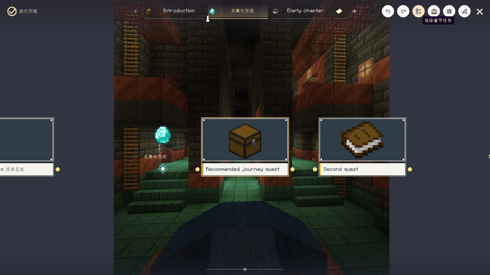

# 背景与旅行历程编辑参考

**简体中文** | [English](en/background-and-journey-editor.md) · [文档中心](README.md)

## 热点事件与传说任务背景

两个界面现在使用相同的全屏背景编辑器：左侧实时预览，右侧可滚动的属性栏。
传说任务背景入口也可从设置的外观页打开，不再误写为“成就总览背景”。

| 设置 | 含义 |
| --- | --- |
| 背景类型 | 图片或视频；视频解码仍需要项目原有的媒体附属组件 |
| 背景地址 | 资源 ID，或媒体选择器导入的地址 |
| 铺满 `cover` | 保持比例并裁剪边缘，填满目标区域 |
| 自适应 `contain` | 保持比例并完整显示，允许留边 |
| 拉伸 `stretch` | 独立适配目标宽高，不保持原比例 |
| 原尺寸适配 `adaptive` | 保持比例，图片过大时缩小，过小时不放大 |
| 背景缩放 | 在选定模式上乘以缩放倍率，范围为 0.1–10 |
| 偏移 X / Y | 相对于居中的背景位置；右/下为正，左/上为负 |
| 背景音乐 | 选择音频文件后循环播放；留空关闭独立背景音乐 |

拖动左侧背景预览可以直接更新偏移。缩放数值右侧提供增减按钮。
重置恢复空背景、无音乐、居中、1 倍铺满。编辑只改变草稿，点击完成才保存；取消不会发布。
无效资源或数值会显示错误，不会自动替换为 0 或 1。

热点事件背景由服务器保存，所有玩家看到同一份配置。修改背景不会更改卡片位置、连线或起点。
传说任务背景是当前客户端的本地覆盖，不影响其他玩家。
旅行历程的章节背景分段列表也提供“可视化编辑当前背景”按钮，使用相同的实时预览、拖动与缩放模式。
背景分段的起始位置保留，完成可视化编辑后返回分段草稿，保存章节后才会发布。

## 背景节点

节点库新增“更改热点事件背景” `set_hot_event_background`。
右侧提供背景选择、视频/图片选择、缩放模式、缩放值、X/Y 偏移和音乐选择。
“可视化预览背景配置”图标可打开相同的实时背景编辑器，完成后回填节点草稿，不会立即执行节点。

| 字段 | 默认值 | 用途 |
| --- | --- | --- |
| `source` | `""` | 图片或视频地址；空值清除背景 |
| `type` | `image` | `image` 或 `video` |
| `mode` | `cover` | `cover`、`contain`、`stretch`、`adaptive` |
| `scale` | `"1"` | 缩放倍率，0.1–10 |
| `offsetX` / `offsetY` | `"0"` | 偏移，-10000–10000 |
| `music` | `""` | 音频地址；空值关闭背景音乐 |
| `once` | `"true"` | 每位触发玩家在此任务进度下只执行一次 |

示例：在任务按钮的点击事件后接此节点：

```json
{
  "id": "event_background",
  "type": "set_hot_event_background",
  "x": 220,
  "y": 100,
  "data": {
    "source": "minecraft:textures/gui/title/background/panorama_0.png",
    "type": "image",
    "mode": "contain",
    "scale": "1.25",
    "offsetX": "24",
    "offsetY": "-12",
    "music": "",
    "once": "true"
  }
}
```

这是管理员创作的服务器显示行为，不要求触发任务的普通玩家具有管理员权限。
任务仍需满足原有的解锁、触发器开关、专注及场景限制。
`once` 只限制执行次数，不会将背景配置改成玩家私有。

## 旅行历程

### 浏览模式

选中章节标签底部的黄色条默认 3 GUI 像素高，随游戏 GUI 比例缩放；
在“设置 → 外观”可调整为 1–5px，支持输入和加减按钮并保存到本地偏好。
原有进度轨道与位置标记继续使用各自的尺寸。

- 悬浮在任务卡片上不再显示任务 tooltip。
- 点击并在同一任务卡片内松开，打开任务详情弹窗。
- 弹窗包含状态、进度、目标、说明和奖励信息；长内容可滚动。
- 右上角关闭图标或 Esc 返回原来的旅行历程。
- 任务详情弹窗宽高约占视口 75%，底部保留奖励展示，不重复放置前往任务界面的按钮；关闭返回旅行历程。
- 拖动卡片区域浏览画布不等同于点击，不会误打开任务。

### 编辑模式

开启编辑权限后，点击右上角铅笔进入编辑状态，再次点击或 Esc 退出。
进入编辑后，按钮变为“铅笔加 X”，悬浮提示为“退出时间线编辑”；
最右侧的 X 仍负责关闭窗口。章节任务入口使用独立的勾选列表图标，
点击打开当前章节的任务多选界面，确认后保存章节成员。
工具栏统一使用按钮自带 tooltip，每次悬浮只显示一份提示。




右键章节图标、名称所在区域或章节标签，可打开章节菜单：

- 编辑当前章节图标。
- 编辑当前章节名称。
- 历程外观。
- 选择章节任务。
- 编辑章节背景。

章节身份编辑器保存章节名称、图标及该章节的外观草稿，保留原来的任务、连线和背景。
保存通过服务器权限验证和文件指纹冲突检查，过期草稿不能覆盖其他编辑者的新数据。
任务卡片仍保留独立的任务属性、展示连线和移出章节操作。

### 可视化外观编辑

右侧选择要编辑的元素和控件类型（图标/文字），左侧展示实时预览：

- 从旅行历程打开时只编辑当前章节；工具栏和右键菜单均不会写入全局主题。
- 预览同时显示当前章节名称、图标、标签、任务卡片、完成标记和章节底部标记。
- 勾选多选或按住 Ctrl，点击多个控件；也可使用全选与反选图标。
- 多选后可一起移动、调整整体宽高或等比例缩放；数值与资源变更只应用到选中类型的控件。
- 章节标记默认显示白色中心菱形、淡蓝外框和透明光晕，也可以选用自定义图标。
- 拖动控件内部：移动，实时更新 X/Y。
- 拖动右边缘：仅调整宽度。
- 拖动底边：仅调整高度。
- 拖动右下角：保持原宽高比例调整整体尺寸。
- 数值输入、资源选择、文字颜色、显示开关与预览保持同步。
- 尺寸为 `0` 表示沿用元素默认尺寸；显式宽高范围为 1–2048。
- 图标与文字分别保存宽高；不设置尺寸的旧数据保持默认行为。
- 章节覆盖只改变所选元素，不覆盖未修改的服务器默认外观。
- 保存应用草稿，取消不发布，重置恢复继承值。

外观修改在编辑器内实时预览，点击保存才发布。多选后的重置也只影响选中的图标或文字，
同一元素中未选中的另一部分会保留。其他章节的配置不会随当前章节一起变更。


### 章节切换节点事件

节点库新增“章节切换事件”，第一项及默认项为“章节切换后”：

| 事件 | 时机 |
| --- | --- |
| `chapter_switch_before` | 用户请求切换章节，开始导航之前 |
| `chapter_switch_after` | 新章节导航到位后；手动拖动跨章节时在章节实际改变后 |

事件的 `eventTarget` 为目标章节 ID。可以在事件节点的目标字段指定章节 ID，或连接可视化判断节点比较 `eventTarget`。
节点仍使用原有的事件冷却与执行次数限制。取消尚未完成的切换，不会补发已取消章节的“切换后”事件。
“未归入章节”是自动展示分区，不发送创作章节切换事件。

## 验证

使用 `compileJava compileSmokeJava` 编译验证。
`-PjourneyEditingTest` 包含背景节点执行/保存重载、节点打开预览后的配置回填、章节身份保存、
宽高句柄、多选批量拖动、其他章节不受影响、背景拖动、无效输入及任务弹窗回归。
`-PjourneyTest` 覆盖原有导航、缩放、滚动、资源选择、外观继承与新弹窗导航。
NeoForge 1.21.1 的上述两组游戏内回归已通过。
后续发布复验已扩展到 Forge 1.20.1、Fabric 1.20.1 和 Fabric 1.21.1 的实际客户端，
详见 [2026-10-16 发布验证](release-verification-2026-10-16.md)。
文档截图保存在 `docs/images/`；开发环境的完整中文 1920×1080 截图在 `build/verification/`。
