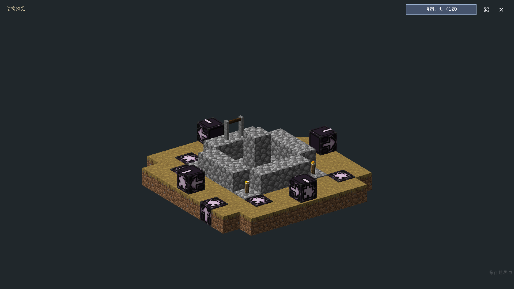
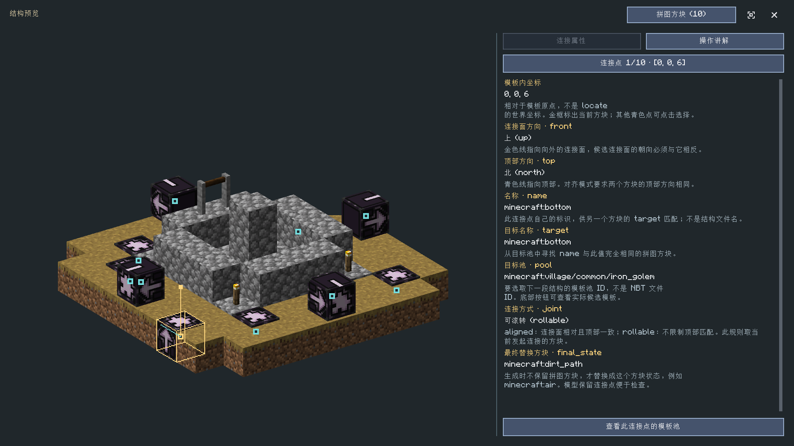
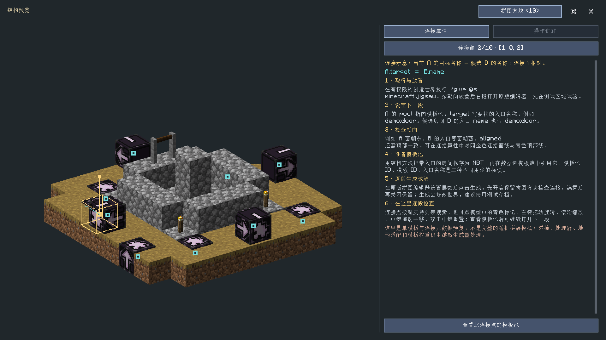

# 候选选择、结构预览与拼图方块

[使用指南](guide.md) · [全部命令](commands.md) · [界面图鉴](interface-gallery.md)

适用：0.2.0 多版本预览 17，Minecraft 1.20.1 Forge/Fabric、1.21.1 NeoForge/Fabric。
世界结构和模板池浏览目前需要有作者权限的本地世界。
已有结构预览里的连接属性、模型高亮和操作说明也可由预览数据直接显示。

## 从“添加候选”开始

候选是字段可以选用的值。“添加候选”先打开对应资源的选择界面，
把选好的资源加入候选列表；在候选列表再次选择，才填写原字段。
关闭资源选择器不会修改原字段。

| 字段内容 | “添加候选”打开的界面 | 保存的值 |
| --- | --- | --- |
| 获取/奖励物品 | 共用全屏物品选择器，底部应用 | 物品 ID 或带数据的物品值 |
| 图标、图片、背景 | 共用全屏资源选择器 | 所选资源引用 |
| 世界结构或群系 | 地点目标选择器，可搜索 ID、标签 | 原始注册 ID，例如 `minecraft:village_plains` |
| 完整地点条件 | 地点目标选择器 | 包含类型、维度等信息的地点值 |
| 导入结构文件 | Java NBT 结构库 | 导入库内的相对文件路径 |
| 任务引用 | 任务选择器 | 任务 ID |
| 其他已有注册候选 | 对应候选列表 | 该类型的原始值 |

例如，节点的 `locate_structure` 目标应当填 `minecraft:village_plains`，
不是 `structure||minecraft:village_plains`，也不是 `village.nbt`。
完整地点条件可以是 `structure||minecraft:village_plains`；
中间为空表示不限制维度。
导入结构则可以是 `minecraft/village/plains/town_centers/plains_fountain_01.nbt`，
用于模组的结构场景，与世界结构注册项用途不同。

## 预览一个世界结构

1. 在结构字段点击“添加候选”。
2. 使用“选择目标”搜索结构 ID 或结构标签。
3. 点击“结构预览”，查看该结构起始模板池引用的 NBT 模板。
4. 点击列表右侧的预览图标，进入三维模型。
5. 返回后，之前选择的结构仍然保留；点击“应用”加入候选。



这里读取世界实际加载的数据资源。村庄等拼图结构通常有起始池；
地牢、要塞等结构也可能由代码生成，没有可直接对应的起始 NBT 模板。
没有模型时会显示原因，仍可把该世界结构选作定位目标。
模组通过代码注册、未提供相应 JSON 资源的池也可能无法列出。

单个模板预览目前限制为每轴最多 32 格、最多 4096 个非空气方块、
最多 128 个实体数据项；实体本身不在这个方块模型里渲染。
多调色板模板在预览时使用第一套调色板，不修改原模板。
超出限制会报错，不会用不完整模型冒充完整结构。

## 在模型中查看拼图方块

打开结构预览后，右上角“拼图方块”按钮显示连接点数量。
没有连接点时按钮禁用。



| 操作或标记 | 作用 |
| --- | --- |
| 点击“拼图方块” | 打开或收起检查面板，收起后恢复大模型视图 |
| 点击连接点按钮 | 打开可搜索列表，按坐标、序号、名称寻找连接点 |
| 点击模型青色标记 | 直接选择那个连接点，含被其他方块遮住的连接点 |
| 金色立方体框 | 当前选中的拼图方块 |
| 金色方向线 | 当前方块向外的连接面方向 |
| 青色方向线 | 当前方块顶部方向 |
| 左键拖动模型 | 旋转 |
| 滚轮 | 在模型上缩放，在属性/讲解区域内平滑滚动 |
| 中键拖动 | 平移模型 |
| 双击中键或右上角重置图标 | 重置旋转、缩放与平移 |
| 查看此连接点的模板池 | 浏览它的真实候选模板，再打开下一段模型 |

宽窗口采用左模型、右属性；窄窗口改为上下布局，说明区域保留滚动条。
底部模板池按钮固定，不会随长说明滚出屏幕。
从模板池和下一段模型返回，保留原连接点选择及视角。

属性面板仅查看连接字段，不修改模板或世界。
预览包只保留拼图连接所需的字段，不携带箱子物品、命令方块命令等任意方块实体数据。
如果模板原来没有填写字段，界面会标记缺失，不会把空字符串当成有效配置。

## 拼图方块是什么

拼图方块是结构片段的连接点。一个房间、道路或走廊保存为一个 NBT 模板，
游戏从模板池选择下一段，再尝试用两个拼图连接点拼接它们。

要分清三种 ID：

| 示例 | 用途 |
| --- | --- |
| `demo:rooms` | 模板池 ID，引用 `worldgen/template_pool/rooms.json` |
| `demo:room` | 模板 ID，引用 `room.nbt` |
| `demo:door` | 连接点名称，用于 `target` 与 `name` 匹配，不是文件 |

## 每个字段怎么填

| 字段 | 含义 | 示例 |
| --- | --- | --- |
| `name` | 当前连接点自己的名称，供别的连接点寻找 | `demo:entrance` |
| `target` | 希望在下一段找到的连接点名称 | `demo:door` |
| `pool` | 从哪个模板池抽取下一段 | `demo:rooms` |
| `final_state` | 不保留拼图方块时替换成的方块状态 | `minecraft:air` 或 `minecraft:stone` |
| `joint` | 当前方块发起连接时采用的朝向规则 | `aligned` / `rollable` |
| `orientation` | 方块状态里的连接面和顶部方向 | `east_up` |
| `selection_priority` | 1.21.1 中，同一片段的连接点选择优先级，越大越先尝试 | `0` |
| `placement_priority` | 1.21.1 中，后续待扩展片段的处理优先级，越大越先处理 | `0` |

1.20.1 不提供上述两个优先级设置。预览仅在模板实际含优先级字段时显示它们。
优先级不是模板池的 `weight`，也不是奖励物品的概率。

`final_state` 填方块状态字符串，不填物品数量、物品 JSON 或命令。
例如 `minecraft:oak_log[axis=y]` 表示沿 Y 轴的原木。
连接面和顶部由拼图方块的放置朝向决定，不是独立的目标 ID。

## 两个连接点如何匹配

设当前方块是 A，池中候选房间的入口方块是 B。

```text
A.pool   = demo:rooms
A.target = demo:door  ──────────>  B.name = demo:door
A.front  = east       <相对>       B.front = west
A.top    = up                     B.top = up
```

游戏会尝试候选片段的旋转，因此应检查的是旋转后参与连接的朝向。
必须满足：

1. A 的 `target` 与 B 的 `name` 字符串完全相同。
2. A、B 的连接面朝向相反。
3. A 的 `joint=aligned` 时，还要求两者顶部方向相同。
4. A 的 `joint=rollable` 时，不要求顶部方向匹配。

A 的 `name` 不需要与 B 的 `name` 相同；
也不要求 B 的 `target` 反过来匹配 A 的 `name`。
当前这一轮的连接规则取 A 的 `joint`。
模板缺少或含无效 `joint` 时，游戏对水平连接面默认使用 `aligned`，
垂直连接面默认使用 `rollable`。

名称与朝向匹配仍不保证一定生成成功：空间碰撞、生成深度、空池元素、
地形适配、处理器等都可能影响实际结果。

## 最小房间示例

以下示例准备一个池 `demo:rooms` 和一个房间模板 `demo:room`。

### 1. 保存一个带入口的房间

在启用命令、有管理权限的创造测试世界中取得方块：

```mcfunction
/give @s minecraft:jigsaw
/give @s minecraft:structure_block
```

建一个小房间，在入口放一个拼图方块 B，连接面朝房间外，
右键打开原版拼图编辑器，填写：

```text
名称 name：demo:door
目标名称 target：minecraft:empty
目标池 pool：minecraft:empty
最终替换方块 final_state：minecraft:air
连接方式 joint：aligned
```

此处用空池结束向后扩展。使用结构方块的“保存”模式，
选择包含房间和入口拼图方块的区域，结构名填写 `demo:room` 并保存。
两个游戏版本的世界内结构方块保存目录都是：

```text
<世界目录>/generated/demo/structures/room.nbt
```

用原版结构方块加载一次，检查范围、入口朝向和拼图元数据仍在。
如果用模组结构库预览，要把文件导入模组的 `structures` 库；
结构库文件路径与数据包模板 ID 不能互相直接替代。

### 2. 建立数据包模板池

在测试世界 `datapacks/demo_jigsaw/` 中准备：

```text
demo_jigsaw/
  pack.mcmeta
  data/demo/worldgen/template_pool/rooms.json
  data/demo/structure/room.nbt       # 1.21.1
```

**1.20.1 的数据包模板目录使用 `data/demo/structures/room.nbt`（复数）。**
1.21.1 数据包资源目录使用 `structure`（单数）；
这与上面的世界 `generated/.../structures` 保存目录不同。

1.21.1 的 `pack.mcmeta`：

```json
{
  "pack": {
    "pack_format": 48,
    "description": "Jigsaw room example"
  }
}
```

1.20.1 将 `pack_format` 改为 `15`，并使用该版本保存的 NBT，
不要直接向下加载高版本模板。

`rooms.json`：

```json
{
  "name": "demo:rooms",
  "fallback": "minecraft:empty",
  "elements": [
    {
      "weight": 1,
      "element": {
        "element_type": "minecraft:single_pool_element",
        "location": "demo:room",
        "processors": "minecraft:empty",
        "projection": "rigid"
      }
    }
  ]
}
```

模板池属于世界生成注册数据。新增、修改后退出并重新进入测试世界，
检查数据包加载错误；不要只依赖一次 `/reload` 就认定生成注册数据已更新。

### 3. 放置起始拼图并生成

在有足够空地的区域放置一个起始拼图 A，填写：

```text
名称 name：demo:start
目标名称 target：demo:door
目标池 pool：demo:rooms
最终替换方块 final_state：minecraft:air
连接方式 joint：aligned
层数 levels：先用 1
保留拼图方块 keep jigsaws：是
```

点原版“生成”，检查 B 是否正确拼到 A 的连接面前方。
确认连接后再关闭“保留拼图方块”，验证 B 替换为 `final_state`。
这是实际生成，会改变世界；本模组预览面板不会替你点击生成。
大房间重叠、其他方块占位或入口方向不合适时，先在空地减小模板重试。

### 4. 把下一段也可视化

把示例结构导入模组的结构库后打开预览，检查 A 或 B 的连接属性。
如果选中 A，底部模板池按钮能打开 `demo:rooms`，
列表应有 `demo:room`；再预览这个房间，可以继续检查它的入口。
对于 B 的 `minecraft:empty` 池，底部浏览按钮禁用。



## 预览范围与排错

| 现象 | 检查 |
| --- | --- |
| 生成后没有下一段 | 池 ID 是否存在，池是否有非空元素，B 的 `name` 是否等于 A 的 `target` |
| 名字正确仍不拼接 | 两个连接面是否相对；`aligned` 的顶部是否一致；是否与已有结构碰撞 |
| 拼图没有被替换 | 原版生成时是否打开了“保留拼图方块”；`final_state` 是否有效 |
| 模板池浏览为空 | 池资源是否可读、是否只有空/特征元素、是否仅由代码注册 |
| 世界结构无法预览 | 该结构可能不是使用起始模板池的拼图结构 |
| 找到 NBT 却提示过大 | 检查 32 格边长、4096 非空气方块和实体数据项限制 |
| 看不到优先级 | 1.20.1 没有；模板没有保存优先级字段时也不显示 |
| 预览和实际生成有差异 | 预览是单模板模型，不运行处理器、地形投影、随机权重或完整拼装 |

列表读取限制：最多遍历 32 个池，最多列出 256 个模板，
同一个池重复或回指时不再递归；组合池元素递归深度最多 16 层。
回退池模板也可能列出，列表不是带权随机抽取结果。
预览不会渲染实体，也不会执行模板里的命令。

连接规则对照本项目构建使用的 Minecraft Java 源码：
`JigsawBlock.canAttach`、`JigsawBlockEntity.loadAdditional`、
`SinglePoolElement.sortBySelectionPriority`、`JigsawPlacement.Placer`。
