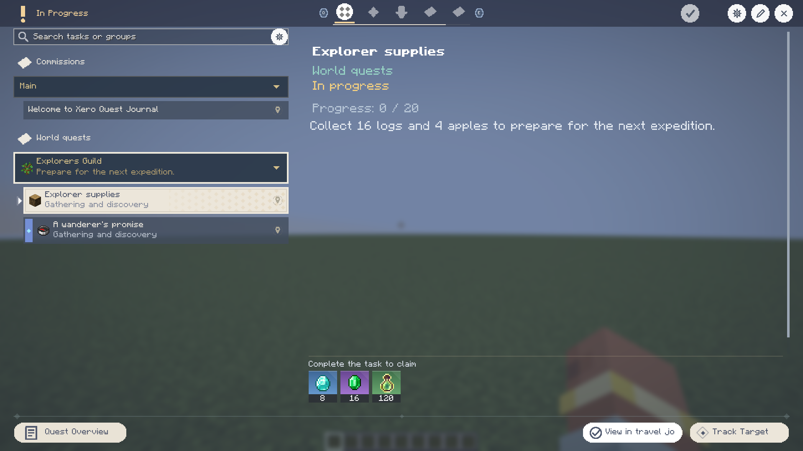

# Documentation Center

[简体中文](../README.md) | **English** · [Project home](../../README.en.md)

This documentation covers **0.2.4**. Start with a workflow,
then use the detailed reference for fields, permissions and persistence.

## Start Here

| Goal | Document |
| --- | --- |
| Pick a loader, Java version and JAR | [Compatibility and verification](testing-and-compatibility.md) |
| First-time player or author workflow | [User guide](guide.md) |
| Find a control by its appearance | [English 1080p interface gallery](interface-gallery.md) |
| Review current release verification | [0.2.4 verification](../release-verification-0.2.4.md) |
| Position notices and avoid minimaps | [Notification settings and HUD notices](interface-gallery.md#settings-and-animation) |
| Look up syntax and permissions | [All commands](commands.md) |
| Review recipe generation and backpack capacity | [2026-10-19 fix verification](../generator-and-objective-verification-2026-10-18.md) |
| Write a predicate or reward script | [JavaScript reference and shared examples](javascript.md) |
| Connect events and branches | [Predicate nodes](trigger-conditions.md) |
| Use variables or move inventory shortcuts | [Variables and inventory](variables-and-inventory.md) |
| Configure rewards, counts and qualities | [Rewards and conditions](rewards-and-conditions.md) |
| Edit chapter visuals, music and backgrounds | [Journey and background editor](background-and-journey-editor.md) |
| Author anecdote records and stickers | [Anecdote book](anecdotes.md) |
| Inspect world structures and connectors | [Candidate selection and jigsaw tutorial](candidate-selectors-and-jigsaw.md) |
| Recover a saved edit or deletion | [Undo and redo scope](task-edit-undo.md) |
| Use combined search, prerequisite modes and minimap | [Search and unlock graph](task-search-and-unlock-graph.md) (development) |
| Choose story generation, structure guidance and template groups | [Generation and template library](generation-and-template-library.md) (development) |
| Configure video or additional audio | [Optional media](media.md) |

## For Players

1. Press `J`, choose a category, and select a task.
2. Read its description and click a completion condition for more detail.
3. Use Track for navigation. Claim available rewards from the bottom of the detail pane.
4. Completed tasks with unclaimed rewards stay in progress.
5. Read mail with `F8`; use personal settings to configure notifications and inventory entries.

## For Authors

1. Use a local world with administrator permission.
2. Run `/xero_quest edit_mode @s true`.
3. Create a small task from the journal's context menu.
4. Configure properties, conditions and rewards, then save.
5. Use the unlock graph for prerequisites and the event graph for event/condition/action logic.
6. Test with actual player state. A valid graph or a saved file alone does not prove reward delivery.

The built-in JS environment, KubeJS and `.mcfunction` rewards use different APIs.
Start with the [script environment table](javascript.md#choose-the-environment).

## Language And Content

UI language follows Minecraft's language setting. Task titles, chapter names and mail bodies
are authored content. Use supported translation keys or localized content when you want those
values to change with the reader's language.

English and Chinese galleries use the same demonstration scenario, captured separately in
`en_us` and `zh_cn`. Each new image is native **1920×1080**. Capture manifests record the actual
locale, scene, dimensions, timestamp and SHA256; see the [screenshot index](../images/README.md).

## Files And Persistence

| Location | Purpose |
| --- | --- |
| `config/xero_quest/groups/` | Task, group and chapter definitions |
| `config/xero_quest/scripts/` | Relative `.js` files for conditions and rewards |
| `config/xero_quest/structures/` | Imported NBT scenes and settings |
| `config/xero_quest/anecdotes/` | Independent anecdote entries |
| `config/xero_quest/task_types/` | Authored category definitions |
| `config/xero_quest/history/` | Disk history/backups for supported author operations |
| World save | Player progress, reward receipts and related runtime state |

Back up both configuration and the world save. Definition editing and undo affect a different
data layer from player progress or already delivered rewards.

## Current Limits

The four installable targets are Forge/Fabric 1.20.1 and NeoForge/Fabric 1.21.1.
Complete 26.x migration remains unfinished. Authoring is primarily a local integrated-server workflow.

Production builds and focused regressions have passed, but broad creation and continuous journey
regressions still have unresolved assertions. Full remote multiplayer and all mod combinations
have not been verified. The [verification summary](testing-and-compatibility.md) separates
historical results, current focused checks and screenshot evidence.
