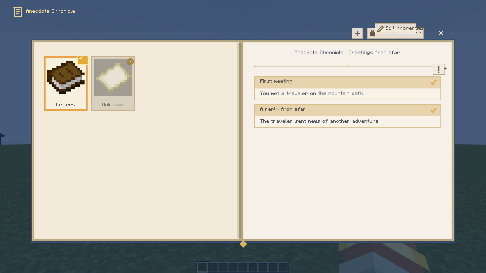
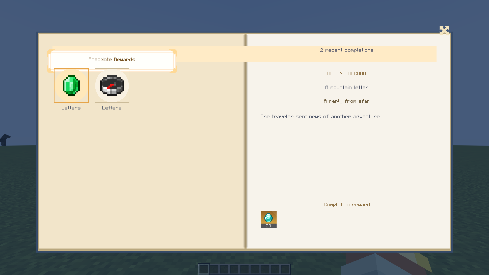

# Anecdotes, Records And Stickers

[简体中文](../anecdotes.md) | **English** · [Guide](guide.md) · [Commands](commands.md)

The Anecdote Chronicle is an independent two-page book.
Open it from the overview's anecdote entry or `/xero_quest open anecdotes`.
`/xero_anecdote @s` only plays a banner; it does not open the book or complete a record.



## Read And Author

Select a left-page card to read its records on the right.
Hover enlarges a card; holding shrinks it. Selection occurs only after release in the same card.
Cards and records have independent smooth scrolling.
An undiscovered entry may remain visible as locked or be hidden according to its definition.

Author mode exposes entry/record editing through context actions.
An entry supports multiple records, and completed records remain in the book.
The reward page keeps completion stickers and animates unread completions before acknowledgment.



## Independent Files

Save each entry in `config/xero_quest/anecdotes/<id>.json`.

| Field | Purpose |
| --- | --- |
| `id` | Stable entry ID |
| `title` | Entry title |
| `cardText` | Card-bottom label; long content is fitted |
| `icon` | Card image/item reference |
| `heading` | Right-page heading |
| `records` | Up to 32 records; IDs must be unique within the entry |
| `defaultDiscovered` | Whether the entry starts discovered |
| `hideWhenLocked` | Whether an undiscovered entry is hidden |
| `order` | Display ordering value |
| `rewards` | Reward definitions |

Each record has `id`, `title`, `body` and optional `completedIcon`.
An omitted/empty reward list inherits the model's default 50 legendary-quality diamonds.
Authors should explicitly review and configure the intended rewards.

```json
{
  "id": "mountain_letter",
  "title": "A mountain letter",
  "cardText": "Letters",
  "icon": "minecraft:book",
  "heading": "Greetings from afar",
  "defaultDiscovered": false,
  "hideWhenLocked": false,
  "order": 10,
  "records": [
    {
      "id": "meeting",
      "title": "First meeting",
      "body": "You met a traveler on the mountain path.",
      "completedIcon": "minecraft:compass"
    }
  ],
  "rewards": [
    {"type": "item", "item": "minecraft:diamond", "count": 2, "quality": "rare"}
  ]
}
```

## Graph Actions

Discover an entry:

```json
{"id":"discover_letter","type":"discover_anecdote","x":220,"y":40,
 "data":{"target":"mountain_letter"}}
```

Complete its record after discovery:

```json
{"id":"finish_meeting","type":"complete_anecdote","x":220,"y":140,
 "data":{"entry":"mountain_letter","record":"meeting"}}
```

Attach the action to a real event/predicate branch and save the owning graph/task.
These are terminal actions, not generic sequential chaining steps.
Do not assume two parallel action branches execute discovery before completion.
Use separate eligible events/stages where ordering is required.

Discovery, completion timestamps and unread completion state belong to player world progress.
Editing a definition does not automatically clear that state.
Reward delivery still follows the existing permissions, claim and receipt rules.
