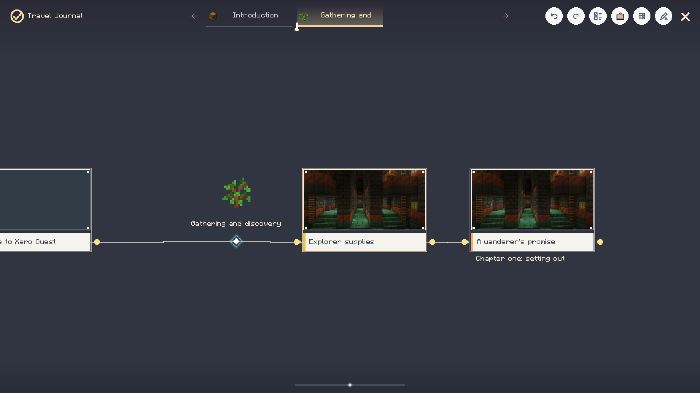
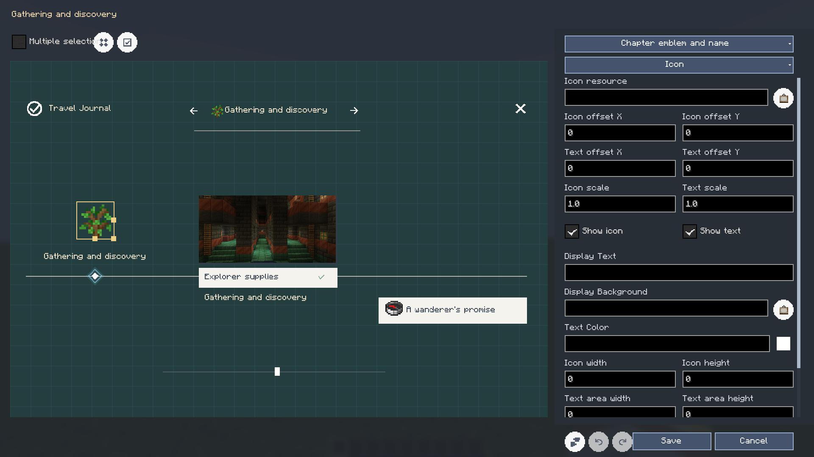

# Journey And Background Editing

[简体中文](../background-and-journey-editor.md) | **English** · [Documentation](README.md)

## Browse And Edit A Chapter

The journey timeline supports chapter tabs, canvas dragging, zoom and task-detail popups.
Task details occupy about 75% of the viewport; the footer shows rewards without a redundant
button to reopen the task screen. Closing returns to the same journey.
Selected-tab underline height defaults to **3 GUI pixels**.
Settings → Appearance provides a 1-5px numeric field and stepper buttons.
The preference applies immediately and saves locally.

In author mode, the pencil enters editing. The pencil with an X exits editing without closing
the window. The separate far-right X closes the window. Each toolbar hover shows one tooltip.
The checklist opens task membership multi-selection.



Right-click a chapter area or tab to edit its name/icon, appearance, task members or background.
Task context actions edit the task, display connections or remove chapter membership.
Display connections are separate from task prerequisite relationships.

## Chapter-Local Appearance

The appearance editor opened from a journey chapter targets that chapter rather than every chapter.
The preview includes chapter/title/tab/marker/task elements.

1. Select the target element and icon/text component.
2. Enable multiple selection or use supported modifier selection.
3. Drag inside to move.
4. Drag the right edge for width, bottom for height, corner for proportional resizing.
5. Fine-tune offsets, dimensions, resource, color or visibility in the inspector.
6. Save to the chapter, or cancel the draft.



Explicit dimensions range from 1 to 2048; 0 inherits the element default.
Icon and text dimensions are separate. Chapter overrides inherit unmodified values from defaults.
Undo behavior has a known unresolved appearance regression; review the
[verification scope](testing-and-compatibility.md) before relying on it as a backup.

## Backgrounds And Music

Hot-event, legendary and chapter background editors share a live-preview workflow.

| Option | Meaning |
| --- | --- |
| Image/video | Media kind; video needs a compatible optional backend |
| Source | Resource ID or imported media reference |
| `cover` | Preserve ratio and crop to fill |
| `contain` | Preserve ratio and fit fully, leaving space when needed |
| `stretch` | Independently stretch both dimensions |
| `adaptive` | Fit oversized media without enlarging undersized media |
| Scale | Additional factor, 0.1-10 |
| X/Y offset | Relative to the centered background; right/down positive |
| Music | Optional looping audio reference |

Preview dragging updates offset. Reset restores the editor's default/empty draft as appropriate.
Apply/Save commits; cancel does not publish. The chapter segment list preserves its start coordinate
while opening the shared visual editor for that segment.

Server-owned authored backgrounds are shared. Legendary personal background settings are client-local.
Media decoding and third-party combinations retain their separate compatibility limits.

## Background Nodes

The graph can configure supported hot-event/overview backgrounds and chapter switching.
Use the visual inspector for source, type, mode, scale, offset and music, then return the draft
to the node. Opening the inspector does not execute the node.

Typical hot-event background data:

```json
{
  "id": "event_background",
  "type": "set_hot_event_background",
  "x": 220,
  "y": 100,
  "data": {
    "source": "minecraft:textures/gui/title/background/panorama_0.png",
    "type": "image",
    "mode": "contain",
    "scale": "1.25",
    "offsetX": "24",
    "offsetY": "-12",
    "music": "",
    "once": "true"
  }
}
```

Chapter switch events distinguish before and after; default binding is after.
Event execution still respects task eligibility and author/runtime permissions.
