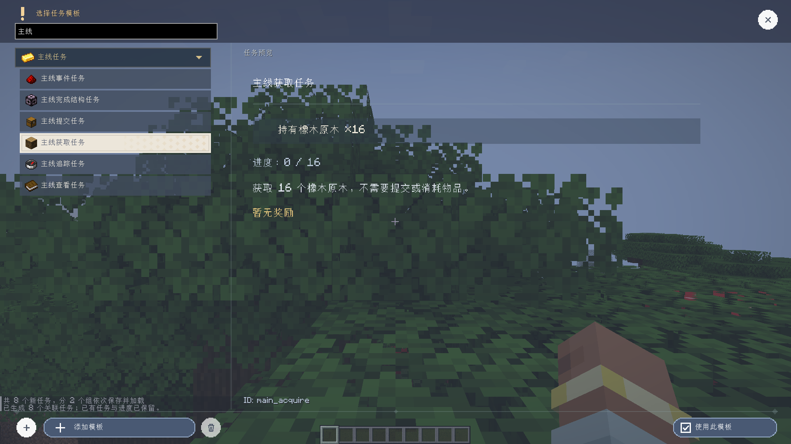

# Related Task Generation And Templates

[简体中文](../generation-and-template-library.md) | **English** · [Documentation](README.md)

These features belong to the local development build. Existing GitHub release assets do not update automatically.

## First Entry And Commands

Each player receives the generation chooser once per world, after entering gameplay and receiving task data.
Opening the screen creates no tasks. Starting or cancelling stores an acknowledgement in that world's player data.
Disconnecting without making a choice leaves the offer available next time.

```text
/xero_quest start_generate_gui
/xero_quest locate <id>
```

The first command reopens the chooser. Everyone may view it; generation requires administrator permission or
ownership of the current singleplayer world because definitions are shared by the server.
The second command retries location guidance for an available, trackable structure task.

| Mode | Behavior |
| --- | --- |
| Journey: advancement chains | Follow mod advancement prerequisites and associate explicit criterion items with recipes/materials |
| Journey: structure exploration | Chain structures registered for the world's dimensions and generation settings |
| Journey: both | Connect a mod's exploration entry to a progression milestone |
| Classic: all content | Existing advancement, obtainable-item and combat generator |

Choose all content or one namespace. The recipe checkbox controls additional recipe/material branches.
Planning and saving run in the background, with chat progress. Reruns retain existing files, IDs, edits and progress.
Cross-namespace dependencies are staged together before publishing. Validation rejects cycles and rolls back
the operation's writes on failure.


## Relevant Rewards And Coverage

Progression rewards supply small quantities of up to four materials from a following criterion's actual recipe,
avoiding the next finished target item. Recipe branches also support subsequent operations.
When no relevant reward can be established, the task retains an empty reward list for author editing.
Exploration supplies food and torches for the next expedition.

The first implementation reads displayed advancements and their parent links, recognizes explicit item IDs in
`minecraft:inventory_changed` conditions, and follows ordinary recipes and survival-reachable materials.
Custom criteria, machine recipes, script stages and unavailable APIs need dedicated adapters.
Data-pack advancement fixtures verify cross-namespace relationships; this is not a claim of exhaustive testing
of every third-party mod.

## Located Exploration

Tracking a structure condition queues a server-side locate. The task's Locate button can retry explicitly.
The coordinate marker uses a point inside the initial structure piece when available; entering the structure
completes the task. V replays existing coordinate guidance.

Targets are cached by task, location condition and team in world data, shared with online teammates and restored
after reconnecting. `globe.located_structure` also exposes structure ID, dimension and coordinates to nodes.
Enter the destination dimension before locating. Missing results display an explanation and can be retried after moving.
Search uses bounded vanilla structure location on the server with a queue and cooldown; chunk calculations can briefly take time.


## Acquisition Templates And Groups

Main, Legendary, Commission and World groups each gain an acquisition template: hold 16 oak logs to finish
automatically without consuming them or displaying a Submit button. `item_hold` includes existing inventory;
`item_acquire` is the separate cumulative acquisition condition. Authors may change target, count or condition type.

The Add group icon sits left of Add template. Empty groups persist independently from task groups.
New templates inherit the selected group. In edit mode, hold for about 350ms and drag templates/groups to reorder;
release commits, dropping on a group header changes membership, and Esc cancels. Quick drags scroll normally;
edges support automatic scrolling. The server saves `config/xero_quest/template_library.json` and synchronizes it with the catalog.

The main journal retains its long-press ordering. Context-menu movement supports repeated steps and exits through
Done, Esc or right-click. Updating the observed history revision fixes the perpetual widget rebuild that blocked
input and made tooltips flicker after a move.



## Compact Item Notices

Default logical width is 320, row height 30 and header height 20. Up to four entries appear newest first.
Runtime and preview share sizing; larger text expands necessary height and long names are clipped.
Pickup/crafting/smelting events matching tracked acquisition, holding or submission conditions display task progress.
Successful submissions show Submitted only after actual inventory consumption. Failed/insufficient submissions show no success notice.
Each entry carries task ID, action, count and progress and receives its own entrance clock, even for repeated items.
Preview staggers four entries once and then stops.

Visual layout settings include placement, overall size, independent text size, optional task background and animation.
Drag the minimap reservation to move it; resize with its corner handle or numeric width/height.
The shorter header and background-free footer leave more preview room, with smoothly scrolling compact-window properties.

## Verification

```powershell
.\gradlew.bat runClient -PgenerationTest --offline --console=plain
```

The real client covers first-entry choice/cancel/reopen and persistence, useful rewards/idempotency, template-group
catalog/reordering, non-consuming log completion, repeated moves, village location/arrival in normal terrain,
extreme text/scale bounds, movable reservations, 2000-task background search, continuous minimap dragging,
and task-linked acquisition/submission notices with failure exclusion. Network protocol is 13; update both endpoints.
