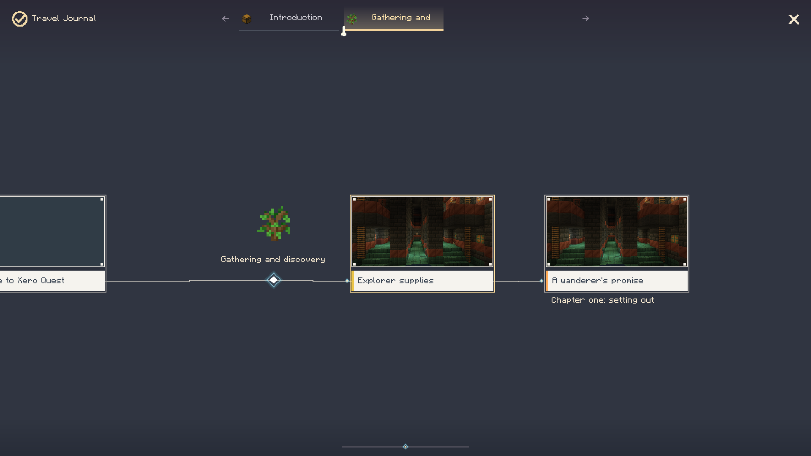
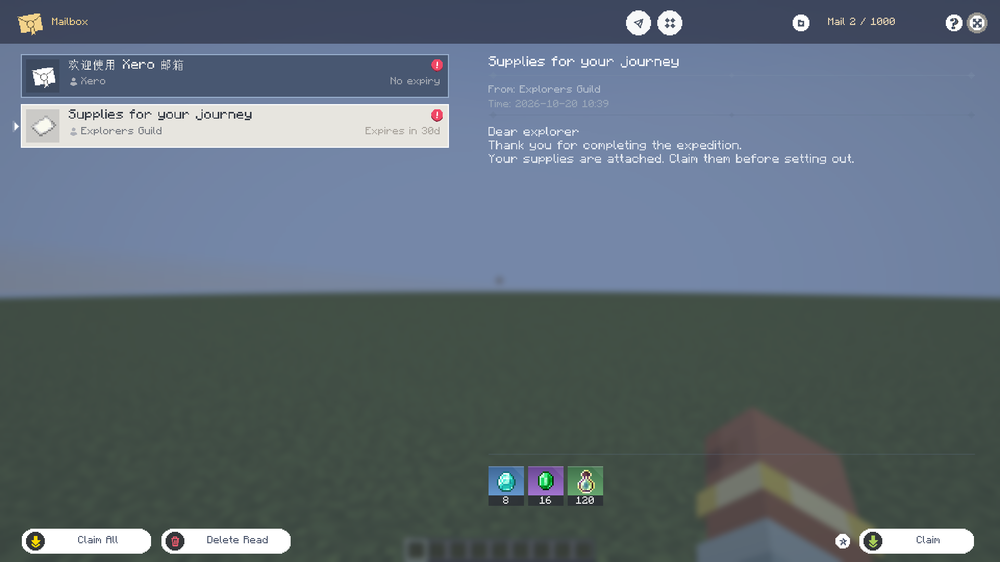
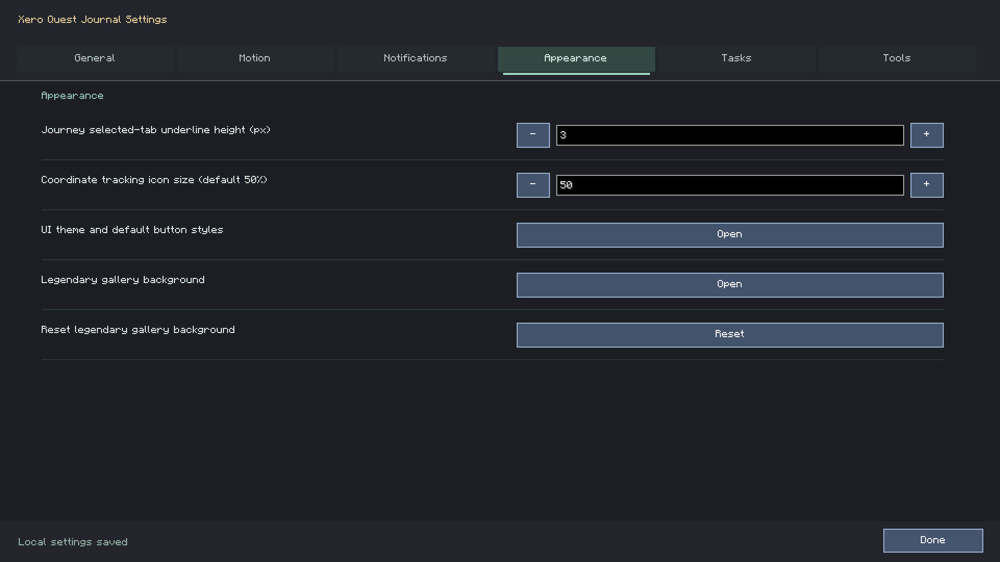
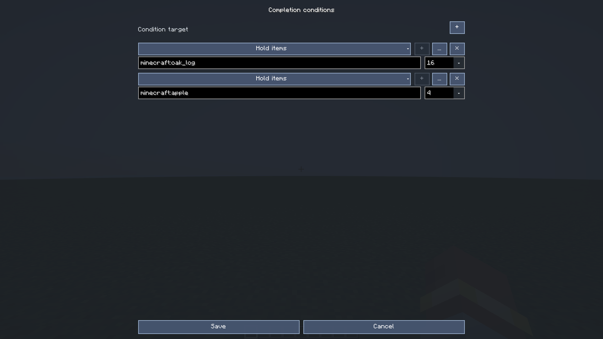
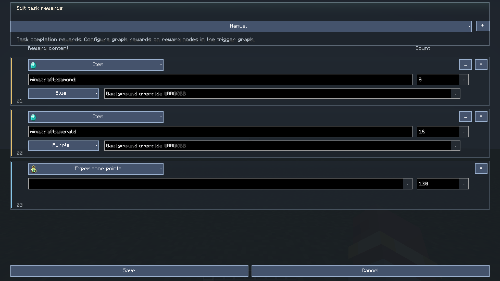

# Player And Author Guide

[简体中文](../guide.md) | **English** · [Documentation](README.md) · [Screenshots](interface-gallery.md)

This guide covers 0.2.1 on Forge/Fabric 1.20.1 and NeoForge/Fabric 1.21.1.
Complete 26.x migration is still in development.

## Install And Set Language

Install one core JAR matching both loader and Minecraft version.
Fabric requires matching Fabric API. Use Java 17 for 1.20.1, Java 21 for 1.21.1.
Keep client/server builds compatible. The full authoring workflow currently targets local worlds.

Choose English or Simplified Chinese in Minecraft's language menu.
UI strings follow that setting; authored text does not automatically translate.
Use a task's supported translation keys or localized authored content for multilingual packs.

## Read And Complete A Task

Open `J` or `/xero_quest open journal`. Select a category, expand a group and choose a task.
The selected category keeps an icon/title row above the list. Reopening the journal remembers
the previous task selection when it is still available.

| State | Meaning |
| --- | --- |
| In progress | Eligible to work on, with runtime conditions evaluated |
| Locked | Prerequisite or unlock conditions are missing |
| Complete, unclaimed | Conditions met; rewards remain to be claimed |
| Claimed | Reward processing for this completion record is complete |
| Unread badge | Newly seen catalog entry that has not been opened |

Completion and claiming are different. A complete/unclaimed task remains in progress with
a claim indicator. Tracking is navigation, not a separate task acceptance lifecycle.
The gold completion-chat link opens the corresponding task.

Click the journal objective row to open the same task popup used by Journey, including status,
progress, completion instructions and bottom rewards. Item cards open their source/detail view.
Closing returns to the popup and then the same selected journal task. Authored objective
controls provide this entry in player mode; author mode retains layout editing.
Inventory overflow and partial claims have their own confirmation/result handling.

“Hold item” checks the vanilla inventory, offhand and recognized backpack storage.
Authors see a capacity estimate; saving impossible requirements is blocked without a supported
integration. Submission consumes only player-inventory items; use cumulative acquisition for totals.


## Search And Filters

Use the search field and its settings menu to choose title/description/subtitle/internal scopes.
The settings menu remains open until closed. In the development build, scopes and filters use
one vertical scrolling panel, including categories, reward types/items and completion condition types/targets.
See [Search and unlock graph](task-search-and-unlock-graph.md) for updated controls and screenshots.

Names, IDs and supported pinyin indices help locate entries. Search indexes are built asynchronously;
the latest query supersedes older work. A naturally empty player category can omit search tools,
while an unsuccessful search keeps the search field available.


## Journey And Task Navigation

Open Journey from the overview or a task's journey button when that task belongs to the journey.
Drag the canvas to browse; release within the same card to open its task popup.
Use the popup's explicit navigation button for the full journal.
Tabs switch chapters; the selected chapter's progress marker can be dragged within its range.

The selected-tab underline defaults to **3 GUI pixels**.
Change it under **Settings → Appearance → Journey selected-tab underline height** from 1 to 5.
This is a local preference saved in `config/xero_quest/ui/client.json`.



## Mail And Anecdotes

`F8` opens mail. Read the body, inspect attachments, and claim before deleting protected mail.
Favorite and attachment rules can prevent deletion. `F7` opens the new-message workflow where permitted.

`/xero_quest open anecdotes` opens the anecdote book. Select an entry, read its records, and inspect
completion stickers on the reward page. Discovery, locking and completed records use dedicated state.
The `/xero_anecdote` notification banner is separate from opening the book.



## Settings

| Tab | Main options |
| --- | --- |
| General | Default view, task/mail inventory entries, HUD and placement editor |
| Motion | Reduced motion, popup duration, animation editors |
| Notifications | Notification scale, icon scale and preview |
| Appearance | Journey underline height, tracking marker size, theme and legendary background |
| Tasks | Server pagination, reward sources and context-menu position |
| Tools | Key bindings, configuration folder and group expansion reset |

Personal preferences save locally. Server-controlled options still require author permission.
Settings tab transitions use 100 ms where motion is enabled.



## Create A Task Visually

1. In a permitted local world, run `/xero_quest edit_mode @s true`.
2. Open the journal and use a group/task context menu to create a task.
3. Give it a stable ID, display title, category, description and icon.
4. Open completion conditions, choose a condition type and target, then set count.
5. Open rewards and set type, target, count and optional quality/background.
6. Save each draft to its parent, then save the owning task as required by that editor.
7. Test the task as a player, including completion, claim and reopening the UI.

Resource selection has a staging step: selecting an item/image highlights it;
Apply commits it to the parent draft. Adding a candidate updates the candidate list,
then selecting that candidate writes the original field.





## File-Based Tasks

Definitions live in `config/xero_quest/groups/` and support JSON plus the project's HTML/XML format.
Do not duplicate the same ID in multiple files.
Use `/xero_quest reload` after external changes and review definition errors.

```json
{
  "id": "first_logs",
  "title": "Gather logs",
  "description": "Keep 16 logs in your inventory.",
  "type": "world",
  "icon": "minecraft:oak_log",
  "defaultUnlocked": true,
  "rewardMode": "manual",
  "triggers": [{"type": "item_hold", "item": "#minecraft:logs", "count": 16}],
  "rewards": [{"type": "item", "item": "minecraft:diamond", "count": 2}]
}
```

An example group directory:

```text
config/xero_quest/groups/expedition/
  group_manifest.json
  first_logs.json
  chapter_one.chapter.json
```

```json
{
  "id": "expedition",
  "name": "Expedition",
  "type": "world",
  "icon": "minecraft:compass"
}
```

A chapter must reference an existing group:

```json
{
  "id": "chapter_one",
  "name": "Gathering and discovery",
  "group": "expedition",
  "quests": ["first_logs"],
  "icon": "minecraft:oak_sapling"
}
```

Use `item_hold` for current inventory, `item_acquire` for newly recorded acquisitions, and
`item_submit` when items must be consumed. Tags such as `#minecraft:logs` aggregate supported
members. Exact encoded stacks preserve identity beyond a plain item ID.

## Graphs, Variables And Scripts

The unlock graph describes task prerequisites and rejects cycles/self-reference.
The event graph attaches events, predicates and actions to controls.
Double-click an editable script/text area to open its full editor.
Field menus support searchable selection; dragging a variable-like field preserves its
player/selector ownership.

Use numeric variables for numeric math. A global/team variable and a task-local variable
have different visibility. [Variables](variables-and-inventory.md) explains the boundaries.

For inline graph JS, use `Number(experienceLevel) >= 10;`.
For a file predicate, use `experienceLevel >= 10;`.
Only Boolean `true` passes; top-level `return` is invalid in built-in source.
Read [JavaScript](javascript.md) before copying code from KubeJS or a browser environment.

## Save, Undo And Conflict Handling

Saved author operations use per-editor server history where supported.
Use toolbar undo/redo or `Ctrl+Z`, `Ctrl+Y`, `Ctrl+Shift+Z`.
Focused text inputs keep their text-editing shortcuts.
New successful edits clear the redo branch.

Undo checks file fingerprints and rejects conflicts as a whole.
It restores definitions and references, not player counters or already granted rewards.
History is session-limited; back up the configuration directory and world save.
See [undo scope and known limits](task-edit-undo.md).

## Troubleshooting

| Problem | Check |
| --- | --- |
| A task is missing | Category, filters, locked/hidden state, chapter/group membership, definition errors |
| Display text looks like an ID/key | Authored title versus translation key, language resources and fallback |
| No reward appears | Completion state, frozen reward record, claim result, inventory capacity |
| A script always fails | Purpose, strict Boolean result, graph string fields and server log |
| Save rejects a conflict | Reopen the current source and review changes |
| Structure has no preview | Start-pool availability, template size and resource type |
| A control does not react during a transition | Wait for the transition, check reduced motion and current modal/menu |
| Version mismatch | Minecraft, loader, Java, Fabric API and matching client/server builds |

See [commands](commands.md), [screenshots](interface-gallery.md) and
[verification](testing-and-compatibility.md) for precise paths and remaining test gaps.
