# Interface Gallery And Operations

[简体中文](../interface-gallery.md) | **English** · [Documentation](README.md) · [Verification](testing-and-compatibility.md)

These are actual **English, native 1920×1080** client screenshots of 0.2.1.
The paired Chinese gallery uses the same demonstration scenario.
Sample tasks, mail and anecdote records illustrate authoring; they do not promise automatic rewards.
IDs, code and user-authored resource names can remain untranslated.

## Journal And Overview

Open `J` or `/xero_quest open journal`. The left list contains category headings, groups and tasks.
The right pane shows the selected task; rewards remain at the bottom.
Complete/unclaimed tasks stay in progress until claiming completes.

Open `/xero_quest open overview` for recommendations and category navigation.
The overview's journey and anecdote entries open their corresponding screens.

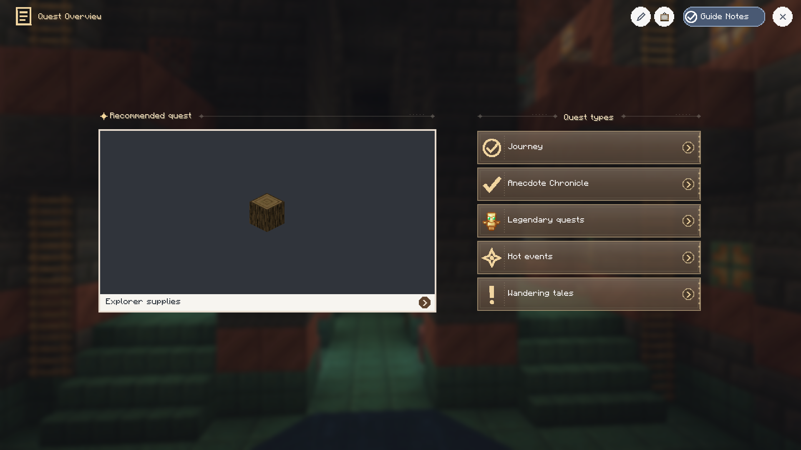

In author mode, right-click a task for grouped operations such as properties, conditions,
rewards and relationships. Menu icons identify actions.

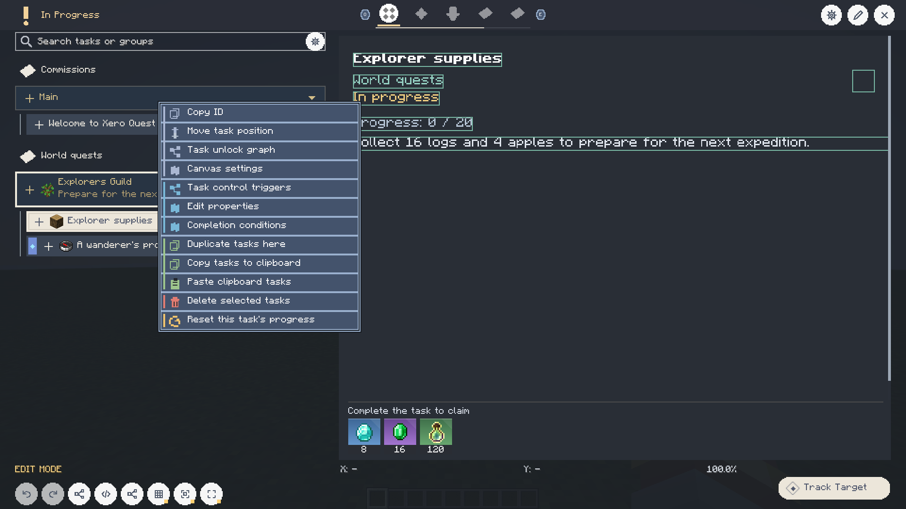

Properties edit the task draft. Save after changing its title, icon or content.
Changing a definition is separate from resetting player progress.

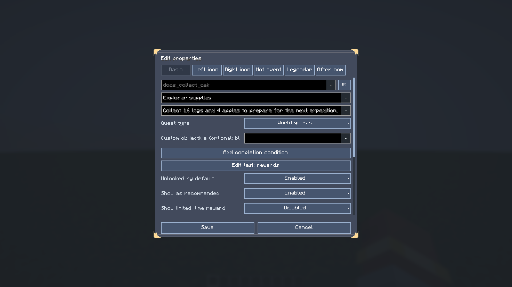

## Search And Filters

The development build combines search scopes and filters in one vertically scrolling panel.
Title, description, subtitle and internal-content scopes can be combined. Close the persistent menu explicitly.

Filters in the same panel narrow supported category, reward and condition metadata.
Selections work with the search query rather than changing definitions.

See [Search and unlock graph](task-search-and-unlock-graph.md) for the new icons, matching logic and minimap.

## Conditions And Rewards

The condition tree chooses type, target, count and supported logical children.
Item conditions, location conditions and scripts have different target formats.

The reward editor configures type, target, count and presentation quality/background.
An item's display quality does not change the real item's attributes.

Claim receipts present received rewards separately from the authoring screen.
A screenshot of a receipt is not a guarantee about every claim/failure path.

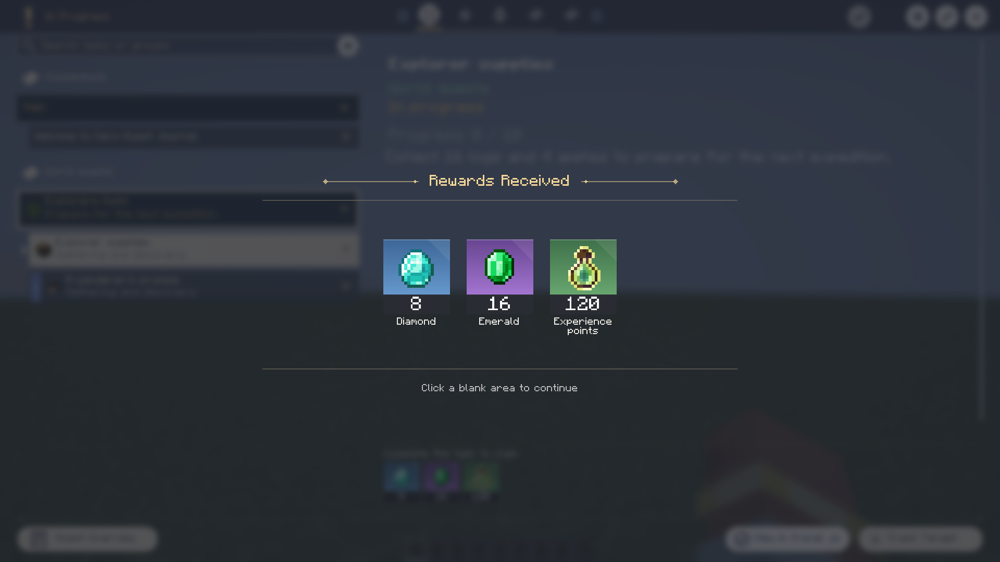

## Loot Tables

Top-left is the stable **ID**, top-right is **display name**.
The value beside random/choice mode is roll count.
Each entry separately configures its item/action, quantity, weight, condition and appearance.
The external icon defaults to a gift.
Each entry can replace the generic choice hint with custom detail text.
Above 10 original entries, contents and selection lists expose a search field.
The detail button inspects without selecting or claiming.

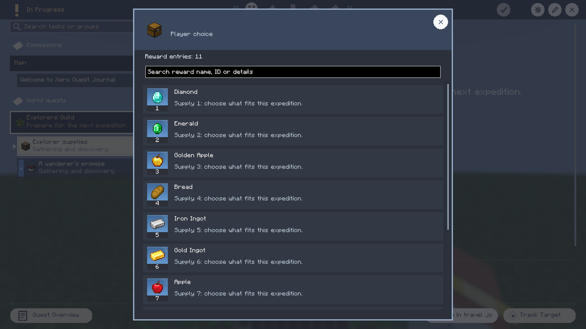

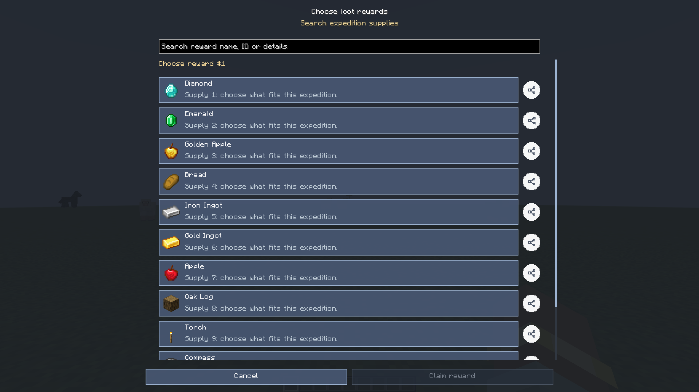

Claimed item cards remain inspectable. XP/level detail panels include a representative icon,
the reward amount and an explanation.

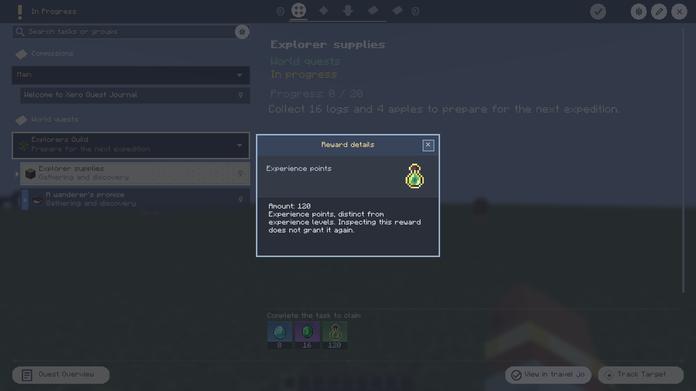

## Mail

Use `F8` or `/xero_quest open mailbox`. Select mail on the left to read the body and bottom attachments.
Claim/delete rules preserve protected unclaimed attachments and favorites where applicable.

The compose editor sets recipients, sender, subject, body, expiry and attachments.
Send/save/export actions have different effects; inspect the action label before committing.

Mail attachments use the shared reward editor and preserve their quality/background presentation.

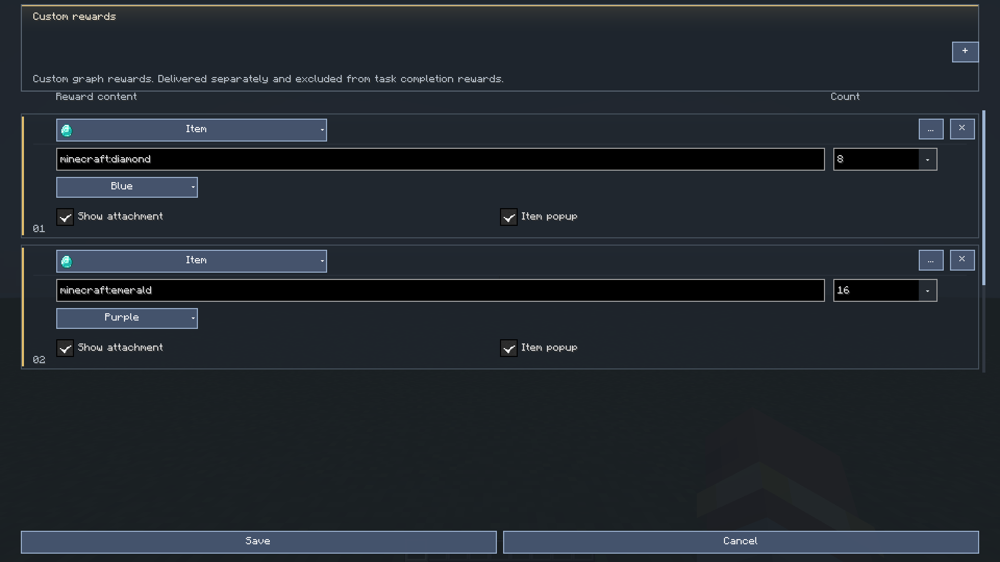

Rich text provides source editing with preview.
Toolbar formatting wraps selected text in tags rather than appending an unrelated tag after it.

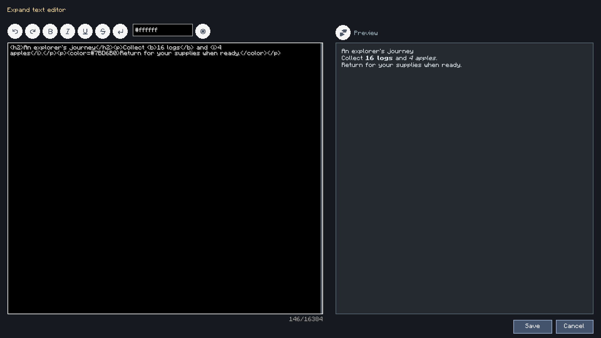

## Journey

Use the overview's journey entry or a task's “View in journey” action.
Tabs select chapters; drag the canvas to browse.
The selected-tab underline defaults to 3px, configurable from 1 to 5 in Appearance settings.

The pencil enters edit mode, the pencil with X exits it, and the checklist selects chapter tasks.
Right-click a chapter/task for supported author actions. Undo/redo have dedicated toolbar entries.

Appearance changes from this entry are chapter-local.
Select one or multiple elements, drag to move, and use width/height/proportional handles.
The left preview reflects the right inspector's draft.

Click a task card to open its details in a popup occupying about 75% of the viewport.
The footer shows the task rewards only; it does not add a redundant “Open task screen” button.
Close returns to the journey.

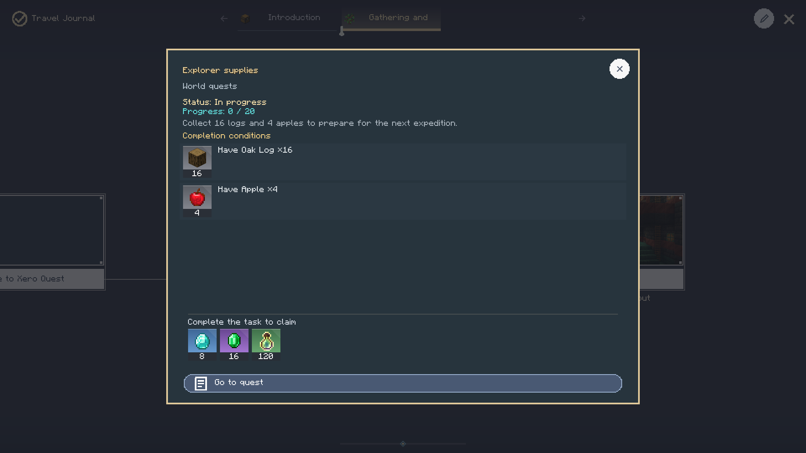

## Anecdotes

`/xero_quest open anecdotes` opens a separate book.
Select an entry on the left and read its multiple records on the right.
Locked/undiscovered entries and their visibility are authored per entry.

Completed records remain available as stickers. The reward page displays completion history;
new stickers use an entry animation and are acknowledged after presentation.
See [anecdote configuration](anecdotes.md).

## Resource Selection

The item picker searches the full result set and renders the visible portion.
Choosing a tile stages selection; Apply commits it. Sorting, metadata and smooth scrolling
remain available. Apply sits immediately left of Cancel at the bottom right; both have
equal compact widths and text padding. The right scrollbar supports thumb dragging and
smooth track navigation.

Texture selection uses the same workflow with resource/image references.

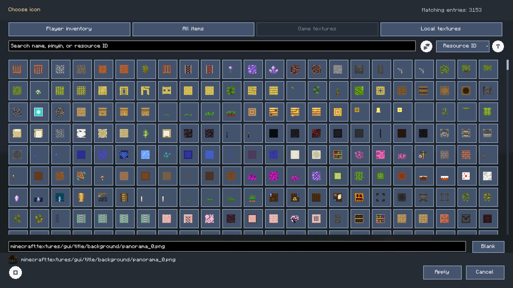

The full-screen preview provides zoom, pan and double-click reset/zoom interaction.

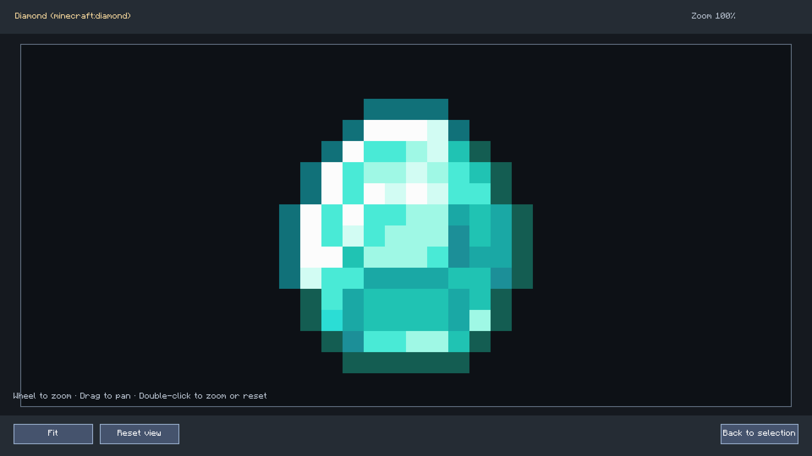

## Graphs And Scripts

The node library groups event, condition and action nodes.
Selecting a node type inserts a graph draft; it does not immediately execute an action.

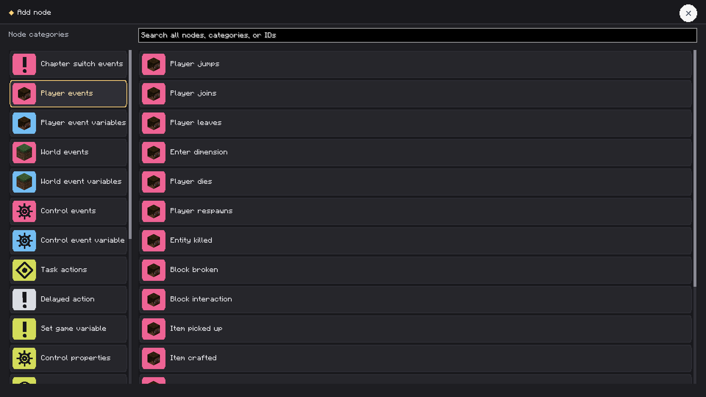

Graph property fields can open typed selectors.
Editable text/script regions support full editor access.

The script editor identifies its execution purpose and offers the matching field reference.
Graph context values are strings; file conditions expose numeric level/coordinates.

Examples are purpose-filtered and append to the existing draft.
Saving checks syntax and does not run rewards. See [all shared examples](javascript.md).

The unlock graph is for task prerequisites, rather than event flow.
Cycles and self-dependencies are invalid.

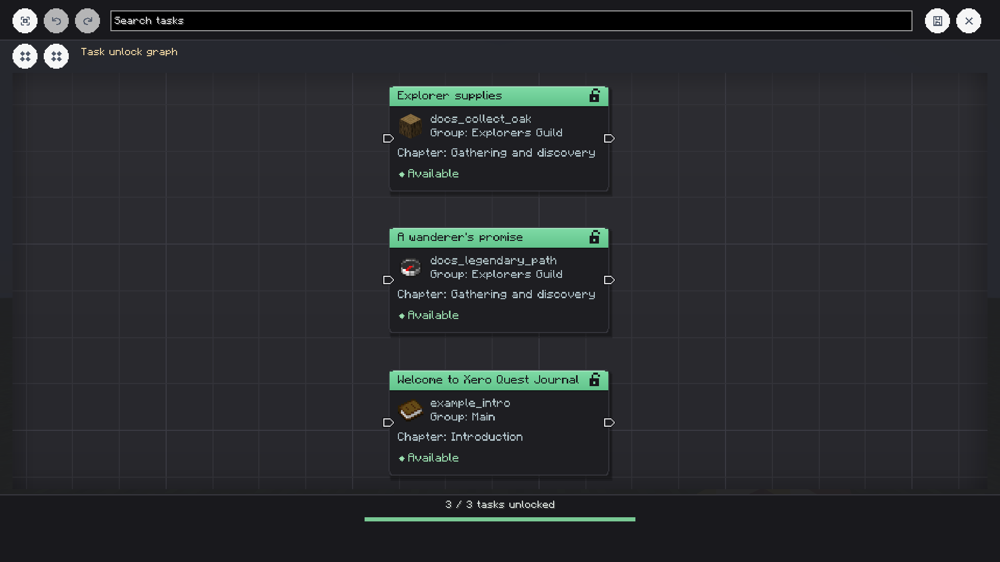

## Variables

The variable catalog identifies values and scopes.
Select task-local/global values deliberately, including sharing and ownership.

The variable editor declares type and sharing.
Use numeric types for visual calculations; string values are not implicit numbers.

## Templates And Locations

Templates start a task draft with reusable content.
Applying a template should be followed by editing and validating the resulting task.

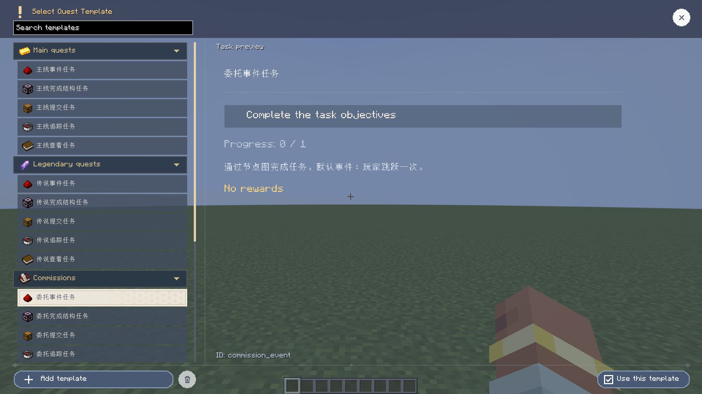

A location may be coordinates, a world structure or a biome.
Keep dimension and coordinate identity together.

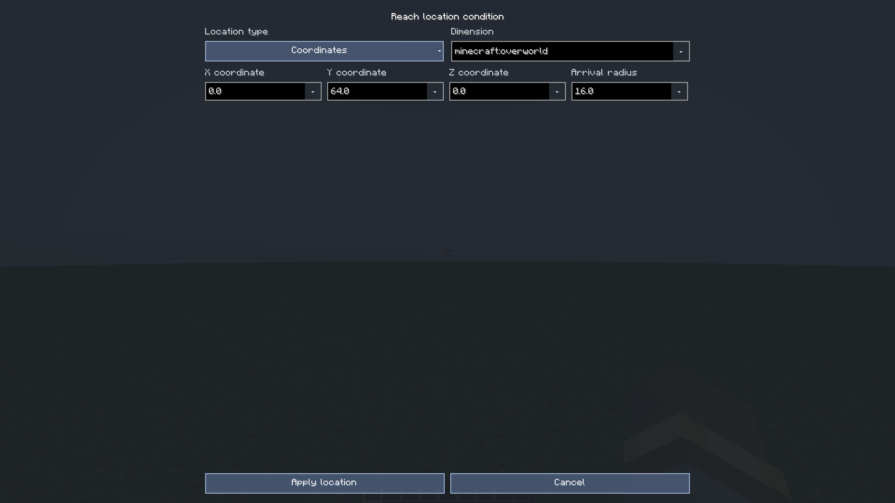

## Structure And Jigsaw Inspection

World structure preview reads actual referenced templates when available.
Left-drag rotates, wheel zooms and middle-drag pans.

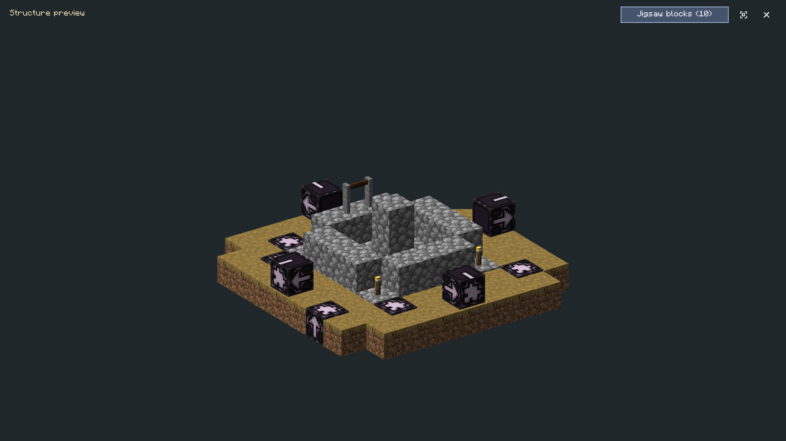

The jigsaw panel lists connectors, highlights selection in gold and displays front/top directions.
Open a connector's pool to inspect candidate templates.

Instructions explain acquisition, connector matching, pool preparation and actual generation.
This viewer does not simulate complete random assembly.

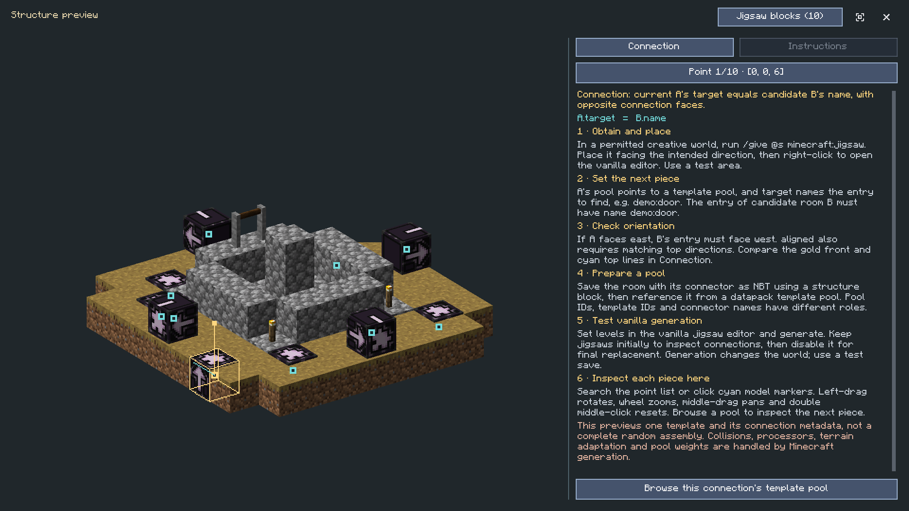

## Background Views

Legendary quests use their own presentation and configured media.

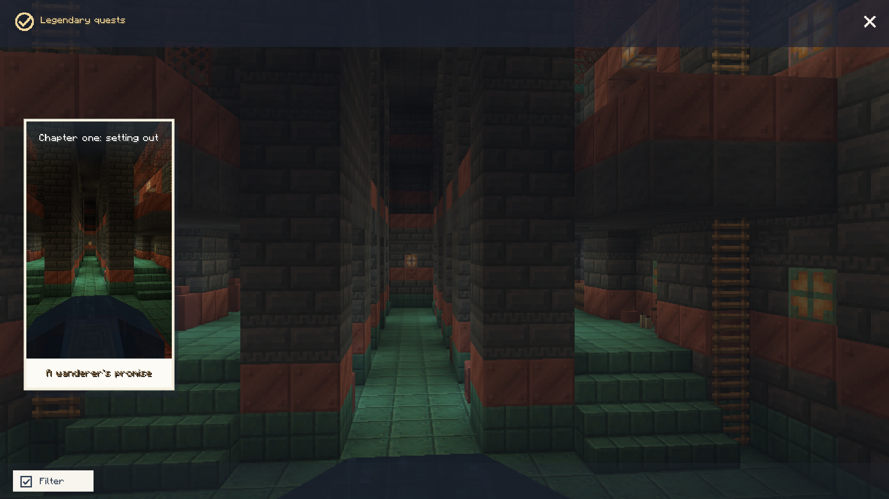

Hot events display linked cards on a movable/scalable canvas.
Backgrounds and music can be authored separately from card layout.

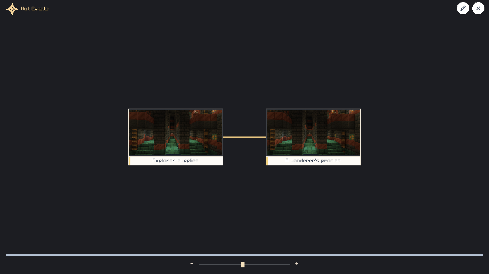

## Candidates And Recycling

Candidate lists are searchable; Add opens the relevant selector.
Adding a value and committing the original field are separate operations.

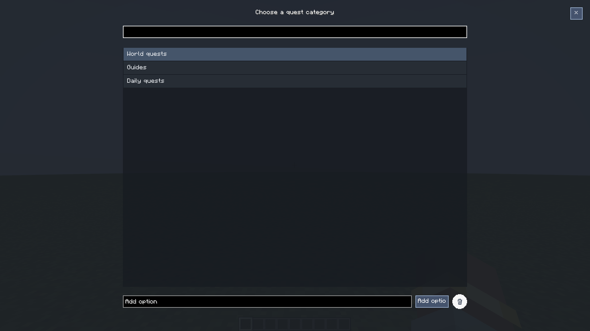

The recycle bin manages custom candidate removals and restoration.
It does not delete Minecraft registry content.

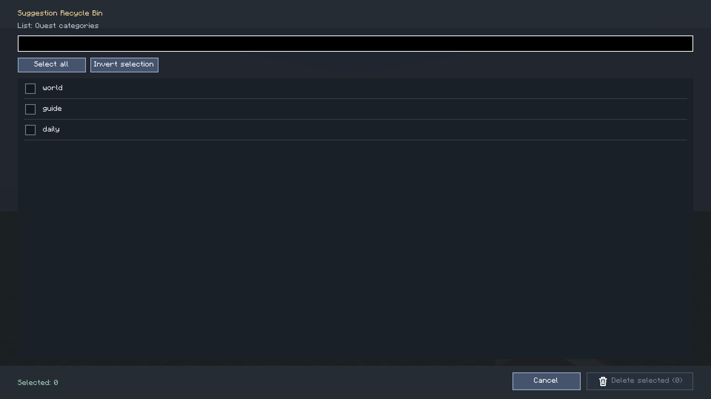

## Settings And Animation

Open `/xero_quest open settings`. Personal settings work without author mode;
server-owned actions retain authorization checks.

Motion options include reduced motion, popup duration and animation editor entries.

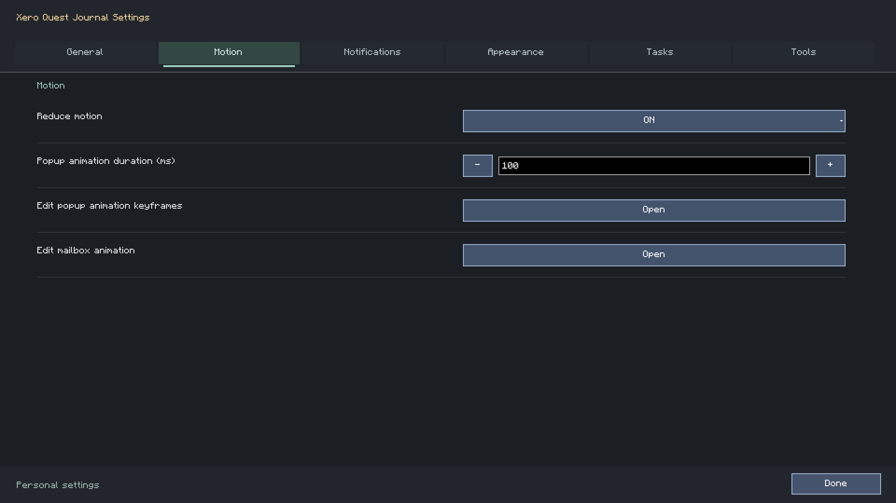

Notification controls adjust overall/icon size and offer a preview.
The pickup notice size setting scales the whole group from 50% to 200%. X/Y position the
scaled group within the usable screen area: X runs left-to-right and Y top-to-bottom.
Zero and 100 align to each axis's ends; defaults are size=100%, X=0%, Y=40%.
Values can be typed or stepped, take effect immediately and are saved locally.
Automatic minimap avoidance reserves a selected corner when Xaero, JourneyMap, VoxelMap or
FTB Chunks is detected. Task tracking and notice groups are placed in priority order and try
other free corners on collision. The corner is a selectable estimate, not a live read of
third-party private HUD settings; disable the reservation if the minimap uses another layout.

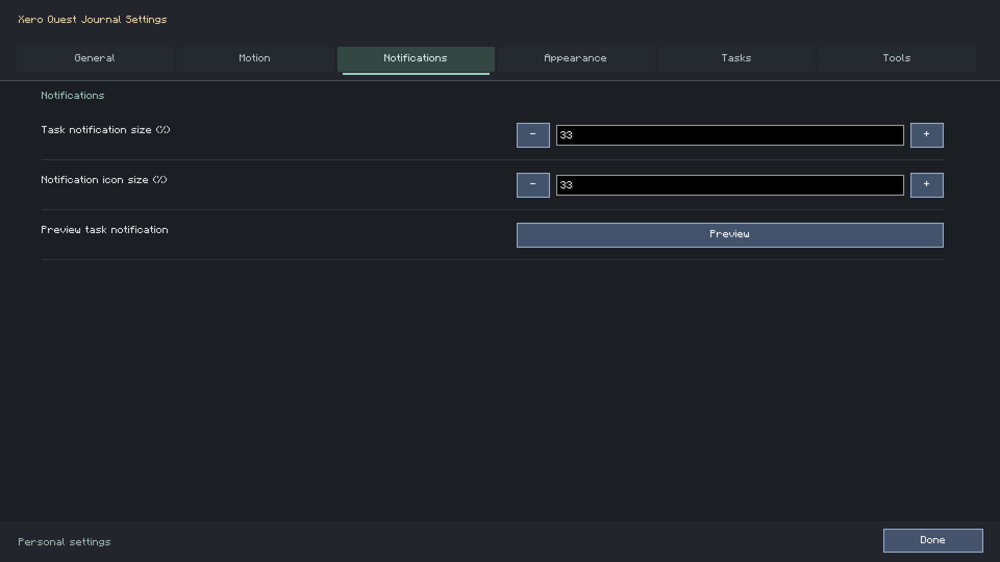

When a tracked item objective gains an item, the HUD shows its icon, localized name, picked
count and objective progress. Up to four notices are visible, newest first; rows slide in,
remain briefly, then fade out. Timers pause while a screen is open.

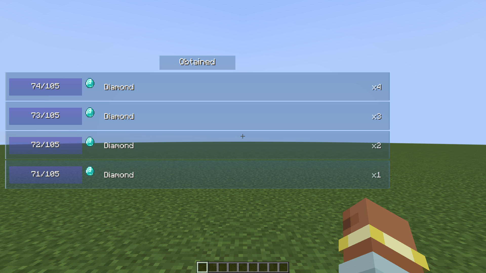

Appearance includes the new selected-tab underline height, tracking marker size,
theme and background controls.

Task settings include pagination, reward sources and context-menu placement.

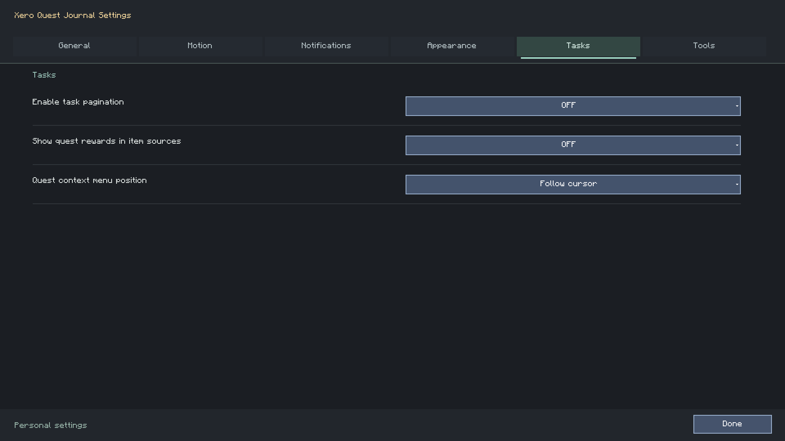

Tools provide key-binding/configuration entries and group-layout reset options.

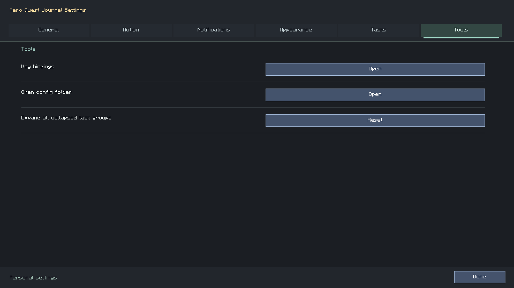

The animation editor exposes keyframes, timeline and property fields.
Preview runs once unless repeat is enabled; default motion uses scale/fade.

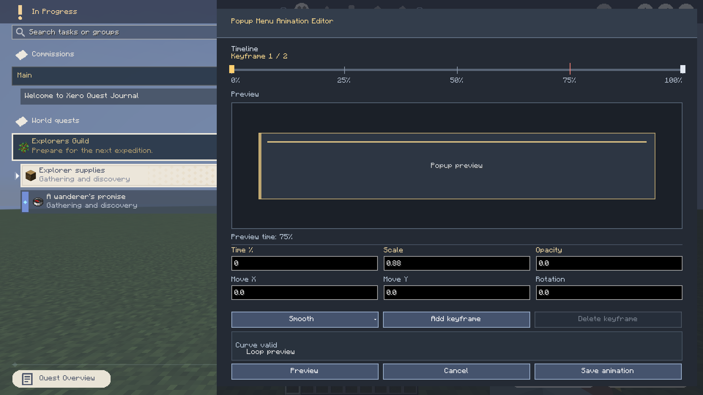

## Inventory Placement

Task/mail entries have independent visibility and relative anchor offsets.
Drag entries in the preview or input values; the top-left anchor uses `(0,0)` at the screen origin.

## Capture And Coverage

Images are captured in the NeoForge 1.21.1 client with shared UI source.
Capture manifests identify scene, locale, dimensions, timestamp, screen class and SHA256.
The [screenshot index](../images/README.md) records reproduction commands.
Screenshots show visible states, not proof that every interaction or platform combination passed.
