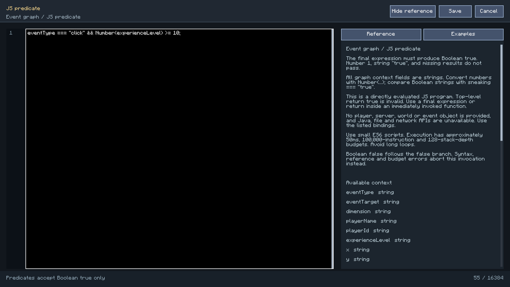
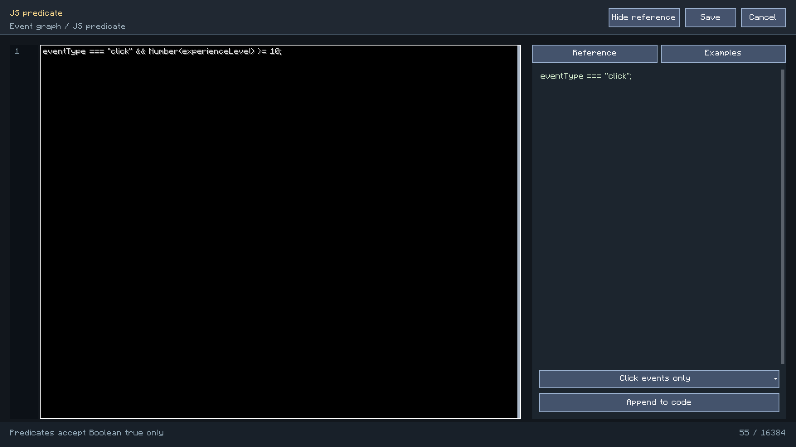

# JavaScript Reference

[简体中文](../javascript.md) | **English** · [Documentation](README.md) · [Predicate nodes](trigger-conditions.md)

The built-in executor uses Rhino 1.7.15 in ES6 mode. Its available data and functions are
defined by this mod. Built-in JS, KubeJS and Minecraft `.mcfunction` rewards are separate environments.

## Choose The Environment

| Use | Editor/target | Stored value | Result rule |
| --- | --- | --- | --- |
| Task script condition | `script` condition, relative `.js` path | File reference | Final value must be Boolean `true` |
| Event-graph JS predicate | JavaScript mode of the predicate node | Inline source in `data.script` | `true` takes the true output; other normal values take false |
| Script reward | `script` reward, relative `.js` path | Source frozen on task completion | Runs reward actions; return value does not complete the task |
| KubeJS action | Dedicated KubeJS execution/editor node | Function name or source, depending on node | Matching KubeJS server environment |
| Minecraft function reward | `function` reward, resource ID | Datapack function reference | Executes `.mcfunction` |

## Final Value And Return

The built-in executor evaluates the program directly. Its last expression supplies the result:

```javascript
experienceLevel >= 10;
```

A top-level `return true;` is invalid. For multiline logic with `return`, use an immediately
invoked function:

```javascript
(function () {
    const correctWorld = dimension === "minecraft:overworld";
    return correctWorld && experienceLevel >= 10;
})();
```

| Final value | Predicate passes? |
| --- | --- |
| Boolean `true` | Yes |
| Boolean `false` | No |
| Number `1` or `0` | No |
| String `"true"` or `"false"` | No |
| `null`, `undefined`, object, array, no result | No |
| Syntax error, undefined variable, budget exception | Error; graph binding stops |

Do not append a non-Boolean-result statement after the intended final expression.

## Paths And Frozen Rewards

Script root:

```text
config/xero_quest/scripts/
  conditions/level10.js
  rewards/welcome.js
```

Enter `conditions/level10.js` or `rewards/welcome.js` in the target field.
Paths must stay under the script root, use `.js`, and satisfy the symlink/path restrictions.
Omit the `scripts/` prefix.

```xml
<conditions>
  <condition type="script" item="conditions/level10.js" count="1"/>
</conditions>
<rewards>
  <reward type="script" item="rewards/welcome.js" count="1"/>
</rewards>
```

Script reward count must be 1. Completion freezes validated source for that reward record.
Editing the file later does not rewrite the historical frozen reward.

## File Condition And Reward Globals

These are direct globals:

| Variable | Type | Meaning |
| --- | --- | --- |
| `playerName` | string | Current player's name |
| `playerId` | string | UUID |
| `dimension` | string | Dimension resource ID |
| `x`, `y`, `z` | number | Current coordinates |
| `experienceLevel` | number | Experience level, not total XP points |

There is no exposed `player`, `server`, `world` or `ctx` object.
Calls such as `player.getHealth()`, `Java.type()`, `require()`, `fetch()` and DOM APIs are outside
this API. File conditions do not receive extra graph fields such as `health` or `sneaking`.

## Graph Context Values Are Strings

Graph context overrides same-named common globals, so graph `experienceLevel`, `x`, `y` and `z`
are also strings.

```javascript
Number(experienceLevel) >= 10;
```

Compare Boolean strings explicitly:

```javascript
sneaking === "true";
```

`"false"` is a nonempty string and is truthy in an ordinary JS `if`.
Returning it still fails this mod's strict Boolean predicate rule.

| Group | All injected graph fields |
| --- | --- |
| Event | `eventType`, `eventTarget` |
| Player | `playerName`, `playerId`, `experienceLevel`, `x`, `y`, `z`, `health`, `maxHealth`, `foodLevel`, `sneaking`, `sprinting` |
| World | `dimension`, `dayTime`, `gameTime`, `raining`, `thundering`, `difficulty` |
| Task/control | `questId`, `controlId`, `controlKind`, `controlValue`, `controlX`, `controlY`, `controlWidth`, `controlHeight` |
| Pointer | `mouseX`, `mouseY`, `mouseWidth`, `mouseHeight`, `mouseHeld`, `mouseInside` |
| Locate context | `locatedX`, `locatedY`, `locatedZ`, `locatedDimension`, `locationFound` |

Unavailable data can be `""`. Check `locationFound === "true"` before interpreting locate coordinates;
`Number("")` is 0. Pointer fields belong to relevant control events.
`eventTarget` may be empty for a click.

Custom variables are not automatically JS globals, and there is no `variables` object.
Use a variable predicate or supported visual variable slot, respecting task/global scope.

## False Results And Errors

A normal non-`true` result continues through the false port.
An exception, undefined variable or budget violation propagates to graph execution, stops the
current binding, logs `Control trigger failed`, and delays that binding for about 200 game ticks.
It does not automatically execute the false branch.

For a missing optional value, test for its availability rather than using exceptions as a condition.
See [predicate nodes](trigger-conditions.md) for once flags and event cooldowns.

## Reward-Only Actions

| Function | Behavior |
| --- | --- |
| `message(text)` | Sends a message and returns `true`; text argument up to 4096 characters |
| `command(text)` | Executes one Minecraft command as the current player context at permission 2; returns success |

Read-only conditions and graph JS predicates do not receive these functions.
Use a command action node when the graph needs to run a command.

```javascript
message("Congratulations, " + playerName + "!");
if (!command("say Quest reward claimed")) {
    throw new Error("Reward command failed");
}
```

Side effects already produced before a failure are not rolled back.
The reward system keeps receipts and avoids blindly retrying non-idempotent actions.
Review `/xero_quest reward receipts` before administrator acknowledgment;
`acknowledge` confirms an existing receipt and does not reissue its reward.

## KubeJS

The optional bridge enters a separate KubeJS server scope.
The editor node wraps source in `function(event) { ... }`, where a function-level `return` is valid.
The event object uses the graph context's field names and string values.

Define in `kubejs/server_scripts/xero_example.js`:

```javascript
global.onXeroQuestAction = function (event) {
    if (event.eventType === "click") {
        return event.questId;
    }
};
```

The execution node takes `global.onXeroQuestAction`, without `()`.
The KubeJS editor node can contain:

```javascript
global.onXeroQuestAction(event);
```

The bridge targets the KubeJS 2101 server API and requires a matching installed mod.
Third-party compatibility across all 1.20.1/Fabric combinations was not verified.
A successful built-in predicate is not evidence that KubeJS integration passed.

## In-Game Editor

Typing an identifier or `.` opens suggestions below the code field in a separate region,
with types or function signatures. The list scrolls without covering the code or status bar.
Click and release inside the same candidate to apply it; focus stays in the code field.

| Operation | Input |
| --- | --- |
| Apply selected candidate | `Tab` |
| Select another candidate | `Alt+Up/Down` |
| Request suggestions explicitly | `Ctrl+Space` |
| Dismiss current suggestions | `Esc` |
| Undo / redo edits and completion | Toolbar buttons, `Ctrl+Z`, `Ctrl+Y` or `Ctrl+Shift+Z` |

Plain arrow keys, Enter, text selection and clipboard operations continue to edit text.
Completion replaces the whole identifier at the caret, including an existing suffix, while
preserving surrounding code. An insertion over the character limit is rejected without truncation.
Undo/redo restores the caret and selection as well as the text.

Candidates distinguish graph predicates, condition files and rewards; `message` and `command`
are offered only for rewards. KubeJS offers this bridge's string-valued `event` fields,
`global` members and logging methods. This is not a complete KubeJS/ProbeJS type database
and does not inspect other script files or execute server scripts.

Background Rhino parsing recognizes lexical declarations, parameters, object literal properties,
simple aliases and common Math/JSON/string/array members. Comments and string contents do not
trigger code suggestions. Dynamic properties, function return types and third-party extensions
may remain unknown. Results from earlier text/caret positions are discarded.

The header identifies the script's purpose. Reference and Examples panels match that environment.
Append Example keeps the existing draft and rejects overflow rather than truncating it.
Use `Ctrl+S` to save; saving checks syntax without executing a reward.

Code, reference and status have separate clipping/scroll regions. Narrow windows can toggle
reference visibility. Resizing preserves the draft. File saves retain their relative path
and check source fingerprints to avoid overwriting external edits.
Graph source updates a graph draft; save the owning graph/task as well.

The focused real-client regression runs on Java 21 / NeoForge 1.21.1:

```powershell
.\gradlew.bat runClient -PscriptCompletionTest --offline --console=plain
```

It covers contextual candidates, locals/properties, literals/comments, caret replacement,
editing and history, asynchronous stale results, press/release, character limits and compact layout.
This verifies the editor, not execution by an installed third-party KubeJS mod.





## Limits

| Resource | Bound |
| --- | --- |
| Inline node source | Up to 16,384 characters per data value |
| Script file | Up to 64 KiB, also subject to the 65,535-byte modified UTF-8 string bound |
| Instruction budget | About 100,000 instructions, checked every 1000 |
| Time budget | About 50 ms, cooperative; external commands are not forcibly preempted |
| Interpreter stack depth | 128 |
| Execution | Server thread; nested entry into the built-in executor is rejected |

Use short expressions/functions and the syntax supported by this Rhino ES6 configuration.
The executor is not a general-purpose host for untrusted author code.

## Troubleshooting

| Symptom | Check |
| --- | --- |
| Predicate always false | Final value is Boolean `true`, with the correct field types |
| `experienceLevel === 10` fails in a graph | Convert the graph string with `Number(...)` |
| Sneaking appears always true | Compare to `"true"` |
| `return` syntax error | Use a final expression or an immediately invoked function |
| `player is not defined` | Use documented globals |
| `message is not defined` | Current environment is read-only |
| Neither branch runs | Server error log, eligibility, cooldown and saved connections |
| Only the first click works | Check event once, predicate once and action once independently |
| Reward still uses old code | It may already hold a frozen completion-time source snapshot |
| File save fails | Permission, path, syntax, length and fingerprint conflict |

## Shared Example Catalog

These exact sources are shared with the in-game reference. Built-in examples have historical
server evaluation coverage. The KubeJS example is a usage pattern requiring a compatible
third-party environment. The documentation refresh validates source parity, not a rerun of
every historical integration.

<!-- SCRIPT_EXAMPLES_START -->

### Graph predicate / click

```javascript
eventType === "click";
```

### Graph predicate / level_graph

```javascript
Number(experienceLevel) >= 10;
```

### Graph predicate / region_graph

```javascript
dimension === "minecraft:overworld" && Number(y) >= 64;
```

### Graph predicate / sneaking

```javascript
sneaking === "true" && Number(health) < Number(maxHealth);
```

### Graph predicate / function_graph

```javascript
(function () {
    const level = Number(experienceLevel);
    return eventType === "click" && level >= 10;
})();
```

### Graph predicate / pointer

```javascript
eventType === "hold" && mouseInside === "true";
```

### Graph predicate / located

```javascript
locationFound === "true" && locatedDimension === dimension;
```

### Condition file / level

```javascript
experienceLevel >= 10;
```

### Condition file / dimension

```javascript
dimension === "minecraft:overworld";
```

### Condition file / region

```javascript
dimension === "minecraft:overworld" && x >= 0 && x <= 100 && z >= 0 && z <= 100;
```

### Condition file / function

```javascript
(function () {
    const correctWorld = dimension === "minecraft:overworld";
    return correctWorld && experienceLevel >= 10;
})();
```

### Reward file / message

```javascript
message("Congratulations, " + playerName + "!");
```

### Reward file / command

```javascript
if (!command("say Quest reward claimed")) {
    throw new Error("Reward command failed");
}
```

### Reward file / reward_branch

```javascript
if (experienceLevel >= 10) {
    message("Level requirement met");
} else {
    message("Reward received");
}
```

### KubeJS action / kubejs

```javascript
if (typeof global.onXeroQuestAction !== "function") {
    throw new Error("Define global.onXeroQuestAction in kubejs/server_scripts first");
}
global.onXeroQuestAction(event);
```

<!-- SCRIPT_EXAMPLES_END -->

## Implementation

[Executor](../../src/main/java/xtdpotato/xero_quest_journal/core/runtime/QuestScripts.java) ·
[Event context](../../src/main/java/xtdpotato/xero_quest_journal/core/runtime/QuestEventGraphs.java) ·
[Visual predicates](../../src/main/java/xtdpotato/xero_quest_journal/core/runtime/QuestVisualPredicate.java) ·
[Reward execution](../../src/main/java/xtdpotato/xero_quest_journal/core/runtime/QuestRewards.java)
