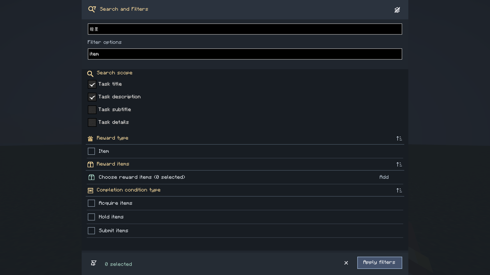
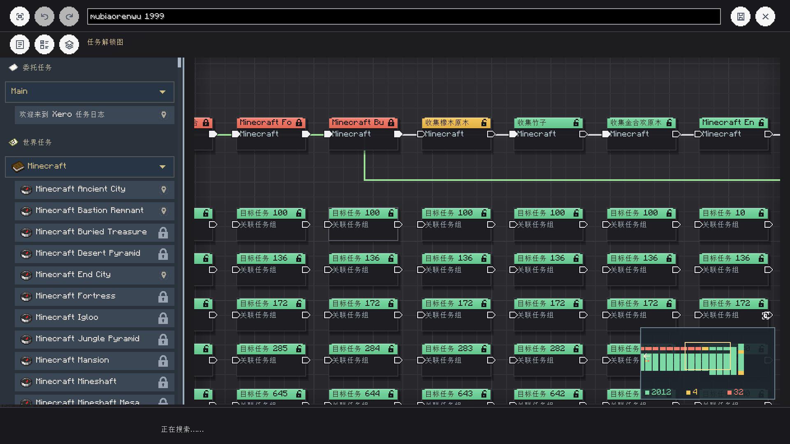
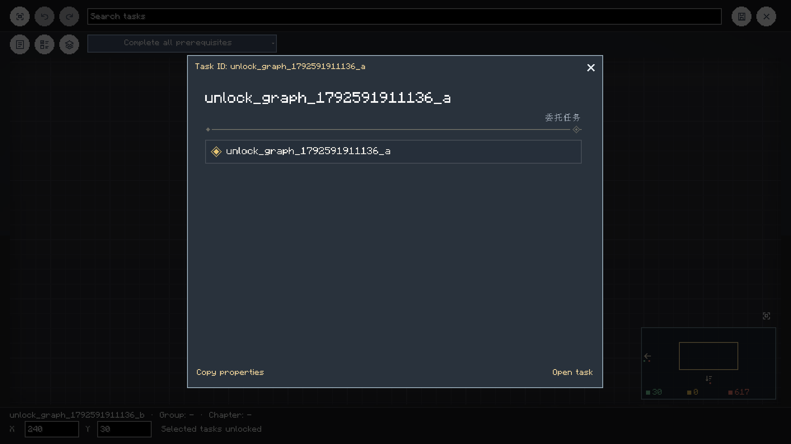
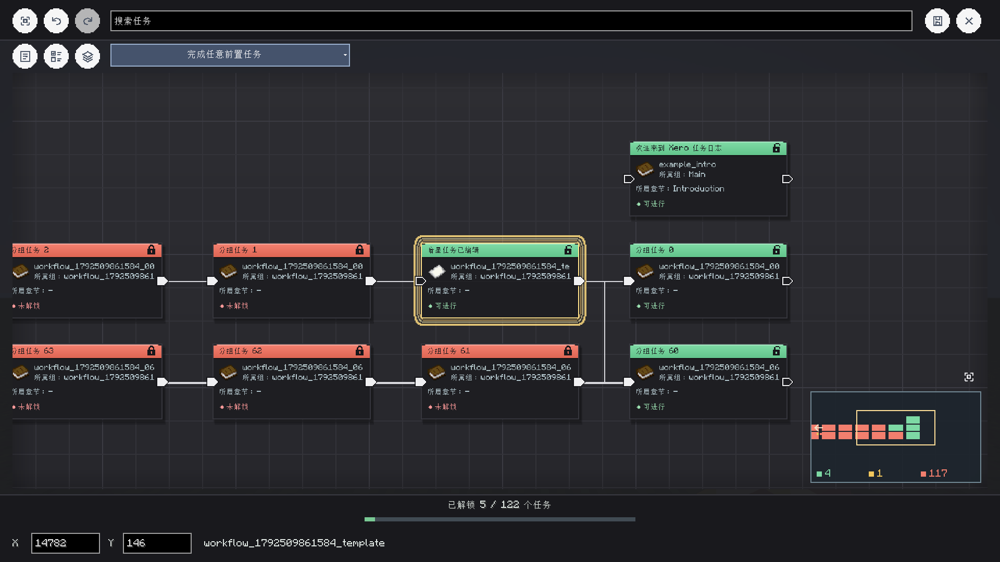
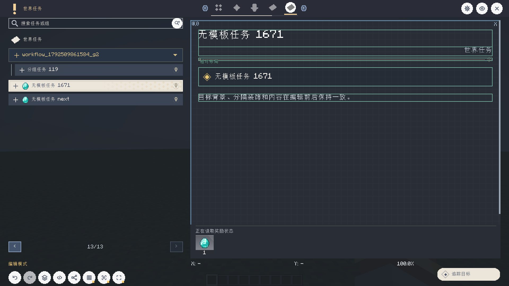

# Search, Filters And Unlock Graph

[简体中文](../task-search-and-unlock-graph.md) | **English** · [Documentation](README.md)

These changes are in the local development build. The existing GitHub 0.2.2 release does not include them.

## Shared Search Panel

Open the magnifier/funnel button beside task search. Task search and filter-option search stay at the top;
search scopes and grouped filters share one vertically scrolling area below. There is no separate filter page.

- Select title, description, subtitle and task-detail search scopes. Title and description are enabled by default.
- Options within one filter category match with OR; different enabled categories match with AND.
- Filter-option search matches names, IDs and available pinyin indices.
- Item/target pickers add specific filter values and return to the existing draft and scroll position.
- The list scrolls smoothly and has a draggable rail. Scrolled-out options cannot cover the fixed toolbar.
- The clear-funnel tool resets filters. **Apply and close** saves scopes and filters and returns to the task list.
- Each filter section can collapse independently. The top tool collapses/expands all sections without losing selections.
- The bottom Cancel icon or Esc discards drafts and restores the original search text. Clicking outside keeps the panel open.



## Tool Icons

| Action | Icon |
| --- | --- |
| Show/hide task control list | Layers / layers with a slash |
| Preview an edited task | Eye |
| Search scopes and filters | Magnifier with funnel |
| Reset filters | Funnel with a clearing arrow |
| Unlock-graph task drawer | List |
| Unlock-graph multiple selection | Selection list with an active highlight |
| Close window | Shared close icon |

Hover tools for their action labels. Hiding the control list keeps the task screen open.

## Layout And Prerequisites

Default placement uses one row per task group, falling back to task type for ungrouped tasks.
Prerequisite depth orders tasks from right to left; very long groups continue on another row.
Saved manual positions remain until **Arrange by groups** is used. Arrangement, links and prerequisite-mode
changes support undo/redo; use Save to write the final draft.
Drawer animation keeps the canvas in place. Rebuilding tools preserves zero camera offsets; automatic fitting
only happens on the first opening or when explicitly requested.

Select a task and choose **Complete all prerequisites** or **Complete any prerequisite** at the top.
In multiple-selection mode the choice applies to the selection. Task properties expose the same setting.
Existing/new tasks default to all. The server still rejects self-links, cycles and missing task references.

Double-click a node or choose **Open task** from its context menu to inspect that task, including locked tasks.
Returning preserves the graph draft and camera. Properties shows the actual task content, objectives and rewards,
with smooth scrolling and an Open task action.

JSON stores the setting in `completionPolicy.prerequisiteMode`, with `"all"` or `"any"`.
For XML/HTML, set the root attribute, for example `<quest id="example" prerequisite-mode="any">...</quest>`.
Tasks without prerequisites retain their default-unlock switch; explicit locks/unlocks retain precedence.

Graph search uses a 120ms debounce and background pinyin indexing. Existing results stay visible while a query runs;
stale results cannot replace the latest query. Search covers task titles, IDs, descriptions, groups and chapters.
The drawer reuses journal categories, grouped rows and icons with visible-row rendering. Group collapse records are
shared with the journal; search temporarily expands matching groups and clearing it restores saved folding.
The compact footer shows the selected task's title, group and chapter; the unlocked-progress bar was removed.



The task-properties popup sizes itself to the task canvas and content. Long content scrolls smoothly inside the panel,
avoiding a wide empty area; the reward section remains anchored at the bottom.



The bottom-right minimap follows canvas wheel zoom and centers on the current area, showing nearby tasks and a yellow viewport rectangle.
Both use one uniform projection, preserving the visible canvas aspect ratio.
Markers share the main graph's state rules and colors: green available, yellow complete, red locked.
Every task participates, including offscreen nodes. Dense overlaps retain all state bits and use interleaved color pixels;
the footer and hover summary show counts for each state. State changes invalidate the cached raster.
Directional arrows mark tasks outside the local map; hover for counts. The fit button above the minimap switches
to a complete overview. Click it again or use the wheel to resume synchronized zoom. Every task participates;
dense overview pixels can overlap while counts stay complete.
Click or drag to navigate. Minimap tooltips are suppressed while dragging. Holding near an edge continuously shifts
the projection so navigation can extend beyond task bounds. Release preserves the position without recentering;
explicit zoom, fitting or canvas panning resumes the following projection. Overview bounds also include the viewport.



Rendering culls offscreen nodes/links and caches labels and minimap points.
Small nodes retain readable titles. Ordinary links use static orthogonal spans; only the selected link animates.
Tool surfaces, node shapes/text/ports, grid and links use batched drawing. A 1202-task benchmark covers stationary,
panning and zooming scenes at native 1080p; see the [raw performance report](../reference/unlock-graph-performance.json).
Ryzen 9 9950X3D / RTX 5070 Ti, GUI scale 2, NeoForge 1.21.1 development client, VSync off, animations enabled,
world rendering included, 5 seconds warmup and 10 seconds sampling per scene. Average FPS exceeds 120 after batching;
occasional slow frames remain, and this is not a minimum guarantee for all machines.

Latest measurement on 2026-10-20: stationary **516.2 FPS**, panning **177.7 FPS**, continuous zoom **172.7 FPS**.
P99 frame times: **7.77 / 11.68 / 11.73ms**; 1% lows: **110.4 / 80.0 / 69.8 FPS** respectively.
Panning and zoom still miss the sustained 120 FPS target despite their higher averages.
Runs vary; the raw report retains the latest run rather than selecting the highest result.

Run `runClient -PtaskWorkflowTest -PunlockGraphPerf` to measure; add `-PunlockGraphProfile` for optional JFR sampling.
The benchmark automatically pans/zooms. Manual input cancels automation, preserves camera/draft and prevents
later automated clicks or saves. Benchmark classes are excluded from production JARs.

## Templates And Objective Rows

Objective rows have a white hover outline in player mode and still open completion details on click.
Editing properties or saving an individual task preserves template controls and dividers without modifying
the shared template. A template reward control suppresses the duplicate automatic reward footer.

Tasks without templates use editable native controls too. Edit and preview preserve objective backgrounds,
diamond progress, type labels and ornamental dividers; legacy automatic layouts receive missing controls.
The editor grid draws above the panel background and below controls, with a toolbar visibility toggle.



## Claims, Notices And Pagination

- Claim buttons retain their red circle with a smaller footprint aligned with adjacent icons. Claiming requires release inside the button.
- After a successful individual claim, Completed opens with the same task selected. W/S selects previous/next tasks without intercepting text editing.
- J opens the current new-task notice; ~ dismisses only that notice. V remains coordinate guidance. Mark all read also clears queued new-task notices.
- Status toasts render above reward items and checkmarks.
- Settings → Notifications → Visual notice layout independently adjusts each notice's text size (50–200%), unaffected by overall scaling. Long task/item names are clipped to the available width, with a reserved gap after the icon.
- Drag the minimap avoid-area corner handle in the preview to resize it, or set width/height numerically from 5–50%. Automatic HUD avoidance uses these dimensions. The editor header is shorter and its fixed bottom band was removed.
- Settings → Tasks → Tasks per page accepts 10–1000, default 50. Save persists the value on the server and requires author permissions. The server `config.json` field is `tasksPerPage`.
- Network protocol is now 13; update server and client together. Use the visual HUD layout editor for notification previews; the obscured standalone preview button was removed.
- Compact item notices follow the tracked acquire/hold/submit objective. Successful submission shows the actual submitted amount; failed submissions and unrelated items do not notify. New rows animate independently, retaining the latest four. See [generation, templates and notice layout](generation-and-template-library.md).

## Verification

```powershell
.\gradlew.bat runClient -PtaskWorkflowTest --offline --console=plain
.\gradlew.bat runClient -PunlockGraphTest --offline --console=plain
.\gradlew.bat runClient -PgenerationTest --offline --console=plain
```

The NeoForge 1.21.1 client checks edit/save/reopen, preserved controls, white hover pixels, unchanged shared templates,
reward deduplication, all/any prerequisites, undo/redo, viewport culling, minimap aspect/navigation, and combined search
in Chinese, English and a compact window. The unlock suite also checks wiring, cycle rejection and 1200-node bounds.
These are targeted checks, not exhaustive feature or cross-loader interaction coverage.
The generation suite also checks 2000-task background pinyin search, stale-result rejection, shared folding, selected
task metadata, continuous minimap edge navigation with no release jump, and acquire/submit notices. Search edit handling
measured about 0.045ms in that run; this is not whole-frame time or a minimum FPS guarantee.
The task suite also checks cancel/collapse, native editor controls, grid toggles, post-claim selection, W/S,
graph task navigation/properties, J/~ and notice queues, toast occlusion pixels, and page sizes 10/1000 with protocol bounds and round trips.
