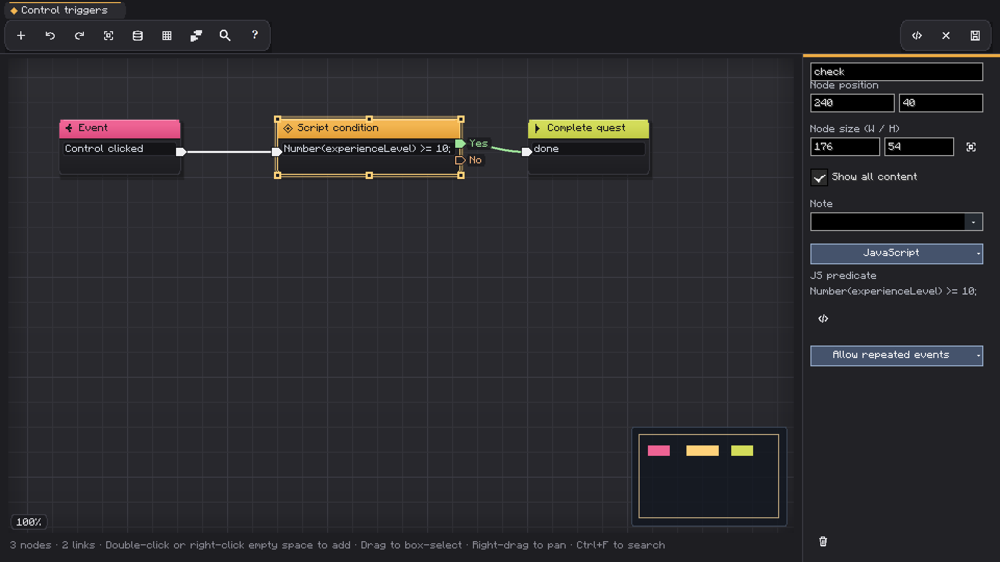
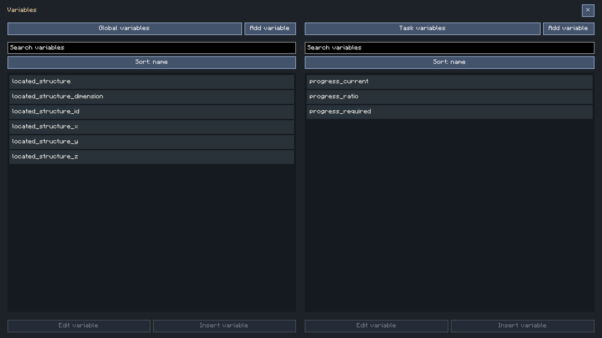
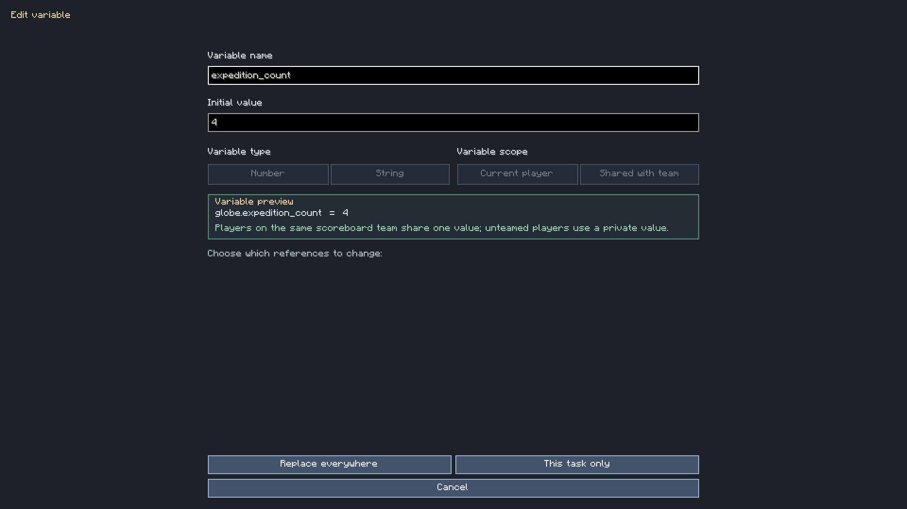
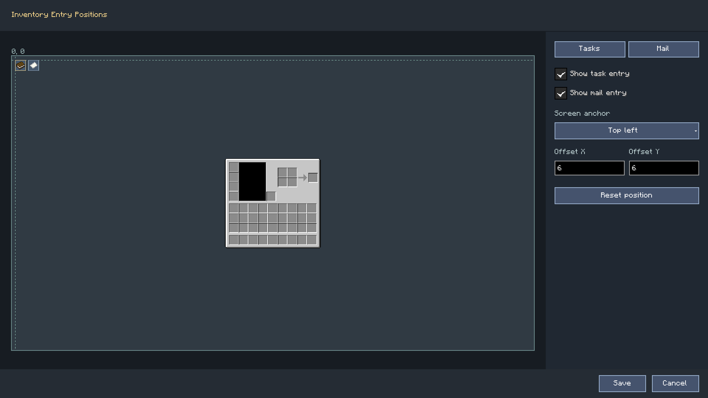

# Visual Fields, Variables And Inventory Shortcuts

[简体中文](../visual-graph-and-inventory-shortcuts.md) | **English** · [Documentation](README.md)

## Search And Edit Node Fields

Click a supported node/property value to open its typed selector.
Item fields use the shared item/image picker; world structures use the location selector;
imported NBT files use the structure library. Search supports IDs, names and supported pinyin indexing.

Selecting a resource highlights it; Apply commits it.
“Add candidate” adds to the candidate list rather than immediately overwriting the source field.
The recycle bin manages custom candidate visibility; it does not unregister game items.

Double-click an editable script/text block to open its full editor.
The show-all checkbox controls whether the node displays the full editable content.
Long text can be edited without fitting it into a narrow node.

## Ownership Matters

A dragged variable-like field preserves what it belongs to.
For example, experience level can refer to the current player or an explicitly selected player/selector.
Check the displayed owner before using a setter; a numeric name alone does not identify whose value changes.
Only contexts with an implemented writable field can be changed by the corresponding setter.

## Custom Variables And Math

Variables have IDs, types and scope/sharing.
Task-private values and global values are distinct; the serialized global scope is `globe`.
Team sharing uses the project's supported team identity rather than assuming every third-party
party mod is integrated.

Numeric calculation nodes require finite numeric values.
Supported operations include:

| Group | Operations |
| --- | --- |
| Arithmetic | `add`, `subtract`, `multiply`, `divide`, `modulo`, `power` |
| Trigonometry | `sin`, `cos`, `tan`, `asin`, `acos`, `atan`, `atan2` |
| Roots and magnitude | `sqrt`, `cbrt`, `abs`, `sign` |
| Rounding and bounds | `floor`, `ceil`, `round`, `min`, `max` |
| Exponential/logarithmic | `exp`, `log`, `log10` |
| Angle conversion | `to_degrees`, `to_radians` |

Trig inputs use radians. Division/modulo by zero, negative square roots and non-finite results
are rejected. Use string typing for text; do not use numeric addition as implicit text concatenation.
Custom variables are not automatically available as JS globals.

## Inventory Entry Placement

Task and mail entries have independent show/hide settings.
Open Settings → General → Inventory placement for the visual editor.
Choose an anchor, drag the entry and fine-tune offsets.

The top-left anchor with `(0,0)` means left/top alignment at the inventory screen's origin.
Other anchors align the corresponding edges; offsets are relative to that chosen anchor.
Changing resolution follows the anchor instead of preserving an unrelated absolute pixel position.

When supported JEI/REI/EMI integration is active, dedicated 16×16 task/mail entries avoid a
duplicate native overlay. REI favorites can be added or removed using the integration's controls.
Third-party version and combination coverage is limited; see the compatibility report.
