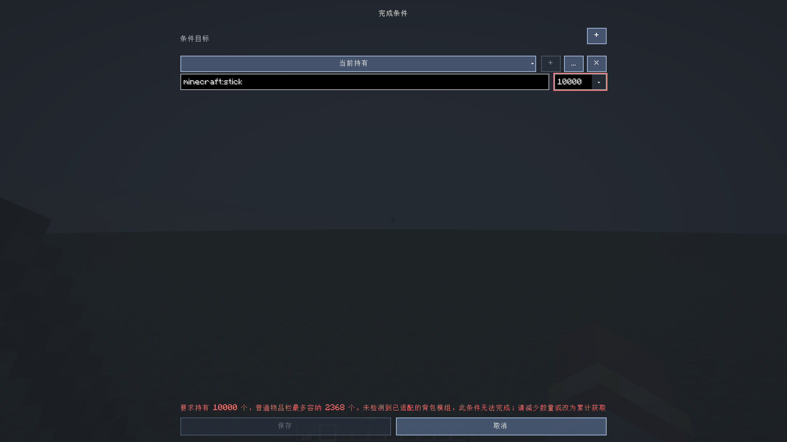
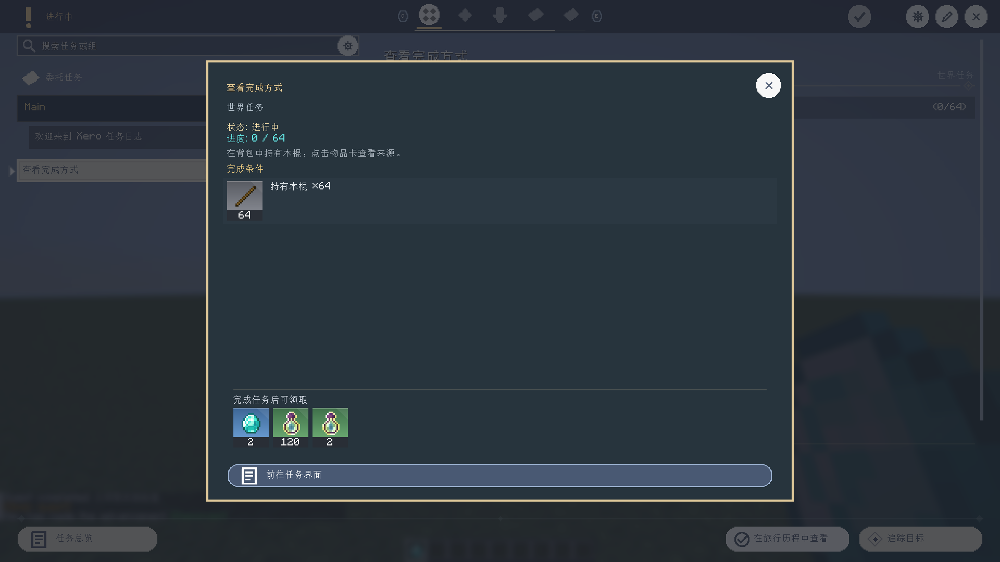

# 自动生成路径、配方奖励与任务条件弹窗验证

日期：2026-10-18，最终验证更新于 2026-10-19。本记录对应 0.2.1 发布后的修复，不替代已发布 v0.2.1 的附件。

## 原因与修复

- 旧 `recipe` 使用解锁深度选择配方；能掉落的物品深度为零，会直接回退经验。
  现在奖励配方独立选择，有可达配方就奖励一轮材料，重复材料合并，无配方物品给予目标物品。
- 初始深度曾把工作台等方块自身掉落当作无需材料的来源。
  现在先解析原材料到产物的配方链，再补充仍不可达的掉落入口。
- 配方前置曾只保留前四种材料，现保留全部不同材料，最多 128 个前置。
- 旧任务重复生成不更新奖励。现在记录 `generatedRewards`、`generatedRewardMode`、
  `generatedRewardMultiplier`，仅在当前奖励与生成基线一致时更新。
  没有基线的旧文件只识别精确匹配的历史难度奖励。
- 旧自身前置的移除结果曾未计入保存判断。现在修复并保存，
  唯一自身前置恢复材料路径；无材料路径的该类任务恢复为可开始的根任务。
  `generatedParents` 保护手工前置，旧默认空前置可补齐。
  新增材料边前检查既有关系，避免经过作者前置形成循环。
- 点击任务界面的目标行或自定义“任务目标”控件，
  打开与旅行历程相同的任务详情弹窗。物品卡可继续检查来源，逐级返回保留任务选择。

## 真实客户端与集成服务器

```powershell
.\gradlew.bat runClient -PgenerateTasksTest -PneoSmokeRunDir=run-generator-recipe-regression --offline
.\gradlew.bat runClient -PrewardInspectionTest -PneoSmokeRunDir=run-objective-inspection --offline
```

生成专项：

- 实际命令依次执行默认 `tier`、再次 `tier`、`all recipe 2`、重复 `all recipe 2`。
- 原版环境生成 1361 个任务、5 个章节、1 个分组；所有任务前置存在且不重复。
- 对全图执行拓扑遍历，并用独立进度逐个检查根任务可开始、前置完成后才解锁。
- 覆盖无来源配方循环、创造专属材料、可达候选材料、掉落与配方并存、
  五种不同材料完整前置，以及经作者关系形成循环时跳过该边。
- 工作台材料奖励为木板 8 个（4 个配方槽位 × 倍率 2）；
  原木无配方时奖励原木 2 个。
- 手改木棍任务的 7 个钻石奖励、标题、说明及热点设置不变。
- 覆盖没有奖励基线的旧文件迁移，以及已修复任务再次仅出现自身前置时的保存。
- 旧文件因加载失败而缺席实时目录时，仍通过生成器所有权、命名空间和条件快照核验后修复。
- 已完成任务保留原 UUID 和冻结奖励；重复生成结果幂等。
- 实际领取生成木板任务的材料奖励，背包增加原木 2 个；重复领取不再增加。

界面专项：

- 普通任务目标 → 旅行历程同款任务弹窗 → 正确物品的来源详情 → 返回弹窗 → 返回原任务。
- 自定义任务目标控件打开相同弹窗并返回原界面。
- 原有已领取任务/邮件奖励、经验/等级图标、战利品、自选搜索专项一并运行。

日志与结果位于本地 `build/verification/`：
`generator-recipe-run.log`、`generated-recipe-unlock-result.txt`、
`journal-objective-inspection-run.log`、`journal-objective-details-result.txt`。

## 构建与范围

四个支持目标：NeoForge/Fabric 1.21.1（Java 21）、Forge/Fabric 1.20.1（Java 17）。
共享逻辑与各平台适配构建；Forge 1.20.1 先于 Fabric 1.20.1。
最终四目标构建均为 `BUILD SUCCESSFUL`；日志为 `final-*-build.log`，
根目标构建也随 `generator-recipe-final.log` 的整图专项运行。

本轮整图与实际发奖测试使用原版 NeoForge 1.21.1 集成服务器。
没有安装 Create、TaCZ 或 LR Tactical，因此不宣称已完整验证这些模组的动态/特殊配方。
配方材料为标准 Ingredient 槽位快照；第三方非标准数量、流体和机器内部隐藏配方
仍取决于其配方接口是否公开。26.x 完整移植和多人远端流程不在本次验收范围。
旧文件手工奖励若恰与历史默认难度奖励完全相同，无法与默认值可靠区分。

## 持有条件与背包容量

`item_hold` / 旧别名 `item_get` 在原版物品栏数量不足时，会只读检查随身/佩戴的背包容器。
适配 Sophisticated Backpacks、Simply Backpacks、Traveler's Backpack 的注册物品能力，
以及 Sophisticated Backpack Inventory Provider/Curios 槽位背包。共享存储按背包 UUID/handler 身份去重，
嵌套深度最多 8、一次快照最多 32768 个条目；持有检查不会打开、修改或扣除容器。

普通 NeoForge 集成客户端 `runClient -PcarriedInventoryTest` 检查原版容量上限、
不可堆叠物品、服务端创建/编辑校验、编辑器禁用保存、可满足的逻辑分支及累计获取。
实际安装 Sophisticated Backpacks 3.26.12 / Sophisticated Core 1.5.14 后，
`runClient -PcarriedInventoryTest -PbackpackIntegrationTest` 验证 10064 根木棍、
共享 UUID 去重、移除背包后回退、胸甲装备槽背包和不消耗内容。

Simply Backpacks 2.1.5 build 51 在 Forge 47.3.0 / Java 17 实测通过相同持有统计、
共享存储去重、移除与佩戴检查。测试发布 JAR 必须通过 ForgeGradle `fg.deobf` 加载；
直接放入开发环境 `mods` 曾产生 `NoSuchFieldError: f_256913_`，重映射后消失。
测试依赖保存在忽略的本地 Maven 路径
`build/verification/test-maven/xero/test/simplybackpacks/2.1.5/simplybackpacks-2.1.5.jar`，
仅启用 `-PsimpleBackpackTest` 时加载，不进入生产包。

```powershell
.\gradlew.bat -p platforms/forge/1.20.1 runClient -PforgeCarriedInventoryTest -PsimpleBackpackTest -PforgeSmokeRunDir=run-carried-simple-test --offline
```

普通与精妙背包结果在根项目 `build/verification/carried-*-result.txt`；
简易背包结果在 `platforms/forge/1.20.1/build/verification/carried-simple-backpack-result.txt`。
未安装 Curios 实测，Traveler's Backpack 的物品能力和 Fabric 存储路径目前仅构建验证。






容量估算按目标物品最大单堆数量和普通可持有槽位计算，不等同于玩家当前空闲空间。
没有识别到支持的背包集成时，超过该上限的持有条件会被创建/编辑端拒绝；
`item_submit` 始终只从玩家物品栏提交，超过普通容量时拒绝。累计目标请使用 `item_acquire`。

## English Summary

Carried-inventory checks use registered backpack item-storage APIs and Sophisticated's player
inventory provider for worn bags. Shared storage identities are deduplicated.

Recipe rewards now select reachable recipe ingredients independently from loot depth, falling
back to the target item for items without a usable recipe. Regeneration updates unchanged
generator-managed rewards and parents while retaining authored edits, progress identities and
frozen completion rewards. Self-parent repairs persist; material edges are not truncated after
four ingredients and cannot close cycles through existing authored dependencies.

The vanilla NeoForge client/integrated-server test traversed all 1361 generated tasks, exercised
real tier-to-recipe commands, legacy repairs, idempotent regeneration and a real one-time item
claim. Journal objectives and authored objective controls open the Journey task popup, support
item/source inspection and return to the original selection.

Builds cover all four supported targets. Third-party modpack recipes and multiplayer gameplay
were not exhaustively tested. These local fixes follow the published v0.2.1 release.

Holding conditions inspect supported carried/equipped backpack storage read-only. Authoring
blocks impossible vanilla-capacity requirements when no supported integration is present;
submission remains limited to player inventory. Real tests passed for Sophisticated Backpacks
on NeoForge 1.21.1 and Simply Backpacks on Forge 1.20.1. The latter needs ForgeGradle remapping
inside the development runtime; the initial obfuscated-field error was resolved by `fg.deobf`.
Chest-slot equipment was tested; Curios, Traveler's Backpack and Fabric storage runtime
combinations have not been fully verified.
