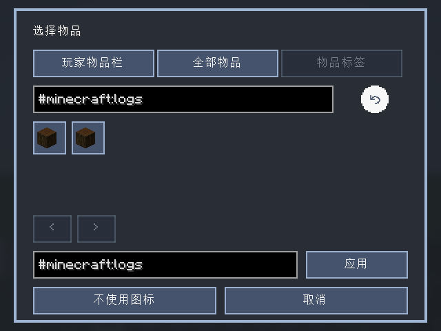
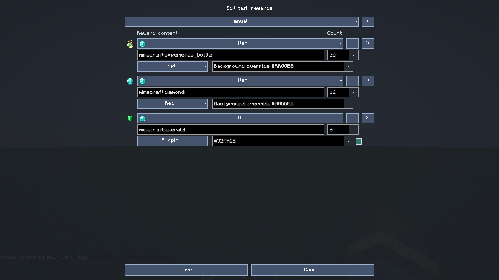
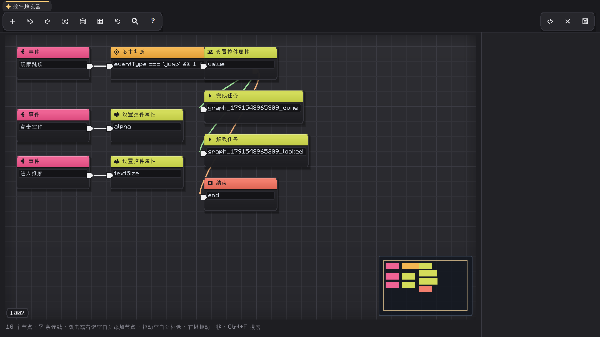
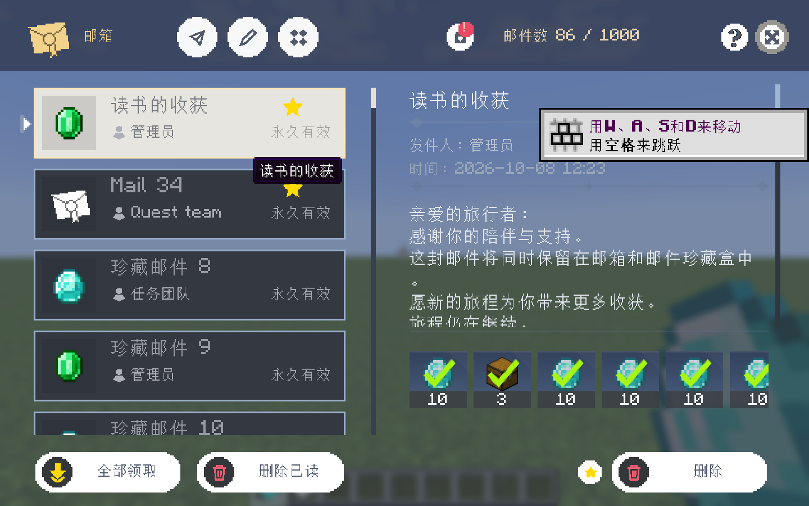

# 玩家与作者使用指南

**简体中文** | [English](en/guide.md) · [文档中心](README.md)

[返回项目首页](../README.md) · [全部命令](commands.md) · [JavaScript](javascript.md) · [判断节点](trigger-conditions.md) · [节点字段与物品栏入口](visual-graph-and-inventory-shortcuts.md) · [奖励和条件参考](奖励与条件配置.md)

常见界面的完整中文 1920×1080 截图、入口和操作见 [界面图鉴](interface-gallery.md)。
已保存的任务修改与删除支持撤销/重做，范围和快捷键见 [任务编辑撤销](task-edit-undo.md)。
当前章节外观、实时预览及背景节点见 [背景与历程编辑](background-and-journey-editor.md)。
候选来源选择、世界结构预览、拼图方块连接属性与数据包房间示例见
[候选与拼图方块教程](candidate-selectors-and-jigsaw.md)。

本指南对应已完成的 1.20.1 Forge/Fabric（Java 17）和 1.21.1 NeoForge/Fabric（Java 21）。
26.x 尚未完成。界面、命令和文件中的任务 ID 是同一个引用体系，编辑前建议同时备份任务目录和世界进度。

## 设置与作者参考

按 `/xero_quest open settings` 打开全屏设置。顶部六个标签共用一个内容区，
标签切换为 100ms；减弱动态或关闭动画时立即切换。窄窗口会将标签内容纵向排列并提供滚动条。

| 标签 | 内容 |
| --- | --- |
| 常规 | 默认日志/总览、物品栏入口、追踪 HUD、物品栏 X/Y 偏移 |
| 动画 | 减弱动态、弹出层时长、独立动画参数编辑器 |
| 通知 | 通知大小、图标大小、真实通知预览 |
| 外观 | 章节选中底条 1–5px（默认 3px）、追踪标记大小、作者主题、传说人物背景 |
| 任务 | 服务端任务分页、任务奖励来源显示 |
| 工具 | 按键绑定、配置文件夹、展开折叠任务组 |

个人设置立即保存在本地，不要求作者模式。服务端分页和作者主题入口需要作者模式与权限 2。
切换设置不会给普通玩家授予编辑服务器任务的能力。


编写脚本前先确认用途：文件条件、事件图 JS 判断和奖励脚本的变量/结果规则有差异。
所有字段、限制和可复制示例见 [JavaScript 参考](javascript.md)；
开始事件、可视化条件、JS 模式与真假连线见 [判断节点详解](trigger-conditions.md)。
游戏内编辑器也内置对应参考和示例，保存只做语法检查，不会试运行奖励。


事件图的字段选取、长按拖出变量、玩家目标/选择器和节点双击快速编辑详见
[节点与背包入口参考](visual-graph-and-inventory-shortcuts.md)。

## 1. 玩家操作

进入世界后按 `J` 打开任务日志，或使用物品栏中的任务入口。顶部标签切换分类，左侧列表负责搜索、展开分组和选择任务，右侧展示当前任务的目标、说明与奖励。


| 状态 | 含义 |
| --- | --- |
| 进行中 | 已解锁，可判定条件或进行任务操作 |
| 未解锁 | 前置或解锁条件尚未满足 |
| 完成、待领取 | 已取得奖励资格，但尚未领取全部奖励 |
| 已领取 | 当前完成记录的奖励已处理 |
| 右上角红点 | 目录中新加入、尚未打开详情的任务 |

红点是“未读”，不是“未接取”。追踪只控制导航与 HUD，也不代表独立的任务接取生命周期。

右上角“领取全部奖励”左侧的勾选图标可把当前玩家的全部新任务标为已读。没有未读任务时禁用；重复点击不会重新领奖或完成任务。

任务已读按钮可清除未读标记，不改变奖励领取结果。

任务较多时，搜索会短暂显示状态图标。文本索引在后台建立，输入防抖后应用最新结果；可以继续输入或清空，不需要等待旧查询结束。

### 追踪与专注

- 在详情中使用追踪按钮选择任务。
- 已完成任务不能新开始追踪；完成时服务端会更新追踪状态。
- 组专注模式把注意力限制到对应任务组，适合按章节推进。
- HUD 显示目标与进度；部分地点目标可显示距离或位置提示。
- 按键和 HUD 开关在游戏控制设置与模组设置中调整。

## 2. 任务与进度存放在哪里

```text
config/xero_quest/
  config.json             全局默认项
  groups/                 任务、组、章节定义
  templates/              任务模板
  task_types/             自定义类型
  scripts/                作者脚本
  structures/             Java NBT 结构与场景设置
  assets/                 作者本地素材
  ui/                     客户端样式、布局和偏好
  unlock_layout.json      解锁图自定义节点位置
```

玩家状态存入世界的保存数据，核心任务完成记录位于：

```text
<world>/data/xero_quest_progress.dat
```

任务定义与玩家进度是两层数据：

- 修改任务说明、图片或奖励定义，不会直接覆盖玩家历史奖励。
- 任务 `uid` 提供稳定的进度身份；更改 ID/UID 前应检查前置、章节、脚本等引用。
- 世界存档不能用客户端 `config` 目录代替；迁移前分别备份。
- 手动复制任务文件后执行重载，检查错误反馈，不要只看文件是否存在。

## 3. 创建第一个任务

1. 在本地集成服务器中开启作弊，进入作者编辑模式。
2. 创建一个任务，设置唯一 ID、标题、类型和归属。
3. 在完成条件编辑器中选择检测类型。
4. 在奖励编辑器中选择目标物品、数量、发放方式与品质。
5. 保存并退出编辑模式，以玩家视角测试。

不属于任何组的任务可以独立存在。需要章节组织时，先建立组，再建立章节，再将任务纳入章节。

手写最小 JSON：

```json
{
  "id": "first_delivery",
  "title": "交付原木",
  "type": "world",
  "icon": "minecraft:oak_log",
  "rewardMode": "manual",
  "triggers": [
    {"type":"item_submit","item":"#minecraft:logs","count":16}
  ],
  "rewards": [
    {"type":"item","item":"minecraft:emerald","count":4,"quality":"uncommon"}
  ]
}
```

放到任务目录后：

```text
/xero_quest reload
/xero_quest open task first_delivery
```

## 4. 选择合适的物品条件

| 需求 | 建议条件 |
| --- | --- |
| 背包里现在有 16 个原木即可 | `item_hold` + `#minecraft:logs` |
| 从解锁开始累计拾取/制作 16 个原木 | `item_acquire` + `#minecraft:logs` |
| 交付 16 个原木并扣除 | `item_submit` + `#minecraft:logs` |
| 只能提交指定附魔或数据的物品 | 从背包选取精确组件物品 |
| 任意模组同类材料都算 | 使用它们实际加入的完整物品标签 |



不要把“显示名称相似”当作“同一个标签”。从选择器搜索并选择实际标签；未安装模组的物品 ID 不会自动变成有效奖励。

组件精确匹配会区分 `custom_data`、附魔、耐久等数据。只要任意种类都可以完成，优先使用标签，避免不必要的精确条件。

## 5. 配置奖励品质

奖励编辑器的品质列表包含自动、灰、绿、蓝、紫、金、红。选择品质后可在右侧填入背景覆盖色。



- 切换品质会清除旧背景覆盖，避免选了红色仍显示旧绿色。
- 后输入的背景色优先于品质背景，例如 `#7650A6`。
- 品质只是界面展示，不为钻石、武器或其他物品赋予真实的 RPG 属性。
- 物品卡片高度 38 GUI 像素，数量位于独立的底部区域。
- 邮件附件目前沿用自动品质，任务奖励可独立配置。

已完成任务的奖励已经冻结。编辑定义后，新一轮完成才使用新定义；不要为了改显示随意重置玩家记录，因为重置也影响领奖资格。

## 6. 组合条件与多步骤

多个顶层条件默认全部满足。需要分支时使用 `all`、`any`、`count` 或 `ratio`：

```json
{
  "type": "any",
  "count": 1,
  "children": [
    {"type":"item_hold","item":"minecraft:diamond","count":1},
    {"type":"item_hold","item":"minecraft:emerald","count":8}
  ]
}
```

顺序流程可以使用 `steps`。只判定当前步骤，最后一步完成后才生成任务完成记录：

```json
{
  "id": "two_step_trip",
  "title": "准备与出发",
  "type": "world",
  "steps": [
    {
      "id": "prepare",
      "title": "准备材料",
      "conditions": [{"type":"item_hold","item":"#minecraft:logs","count":8}]
    },
    {
      "id": "confirm",
      "title": "确认出发",
      "conditions": [{"type":"confirm","count":1}]
    }
  ]
}
```

任务最多 32 步。条件树和图编辑器还各有独立的节点/深度上限，不是无限制执行引擎。

## 7. 解锁关系与事件图

解锁图配置前置任务关系；事件图配置某个控件或任务事件发生时执行哪些条件和动作。



作者应分别检查：

- 前置任务 ID 是否存在，是否形成循环。
- 连线端口类型是否正确，条件分支是否接到预期动作。
- 任务完成后是否允许继续处理事件。
- 脚本、函数和命令是否来自可信作者。

服务端仍会检查图和任务定义，不能依赖客户端编辑器作为唯一校验。

## 8. 自动生成的奖励模式

```text
/xero_quest generate all tier
/xero_quest generate create recipe 2
/xero_quest generate create output 16
/xero_quest generate all none
```

| 模式 | 用途 |
| --- | --- |
| `tier` | 按难度提供经验及部分物品 |
| `recipe` | 给物品任务提供制作材料 |
| `output` | 给物品任务提供目标物品 |
| `none` | 先生成任务结构，之后人工配置奖励 |

生成器保留已有 ID，不会自动覆盖手工编辑。要修改已经生成的任务，使用编辑器或有针对性地编辑源文件，不要直接删除整个任务目录。

## 9. 邮箱和媒体

默认 `F8` 打开邮箱，`F7` 打开新邮件；可在按键设置中修改。邮箱支持查看、收藏、附件领取与保护性删除。隐藏奖励和关闭弹窗是不同选项：隐藏会影响附件展示，但不意味着不执行奖励。



图片素材可使用资源 ID 或本地素材。复杂音频/视频依赖可选后端；缺失视频解码器不应阻止任务、图片和基础音频工作。安装方式见 [媒体说明](媒体模组安装.md)。

## 10. 常见问题

| 现象 | 排查方向 |
| --- | --- |
| 原木任务不累计 | 确认已解锁、条件类型、完整标签 ID、物品是否属于该标签 |
| 同名物品不匹配 | 检查是否使用了精确组件栈以及组件是否变化 |
| 奖励颜色不符合品质 | 检查背景覆盖；重新选择品质会清空旧覆盖 |
| 改完奖励仍是旧奖励 | 已完成奖励被冻结，不会回写历史资格 |
| 看不到新任务红点 | 首次目录同步不标旧任务；自动显示对应详情也会视为已读 |
| 无法编辑 | 确认是有权限的本地作者，不是受限远端玩家 |
| 背包满无法领取 | 清理空间，或在明确的溢出确认中同意掉落 |
| 无法播放视频 | 检查可选媒体后端、平台、文件格式与资源路径 |
| 多人连接失败 | 两端需要兼容构建，当前网络协议为 10 |

## 11. 更新与备份

升级前备份 `config/xero_quest/` 与世界存档。不要同时安装两份核心 JAR，也不要让客户端与服务端使用不同协议版本。

本仓库中的测试世界、生成日志和临时脚本缓存不属于用户整合包配置；不会随源码上传。报告问题时优先提供复现步骤、最小任务定义、版本与相关日志，并移除令牌、私人聊天和个人路径。
