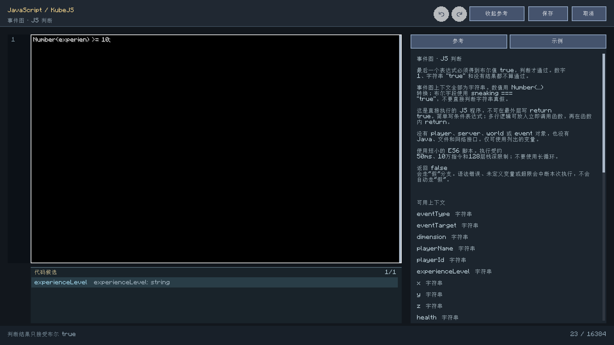
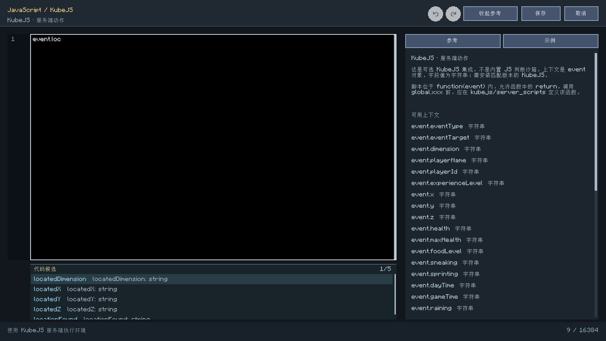
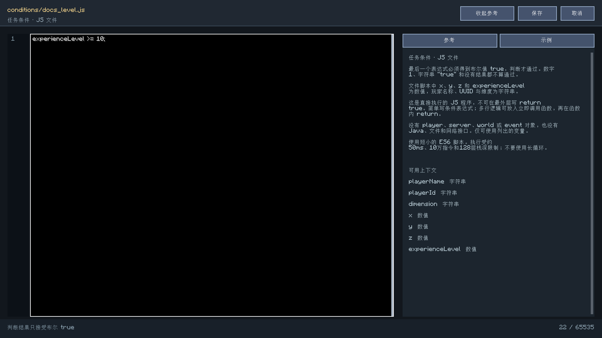
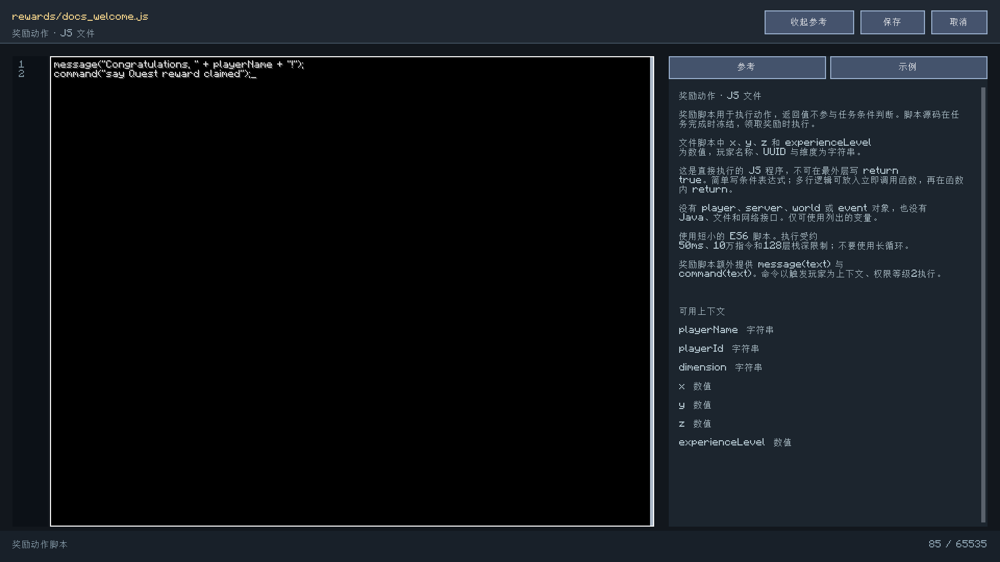

# JavaScript 编写参考

**简体中文** | [English](en/javascript.md) · [文档中心](README.md)

[项目首页](../README.md) · [全部命令](commands.md) · [判断节点](trigger-conditions.md) · [使用指南](guide.md)

这份参考对应内置 `QuestScripts` 执行器和事件图的实际实现。**内置 JS、KubeJS、Minecraft
函数文件是三个不同的执行环境，不能混用 API。** 内置引擎为 Rhino 1.7.15，使用 ES6 模式；
它不是浏览器或 Node.js。

## 先选择正确的用途

| 用途 | 在哪里填写 | 保存的内容 | 通过/执行规则 |
| --- | --- | --- | --- |
| 任务“脚本判定”条件 | 条件编辑器选择 `script`，目标填 `.js` 相对路径 | 文件引用 | 最后结果严格等于布尔 `true` 才满足 |
| 事件图“JS 判断” | 判断节点的模式选 JavaScript，再打开脚本编辑器 | 节点内联源码 | 布尔 `true` 走“真”，其他正常结果走“假” |
| JavaScript 奖励 | 奖励类型选 `script`，目标填 `.js` 相对路径 | 完成时冻结文件源码 | 领取时执行动作；返回值不决定任务是否完成 |
| KubeJS 脚本执行/编辑节点 | 对应 KubeJS 动作节点 | `global.xxx` 函数名或源码 | 需匹配的 KubeJS；使用独立的服务端环境 |
| Minecraft 函数奖励 | 奖励类型选 `function`，填写资源 ID | 数据包函数引用 | 执行 `.mcfunction`，不是 JavaScript |

## 最重要的返回值规则

内置执行器直接求值整段程序，不会替你包一层函数。最后一个表达式的结果就是脚本结果。

```javascript
experienceLevel >= 10;
```

简单条件直接写表达式即可。下面的顶层 `return` **不合法**：

```javascript-invalid
return true;
```

需要多行和 `return` 时，自己使用立即调用函数：

```javascript
(function () {
    const correctWorld = dimension === "minecraft:overworld";
    return correctWorld && experienceLevel >= 10;
})();
```

| 最后结果 | 条件/JS 判断是否通过 |
| --- | --- |
| `true` | 是 |
| `false` | 否 |
| `1`、`0` | 否；不进行“非零为真”转换 |
| `"true"`、`"false"` | 否；这是字符串 |
| `null`、`undefined`、对象、数组、无结果 | 否 |
| 抛出异常、使用未定义变量、超出预算 | 发生错误；图执行会中断，详见下文 |

**不要在最终条件表达式之后再写一个没有布尔结果的语句。** 例如只声明变量而没有最后的
条件表达式，通常没有符合要求的结果。

## 文件的位置和引用方式

脚本根目录为当前游戏/服务端配置目录中的 `config/xero_quest/scripts/`。

```text
config/xero_quest/scripts/
  conditions/level10.js
  rewards/welcome.js
```

条件或奖励的“目标”填 `conditions/level10.js`、`rewards/welcome.js`，不要填绝对路径，
不要再加 `scripts/` 前缀。路径必须留在脚本根目录内，扩展名必须为 `.js`，不接受符号链接。

条件配置示例：

```xml
<conditions>
  <condition type="script" item="conditions/level10.js" count="1"/>
</conditions>
```

奖励配置示例：

```xml
<rewards>
  <reward type="script" item="rewards/welcome.js" count="1"/>
</rewards>
```

脚本奖励的次数必须为 1。脚本文件通过校验后，任务完成时会保存当时的源码快照；
之后编辑文件不会改写已经完成任务的历史奖励。

## 文件条件和奖励的公共变量

这些是直接可用的全局变量，不需要 `ctx.` 或 `event.` 前缀。

| 变量 | 类型 | 含义 |
| --- | --- | --- |
| `playerName` | string | 当前玩家名称 |
| `playerId` | string | 当前玩家 UUID |
| `dimension` | string | 维度资源 ID，例如 `minecraft:overworld` |
| `x`、`y`、`z` | number | 玩家实时坐标 |
| `experienceLevel` | number | 玩家经验等级，不是总经验点数 |

没有 `player`、`server`、`world`、`ctx` 对象。不能写 `player.getHealth()`、
`server.runCommand()`、`Java.type()`、`require()`、`fetch()` 或浏览器 DOM 操作。
文件条件中也没有 `health`、`sneaking` 等额外图上下文变量。

## 事件图 JS 判断：所有上下文值都是字符串

图节点除了上述变量名称，还注入事件/玩家/世界/控件/鼠标/定位字段。
**图上下文会覆盖同名公共变量，因此图中的 `experienceLevel`、`x`、`y`、`z`
也是字符串。** 这是与文件条件最容易混淆的地方。

```javascript
Number(experienceLevel) >= 10;
```

数值比较建议明确 `Number(...)`。不要用 `experienceLevel === 10` 比较字符串与数值。
布尔字段也要明确比较：

```javascript
sneaking === "true";
```

`"false"` 是非空字符串，在 `if (sneaking)` 里也会被当成真；单独返回 `sneaking`
则得到字符串，仍不满足本模组的严格布尔判断。

### 全部图上下文

| 分组 | 变量 |
| --- | --- |
| 事件 | `eventType`、`eventTarget` |
| 玩家 | `playerName`、`playerId`、`experienceLevel`、`x`、`y`、`z`、`health`、`maxHealth`、`foodLevel`、`sneaking`、`sprinting` |
| 世界 | `dimension`、`dayTime`、`gameTime`、`raining`、`thundering`、`difficulty` |
| 任务和控件 | `questId`、`controlId`、`controlKind`、`controlValue`、`controlX`、`controlY`、`controlWidth`、`controlHeight` |
| 指针事件 | `mouseX`、`mouseY`、`mouseWidth`、`mouseHeight`、`mouseHeld`、`mouseInside` |
| 定位动作上下文 | `locatedX`、`locatedY`、`locatedZ`、`locatedDimension`、`locationFound` |

所有字段值均为字符串。没有适用数据时可能是空字符串，不要把 `Number("")` 得到的 0
误认为一次成功的定位。先检查 `locationFound === "true"`。鼠标字段应在对应控件事件下使用。
`eventTarget` 的内容取决于事件，点击事件中可以为空。

自定义变量不会自动变成 JS 全局变量，也没有 `variables` 对象。需要读取任务/全局自定义
变量时，使用“变量判断”节点，或可视化判断中的变量槽。变量作用域规则见[判断节点文档](trigger-conditions.md)。

## 真假分支与错误的区别

正常返回布尔 `false` 或其他非 `true` 结果，会沿“假”端口继续。
如果语法错误、变量未定义或执行超限，异常会传到事件图执行器，本次绑定执行中断，
记录 `Control trigger failed` 日志，并延后该事件绑定约 200 游戏刻再接受触发。
这不是自动执行“假”分支。

如果数据本来就可能缺失，在表达式里先检查，不要用异常代替正常条件。
有关开始节点冷却、两种“一次执行”和分支连线的细节，见[判断节点文档](trigger-conditions.md)。

## 奖励脚本的两个动作函数

只有奖励执行模式额外提供：

| 函数 | 参数与结果 |
| --- | --- |
| `message(text)` | 发送文本消息，返回 `true`；单个文本参数最多 4096 字符 |
| `command(text)` | 执行单行 Minecraft 命令，返回是否成功；当前玩家上下文、权限等级 2 |

这两个函数不提供给只读条件或 JS 判断节点。需要在事件图中执行命令，使用“命令”动作节点。

```javascript
message("Congratulations, " + playerName + "!");
if (!command("say Quest reward claimed")) {
    throw new Error("Reward command failed");
}
```

脚本动作失败前已经产生的消息、命令或外部副作用不会自动回滚。奖励系统保存执行回执，
不会盲目自动重试非幂等脚本。管理员应先检查实际结果，再考虑
`/xero_quest reward receipts` 和 `acknowledge`；后者只确认回执，不重新执行奖励。

## KubeJS：单独的可信服务端环境

“KubeJS 脚本编辑”节点通过可选桥接进入 KubeJS 服务端作用域，源码实际被包在
`function(event) { ... }` 内，因此该环境中的函数 `return` 是合法的。
`event` 是本次调用的上下文对象，字段名与图上下文相同，字段值仍为字符串。

在 `kubejs/server_scripts/xero_example.js` 中定义：

```javascript
global.onXeroQuestAction = function (event) {
    if (event.eventType === "click") {
        return event.questId;
    }
};
```

然后“KubeJS 脚本执行”节点填写 `global.onXeroQuestAction`；
不要加 `()`，不要在函数名框里粘贴整段源码。
“KubeJS 脚本编辑”节点可写：

```javascript
global.onXeroQuestAction(event);
```

这不是内置只读沙箱，不能套用内置 `message()` / `command()` 的接口说明。
桥接以 KubeJS 2101 服务端 API 为基础，需实际安装匹配的第三方模组；
缺少模组或 API 不兼容会报错。1.20.1 与 Fabric 的第三方联合兼容没有在本轮验证，
不要把普通 JS 判断通过当作 KubeJS 联动通过。

## 游戏内编辑器

- 输入标识符或 `.` 后，代码区底部自动显示匹配候选，包含字段类型或函数签名。
  候选使用独立区域，不覆盖代码、选区或底部状态；列表可滚动，点击时在同一候选内松开才应用。
- `Tab` 应用当前候选，`Alt+↑/↓` 切换候选，`Ctrl+Space` 主动请求候选，`Esc` 收起当前候选。
  普通方向键、Enter 换行、拖动选区、复制粘贴仍操作文本，候选不会获取输入焦点。
- 补全只替换光标所在的标识符，保留左右代码；在单词中间应用时会一起替换该单词剩余部分，
  不会重复添加后缀。超过字数限制时保留原文。顶部撤销/重做按钮及 `Ctrl+Z`、`Ctrl+Y`
  （或 `Ctrl+Shift+Z`）可以恢复编辑和补全，包含原来的光标、选区。
- 内置候选区分图判断、条件文件和奖励文件；只有奖励环境提示 `message` / `command`。
  KubeJS 提示本桥接的 `event.*` 字符串字段、`global.*` 和日志方法；
  **不是完整的 KubeJS/ProbeJS 类型数据库**，不会读取其他脚本文件或执行服务器代码来发现候选。
- 当前源码通过 Rhino 容错解析识别词法作用域中的变量、函数参数、对象字面量属性、
  简单别名，以及常见 Math/JSON/字符串/数组成员。字符串与注释中不自动弹出代码候选；
  动态创建的属性、函数返回类型和第三方扩展可能无法推断。解析在后台执行，并丢弃过期结果。
- 顶部显示当前用途；保存只检查/保存源码，不会试运行奖励或执行命令。
- “参考”列出当前环境的返回值规则、字段和限制；“示例”按用途筛选。
- “追加到代码”保留已有内容，并以语句分隔符追加示例；需要替换时先选择旧代码。
  超过字数上限时会拒绝追加，保留原稿，不截断代码。
- `Ctrl+S` 保存。内置脚本的语法错误会显示行/列与原因；顶层 `return` 会被拒绝。
- 行号随换行与滚动同步，代码、参考和底部状态分别裁剪，不覆盖工具栏。
- 窄窗口用“编写参考/收起参考”切换代码与参考；调整大小和打开参考不会丢弃草稿。
- 文件编辑保留原相对路径和源文件指纹，发生外部修改冲突时拒绝覆盖。
- 现有文件型编辑使用本地集成服务器的作者权限。多人服务端文件应由管理员在服务端编辑；
  不能把客户端本地的同名文件视为远端服务端文件。
- 图内脚本保存先更新图草稿，还需要保存事件图/所属任务，才会成为实际配置。





补全专项回归使用真实客户端运行（Java 21 / NeoForge 1.21.1）：

```powershell
.\gradlew.bat runClient -PscriptCompletionTest --offline --console=plain
```

覆盖环境区分、局部变量/对象属性、注释/字符串、光标中间补全、普通编辑、
撤销重做、异步结果过期、点击释放、字数上限和紧凑布局。
这是编辑器功能验证，不表示已经测试第三方 KubeJS 的脚本执行。






以上为中文 1920×1080 原始客户端截图。奖励列表中脚本条目的编辑按钮直接进入奖励用途的
参考编辑器；命令和 `.mcfunction` 保留各自文本编辑流程。

## 长度与执行限制

| 项目 | 限制 |
| --- | --- |
| 图节点内联脚本 | 节点数据值最多 16384 字符 |
| 脚本文件 | 文件大小不超过 64 KiB，且满足 NBT 修改版 UTF-8 字符串的 65535 字节上限 |
| 指令预算 | 约 100000 指令，每 1000 指令检查一次 |
| 时间预算 | 约 50ms，协作检查，不是对外部命令执行的强制抢占 |
| 解释器栈深 | 128 |
| 调用线程 | 服务端线程，不允许嵌套重入内置执行器 |

优先使用简单表达式和短函数，不使用忙等待、无限循环或大规模运算。
支持的基准是本项目的 Rhino ES6 模式，不保证现代浏览器全部新语法可用。

## 常见问题

| 现象 | 检查方式 |
| --- | --- |
| 选择 JS 判断后一直走假 | 最终值是否为布尔 `true`，而不是字符串/数字？ |
| `experienceLevel === 10` 不通过 | 图字段是字符串，改为 `Number(experienceLevel) === 10` |
| 潜行判断总是错误 | 使用 `sneaking === "true"`，不要直接判断非空字符串 |
| `return` 报语法错误 | 在内置脚本里改为末尾表达式或立即调用函数 |
| `player is not defined` | 使用可用的数据变量；没有 Java 玩家对象 |
| `message is not defined` | 当前是只读判断环境；消息/命令应放到动作节点或奖励脚本 |
| 假分支也没有执行 | 检查服务器 `Control trigger failed` 日志，错误会中断执行 |
| 再次点击只走假分支 | 检查 JS 判断“一次执行”是否已经成功过 |
| 后来条件满足也不再触发 | 检查开始事件是否勾选“一次执行” |
| 修改奖励文件却仍执行旧代码 | 已完成任务持有冻结的奖励源码快照 |
| 保存文件失败 | 检查作者权限、文件存在、语法、长度和外部修改冲突 |

<!-- SCRIPT_EXAMPLES_START -->
## 已校验示例索引

以下源码与游戏内参考面板共享，内置示例经过实际服务端引擎求值。KubeJS 示例只作为独立环境写法参考，未安装第三方模组联合实测。

### 事件图 JS 判断 / click

```javascript
eventType === "click";
```

### 事件图 JS 判断 / level_graph

```javascript
Number(experienceLevel) >= 10;
```

### 事件图 JS 判断 / region_graph

```javascript
dimension === "minecraft:overworld" && Number(y) >= 64;
```

### 事件图 JS 判断 / sneaking

```javascript
sneaking === "true" && Number(health) < Number(maxHealth);
```

### 事件图 JS 判断 / function_graph

```javascript
(function () {
    const level = Number(experienceLevel);
    return eventType === "click" && level >= 10;
})();
```

### 事件图 JS 判断 / pointer

```javascript
eventType === "hold" && mouseInside === "true";
```

### 事件图 JS 判断 / located

```javascript
locationFound === "true" && locatedDimension === dimension;
```

### 任务条件文件 / level

```javascript
experienceLevel >= 10;
```

### 任务条件文件 / dimension

```javascript
dimension === "minecraft:overworld";
```

### 任务条件文件 / region

```javascript
dimension === "minecraft:overworld" && x >= 0 && x <= 100 && z >= 0 && z <= 100;
```

### 任务条件文件 / function

```javascript
(function () {
    const correctWorld = dimension === "minecraft:overworld";
    return correctWorld && experienceLevel >= 10;
})();
```

### 奖励动作文件 / message

```javascript
message("Congratulations, " + playerName + "!");
```

### 奖励动作文件 / command

```javascript
if (!command("say Quest reward claimed")) {
    throw new Error("Reward command failed");
}
```

### 奖励动作文件 / reward_branch

```javascript
if (experienceLevel >= 10) {
    message("Level requirement met");
} else {
    message("Reward received");
}
```

### KubeJS 动作（需另装并匹配第三方 API） / kubejs

```javascript
if (typeof global.onXeroQuestAction !== "function") {
    throw new Error("Define global.onXeroQuestAction in kubejs/server_scripts first");
}
global.onXeroQuestAction(event);
```

<!-- SCRIPT_EXAMPLES_END -->

## 实现与参考

- [内置执行器](../src/main/java/xtdpotato/xero_quest_journal/core/runtime/QuestScripts.java)
- [图执行与上下文注入](../src/main/java/xtdpotato/xero_quest_journal/core/runtime/QuestEventGraphs.java)
- [可视化判断](../src/main/java/xtdpotato/xero_quest_journal/core/runtime/QuestVisualPredicate.java)
- [奖励快照与执行](../src/main/java/xtdpotato/xero_quest_journal/core/runtime/QuestRewards.java)
- [可选 KubeJS 桥接](../src/main/java/xtdpotato/xero_quest_journal/core/runtime/QuestKubeJs.java)
