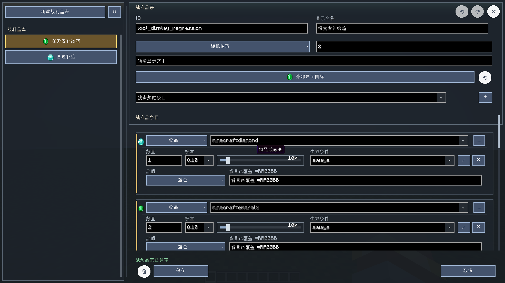
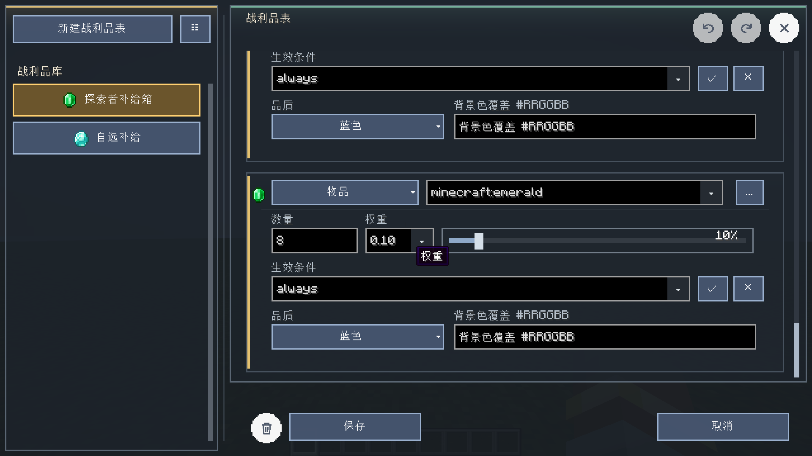
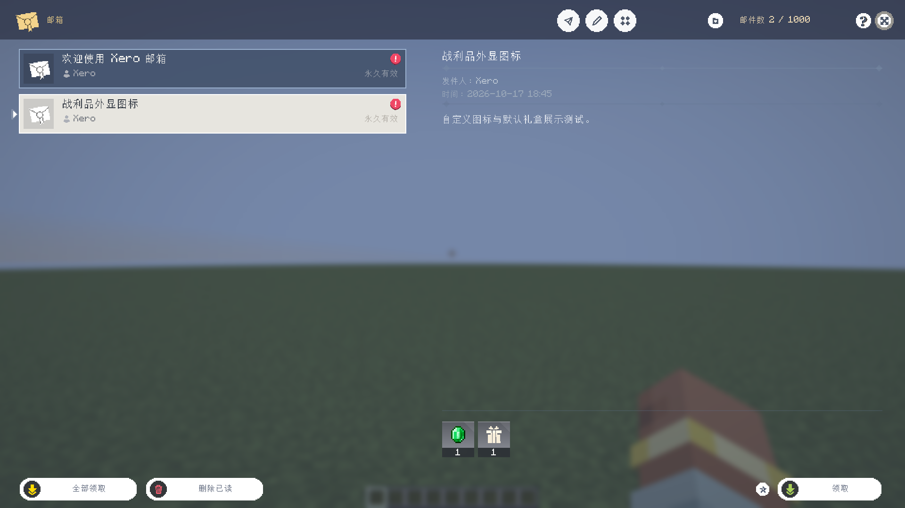

# 2026-10-17 多版本预览 13 验证

本次 Release 对应模组版本 `0.2.0`，标签为 `v0.2.0-multiversion-preview.13`。
只发布已接入共享源码的四个目标；26.1、26.2、26.3 工程仍未完成完整 GUI、输入、
物品/配方、权限和运行时迁移，不提供可安装 JAR。

## 发布构建

| Minecraft | 加载器 | Java | 结果 |
| --- | --- | --- | --- |
| 1.20.1 | Forge 47.3.0 | 17 | `build` 通过 |
| 1.20.1 | Fabric | 17 | `build` 通过 |
| 1.21.1 | NeoForge 21.1.233 | 21 | `build` 通过，5 MB 核心包检查通过 |
| 1.21.1 | Fabric | 21 | `build` 通过 |

四个 JAR 均由 Release 打包脚本检查 loader metadata、共享作者功能类、测试代码隔离和大小限制。
Release 附件包含四个独立安装 JAR、按 loader/Minecraft 分类的合集 ZIP、SHA-256 校验文件。

本次新增验证：从任务右键菜单打开“任务解锁图”时，目标节点会自动居中并保持 3 秒高亮；
自动生成任务回归验证所有生成任务的前置列表不包含自身 ID，并覆盖生成、重载和再次生成流程。
编辑画布回归通过，确认编辑模式下空奖励任务仍显示底部奖励栏和可点击加号。

奖励弹窗专项当前仍有一个既有失败：完成任务后的分类路由断言未通过，发生在奖励栏改动之外，
不影响生产构建结果，后续需单独修复该测试/分类状态同步问题。

## 本次专项回归

NeoForge 1.21.1 使用 `runClient -PlootTableTest` 启动集成世界并通过，断言覆盖：

- 旧战利品 JSON 缺少 `displayIcon` 时回退礼盒；自选表图标写盘、重载和跨表修改冻结。
- 自选奖励冻结与实际奖池分离，奖池内容未被展示图标改变。
- 服务器目录同步图标、目录缓存刷新、邮件世界存档和网络快照往返。
- 邮件自选奖励选择后实际发放正确物品，并阻止重复领取。
- 全屏图标选择器仅在“应用”后提交，支持重置、撤销和重做。
- 桌面与 640×360 紧凑界面控件无重叠；紧凑界面整页平滑滚动可到达最后一项，
  底部保存操作保持固定。
- 1920×1080 中文客户端编辑器、紧凑滚动布局和邮件截图。

此外，关键帧弹出动画专项 `popupAnimationTest` 已分别在 NeoForge 1.21.1、
Fabric 1.21.1、Fabric 1.20.1 和 Forge 1.20.1 客户端通过，日志均包含
`XERO_POPUP_ANIMATION_PASS`。为支持 1.20.1 测试，Fabric/Forge 的测试源码生成器
同步适配了旧版 `SavedData.save/load` 签名。

该回归不等于对所有 MC 版本、第三方模组组合或远端多人流程的全面验收。
