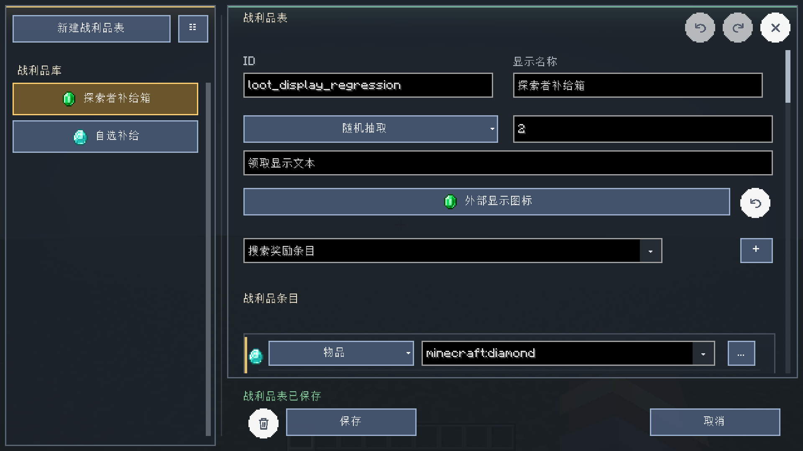
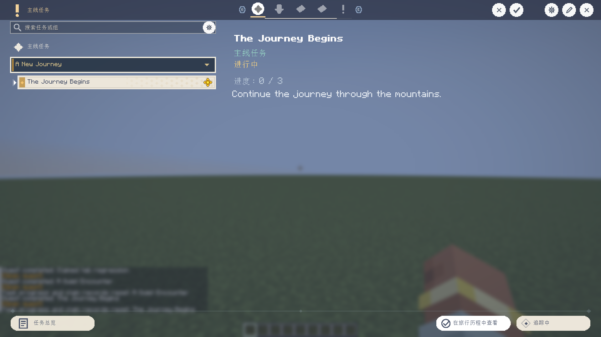
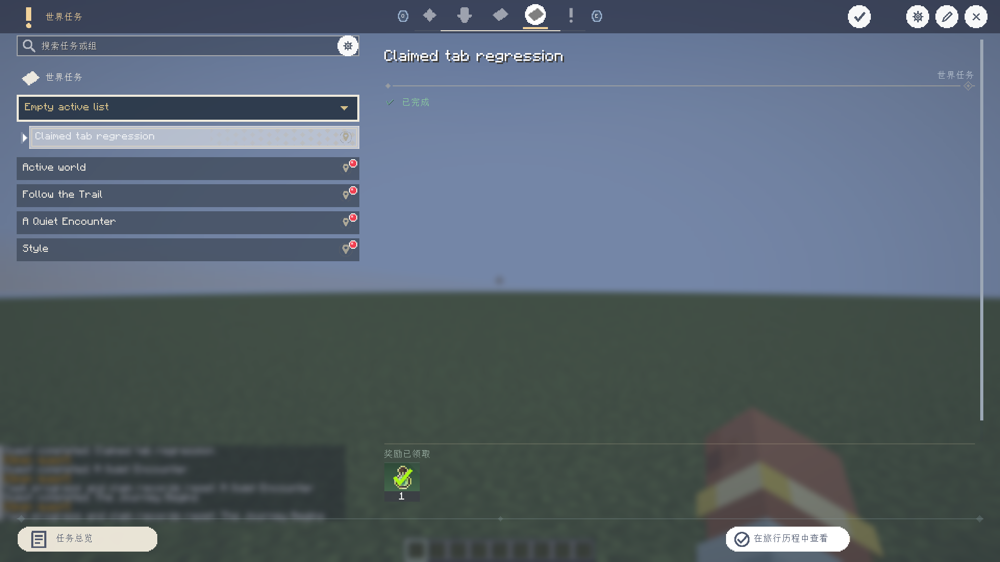
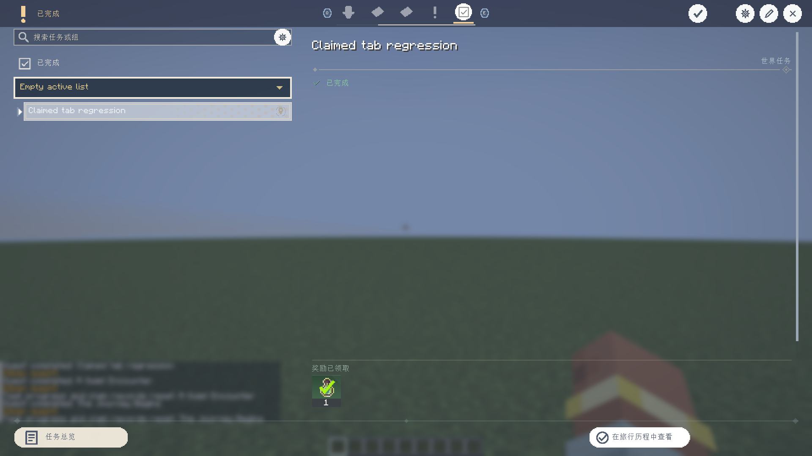
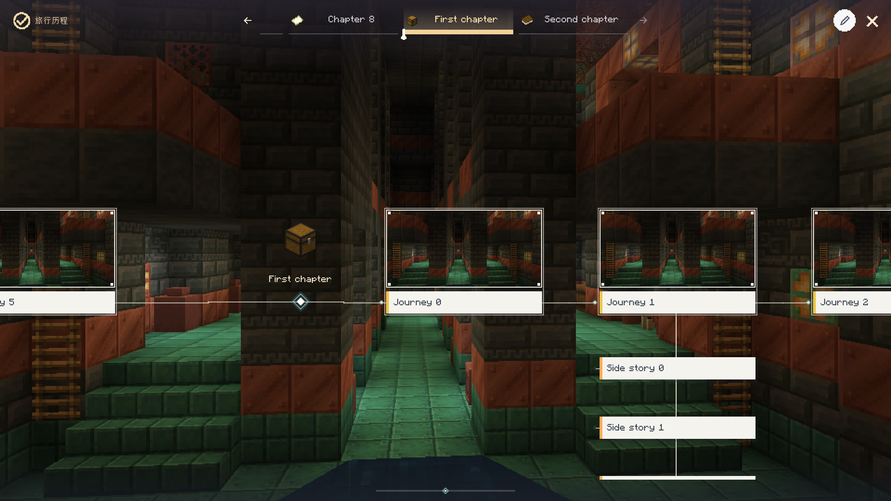

# 2026-10-18 多版本预览验证记录

[项目首页](../README.md) · [版本矩阵](porting-matrix.md) · [候选与拼图方块教程](candidate-selectors-and-jigsaw.md)

模组版本保持 `0.2.0`，发布标识为 `v0.2.0-multiversion-preview.17`。
本轮新增通用候选来源选择、实际世界结构模板浏览、拼图连接检查与中文操作说明，
并修复自动任务标题参数和任务完成聊天跳转。

## 验证范围

本轮客户端测试运行于 NeoForge 1.21.1 的真实客户端与集成服务器，
不是仅检查源码或 JAR 中是否存在类。

`runClient -PcandidatePickerTest --offline` 通过，输出 `XERO_CANDIDATE_PICKER_PASS`。
专项覆盖：

- 物品候选打开全屏物品选择器，应用后返回；取消不写入原字段。
- 加入候选与选择字段分离，普通注册候选打开已有列表。
- 世界结构保留原始注册 ID，NBT 文件使用独立结构库入口。
- 从实际 `minecraft:village_plains` 起始池发现模板，打开非空三维模型。
- 模型缩放和逐层返回，返回保留选择的世界结构。
- 拼图预览只保留连接元数据，不传任意命令、容器等方块实体字段。
- 方向、目标名称、替换方块、两个优先级及原版 joint 缺省规则。
- 用游戏 `JigsawBlock.canAttach` 验证匹配示例通过、错误名称被拒绝。
- 连接点搜索列表选择、点击模型投影标记选择对应连接点。
- 当前连接点的真实模板池浏览、下一段模型预览和逐层返回。
- 中文操作说明、960×540 窄窗口的上下布局与溢出内容滚动。
- 任务完成文本没有残留 `%s`，金色链接独占下一行，
  点击命令指向对应任务，权限 0 的玩家可以解析此命令。

本地日志：`build/verification/candidate-picker-run.log`，
专项结果：`build/verification/candidate-picker-result.txt`。

另运行 `runClient -PstructureSceneTest --offline` 通过：
真实场景 tick、装备数据、权限、完成方块、附加触发器、场景重置与奖励分离、
版本变更拦截、安全返回、独立编辑副本及场景设置界面均完成原有断言。
日志：`build/verification/candidate-structure-scenes-run.log`。


## 构建与附件

四个目标均从当前共享源码构建，发行 JAR 保持各自加载器及 Minecraft 版本独立。
下列四条构建均为 `BUILD SUCCESSFUL`，本轮使用离线缓存，无需等待镜像下载。
Forge 1.20.1 与 Fabric 1.20.1 按顺序构建，避免后者转换来源目录时互相覆盖。

| 目标 | Java | 命令 |
| --- | --- | --- |
| NeoForge 1.21.1 | 21 | `gradlew build --offline` |
| Fabric 1.21.1 | 21 | `gradlew -p platforms/fabric/1.21.1 build --offline` |
| Forge 1.20.1 | 17 | `gradlew -p platforms/forge/1.20.1 build --offline` |
| Fabric 1.20.1 | 17 | `gradlew -p platforms/fabric/1.20.1 build --offline` |

打包脚本检查加载器元数据、关键功能类、核心包体积和测试类未混入，
生成四个 JAR、按加载器/版本整理的 ZIP 和 SHA256SUMS。
文档链接、代码围栏、本地化键和中文截图分辨率另由文档校验脚本检查。

## 边界与未验证项

- 这次不是全部历史回归重跑，也没有覆盖远端多人服务器的模板池浏览。
- 曾尝试宽泛的 `creationTest`，在 `context-copy_id` 点击步骤失败；
  不能用本次专项通过代替它。该测试文件未为绕过失败而改动。
- 模板池浏览为本地作者工具，使用集成服务器线程读取资源；单模板元数据检查不要求重新生成世界。
- 预览是单模板及连接元数据，不是完整随机拼装模拟，也不展示实体模型。
- 教程中的自定义数据包完整生成流程未逐个平台实测；连接规则与真实村庄模板路径已专项验证。
- 26.1–26.3 没有完成完整迁移，本次没有发布对应安装包。
- 历史“33 项回归”等结果仍属于原验证日期，不归入本轮通过数量。

## 预览 18：战利品字段标签

`v0.2.0-multiversion-preview.18` 保持模组版本 `0.2.0`，
将战利品表顶部两列标为“ID”和“显示名称”。
小窗口原来通过条件分支隐藏了这两个标签；现在标签随表单滚动，
并把紧凑表单整体下移 14 GUI 像素，保留标签与输入框、后续控件的间距。

`runClient -PlootTableTest --offline` 通过，实际检查普通与 640×360 GUI 布局，
同时完成原有战利品保存、图标应用/重置/撤销重做、品质与背景、邮件奖励发放、
控件不重叠和平滑滚动断言。截图均为中文、原生 1920×1080。
日志：`build/verification/loot-labels-run.log`；
结果：`build/verification/loot-table-result.txt`。
此轮仅重跑战利品专项与四目标生产构建，上文候选/结构专项属于预览 17。



## 预览 19：分类标签的小标题

`v0.2.0-multiversion-preview.19` 修复具体任务分类和已完成标签中的左侧列表小标题。
每个非空分类列表在任务组/任务前保留对应图标与名称，占据 25 GUI 像素的标题行，
下方间距 4 GUI 像素，统一计入滚动范围。原有任务排序、分页和空列表行为沿用。

实际客户端运行：

```powershell
.\gradlew.bat runClient -PjournalFocusTest -PneoSmokeRunDir=run-tab-section --offline
```

使用独立测试目录通过，输出 `XERO_JOURNAL_FOCUS_PASS`。
首次复用旧 `run-journal-focus` 时，测试类型与 2026-10-17 遗留夹具重名；
改用独立目录完成验证。重跑时应指定新的测试目录。

专项覆盖：

- 连续两轮切换所有可用标签，非空列表的小标题存在且不重复。
- 主线、世界及已完成标签的中文 1920×1080 实际截图。
- 任务组展开/收起后仍保留分类小标题。
- 小标题与后续列表行不重叠，滚动总高度包含标题。
- 空分类保留原有空状态与隐藏搜索框行为。
- 同时通过原有专注任务推进、追踪恢复、玩家隔离、存档与网络等专项断言。

四个既有目标生产构建同步通过。本轮没有重跑全部历史回归。
日志：`build/verification/tab-section-run.log`；
结果：`build/verification/journal-focus-result.txt`。







## 预览 20：旅行历程工具栏

`v0.2.0-multiversion-preview.20` 移除旅行历程额外手工绘制的编辑按钮 tooltip，
由按钮的原生延迟提示统一绘制，绘制前清理场景深度，保留文字可读性。
编辑状态改用 32×32 的 `edit_exit.png`（原铅笔加 X），
章节任务入口改用同尺寸 `select_tasks.png`（勾选列表）。
打包脚本对四个发行 JAR 都检查这两个图标是否存在。

实际客户端运行：

```powershell
.\gradlew.bat runClient -PjourneyEditingTest -PneoSmokeRunDir=run-journey-toolbar --offline
```

完整专项通过，输出 `XERO_JOURNEY_EDITING_PASS`。
新增工具栏测试监听真实 tooltip 渲染事件：
“编辑时间线”“退出时间线编辑”“选择章节任务”三个悬浮状态，
每处连续至少三个渲染帧均只出现一次 tooltip 绘制。
实际点击检查进入/退出编辑不会关闭窗口，章节任务选择打开多选界面，
取消后返回原界面；同时检查新图标资源可读取且尺寸均为 32×32。

本轮也完成原有推荐任务定位、任务拖动与显示连线、章节任务增删、
背景与音乐切换、章节独立外观、多选和尺寸句柄、章节切换事件、
权限/冲突校验、任务弹窗导航及桌面/小窗口布局等断言。
四个既有目标生产构建通过；没有重跑全部历史回归或远端联机。
日志：`build/verification/journey-toolbar-run.log`；
结果：`build/verification/journey-editing-result.txt`。


## 预览 21：选中章节底条

仅修改旅行历程选中章节的黄色底条高度，从 1 改为 5 GUI 像素，
底边仍在标签局部坐标 30，未选中标签、细进度轨道及标记尺寸沿用原值。
四个生产目标均重新构建通过。

实际客户端截图像素检查通过：1920×1080、GUI 比例 2 时，
选中条在第 64–73 行连续占 10 个画面像素，对应 5 个 GUI 像素。
图中英文是作者测试章节/任务名称，界面语言为简体中文。

本轮尝试 `runClient -PjourneyTest`，整套未通过：
原始进度拖动检查忽略整像素落点，结构条件检查仍假定旧版行内展开。
临时按实际落点及现有独立详情弹窗作诊断后，继续遇到
`Appearance undo did not restore the previous draft` 断言失败。
这些临时诊断改动未纳入提交，不以局部通过代替完整回归通过。
初始、第二次及最终诊断日志分别为 `journey-underline-initial-run.log`、
`journey-underline-second-run.log`、`journey-underline-run.log`，均位于 `build/verification/`。
本次成功验证范围为黄色条像素尺寸、实际渲染和四目标生产构建。


