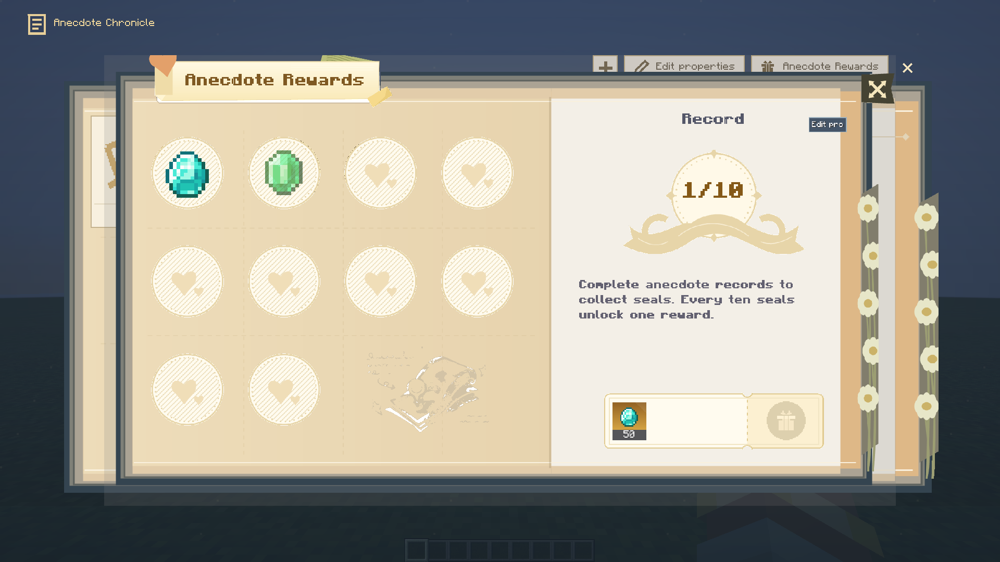
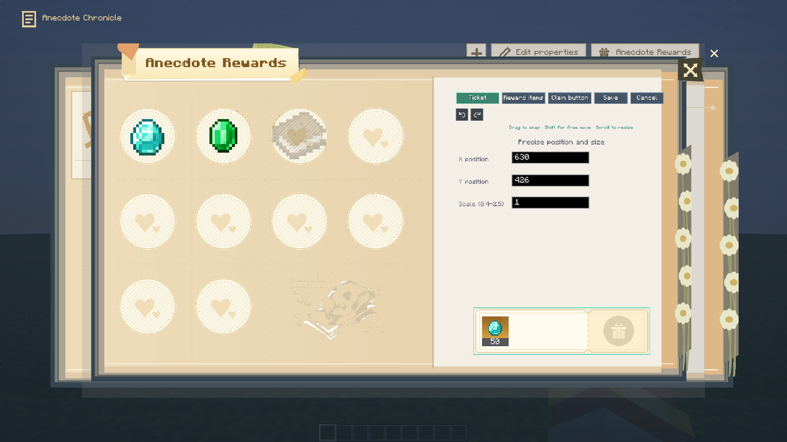

# Xero Quest Journal 0.2.3

**简体中文** | [English](#english)

## 更新内容

- 逸闻奖励页弹出时使用 20% 灰色背景；地图水印缩小、改为灰色并放入左页底部预留区域，不再压住贴纸。
- 奖励布局编辑新增 X、Y 和缩放精确输入，数值修改会实时预览。
- 拖动控件默认按 8 个画布单位吸附；按住 Shift 可临时自由移动。拖动、缩放和数值编辑均支持撤销/重做。
- 四个正式支持的游戏版本/加载器构建已更新至 0.2.3。

## 下载

| Minecraft | 加载器 | JAR |
| --- | --- | --- |
| 1.21.1 | NeoForge | [下载](https://github.com/XTDPotato/xero_quest_journal/releases/download/v0.2.3/xero_quest_journal-neoforge-1.21.1-0.2.3.jar) |
| 1.21.1 | Fabric | [下载](https://github.com/XTDPotato/xero_quest_journal/releases/download/v0.2.3/xero_quest_journal-fabric-1.21.1-0.2.3.jar) |
| 1.20.1 | Forge | [下载](https://github.com/XTDPotato/xero_quest_journal/releases/download/v0.2.3/xero_quest_journal-forge-1.20.1-0.2.3.jar) |
| 1.20.1 | Fabric | [下载](https://github.com/XTDPotato/xero_quest_journal/releases/download/v0.2.3/xero_quest_journal-fabric-1.20.1-0.2.3.jar) |
| 全部版本合集 | ZIP | [下载](https://github.com/XTDPotato/xero_quest_journal/releases/download/v0.2.3/xero_quest_journal-supported-builds-0.2.3.zip) |

26.1–26.3 仍是部分迁移工程，本版本没有对应的可安装 JAR。1.20.1 使用 Java 17，1.21.1 使用 Java 21。多人客户端与服务端需使用同版本、同加载器构建。

## 验证

NeoForge 1.21.1 真实客户端逸闻界面回归通过，覆盖浮层颜色、水印位置、精确坐标、吸附与 Shift 绕过、撤销/重做及服务端保存。四个目标构建与生产 JAR 元数据检查通过。完整范围与 SHA256 见[发布验证报告](../release-verification-0.2.3.md)。

## English

### Changes

- The anecdote reward popup now uses a 20% gray scrim. Its smaller gray map watermark sits in the reserved lower-left-page area without covering stickers.
- Reward layout editing adds exact X, Y and scale fields with a live preview.
- Dragging snaps to 8 canvas units by default; hold Shift to temporarily move freely. Drag, resize and numeric edits support undo/redo.
- All four supported game/loader builds are updated to 0.2.3.

### Downloads

| Minecraft | Loader | JAR |
| --- | --- | --- |
| 1.21.1 | NeoForge | [Download](https://github.com/XTDPotato/xero_quest_journal/releases/download/v0.2.3/xero_quest_journal-neoforge-1.21.1-0.2.3.jar) |
| 1.21.1 | Fabric | [Download](https://github.com/XTDPotato/xero_quest_journal/releases/download/v0.2.3/xero_quest_journal-fabric-1.21.1-0.2.3.jar) |
| 1.20.1 | Forge | [Download](https://github.com/XTDPotato/xero_quest_journal/releases/download/v0.2.3/xero_quest_journal-forge-1.20.1-0.2.3.jar) |
| 1.20.1 | Fabric | [Download](https://github.com/XTDPotato/xero_quest_journal/releases/download/v0.2.3/xero_quest_journal-fabric-1.20.1-0.2.3.jar) |
| All supported builds | ZIP | [Download](https://github.com/XTDPotato/xero_quest_journal/releases/download/v0.2.3/xero_quest_journal-supported-builds-0.2.3.zip) |

The 26.1–26.3 projects are partial migrations and do not have installable JARs in this release. Use Java 17 for 1.20.1 and Java 21 for 1.21.1. Multiplayer clients and servers must use matching versions and loaders.

### Verification

The real NeoForge 1.21.1 client anecdote regression passed, covering popup color, watermark placement, precise coordinates, snapping and Shift bypass, undo/redo, and server persistence. All four production targets and JAR metadata checks passed. See the [verification report](../release-verification-0.2.3.md) for full scope and SHA256 values.
