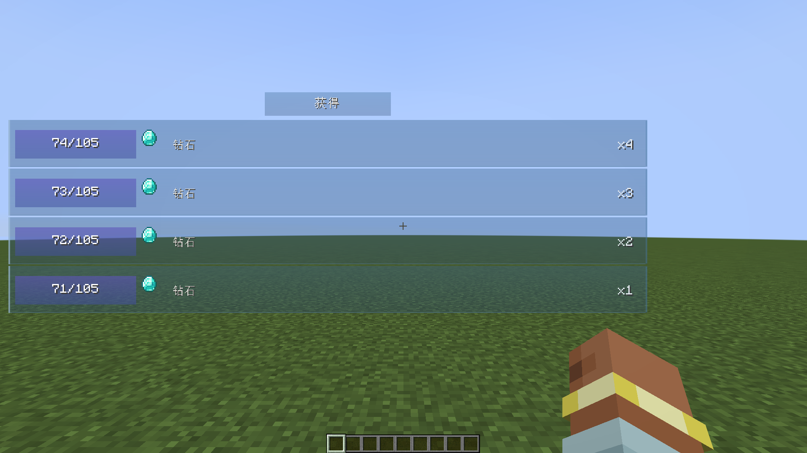

# Xero Quest Journal 0.2.4

**简体中文** | [English](#english)

## 更新内容

- 自动生成支持模组进度/配方关联与结构探索故事线；首次进入世界可选择生成方式，
  并可使用 `/xero_quest start_generate_gui` 再次打开。
- 探索任务支持自动定位结构、共享队伍坐标和抵达判定。进度线根据模组进度、配方与相关物品构建连锁。
- 每条任务奖励可单独选择是否展示，以及手动领取、自动领取或跟随任务默认。
- 函数/脚本奖励提供打开对应目录；保存函数后热重载数据包，脚本执行时读取最新文件。
- 奖励编辑模式下添加卡片接续排列于奖励末尾；标签物品展示支持动态预览、全标签列表与 JEI/REI/EMI 跳转。
- 完善任务流程、奖励回执、拾取提示、奖励查看及结构探索界面。

## 下载

请在 [GitHub 0.2.4 Release](https://github.com/XTDPotato/xero_quest_journal/releases/tag/v0.2.4)
选择与 Minecraft 版本、加载器匹配的单个 JAR。Release 另附四平台合集 ZIP 与 `SHA256SUMS.txt`。

| Minecraft | 加载器 | Java |
| --- | --- | --- |
| 1.21.1 | NeoForge 21.1.233 | 21 |
| 1.21.1 | Fabric | 21 |
| 1.20.1 | Forge 47.3.0 | 17 |
| 1.20.1 | Fabric | 17 |

26.1–26.3 仍处于部分迁移状态，没有可安装 JAR。多人游戏的客户端与服务端需要使用匹配构建。

## 界面截图

截图均为原生 1920×1080 客户端捕获。

## 验证

- NeoForge 1.21.1：`runClient -PtaskWorkflowTest` 通过，覆盖任务编辑/切换、领取后相邻任务选择、搜索筛选与解锁图导航流程。
- 四个正式支持目标由发布构建分别编译，并由打包器校验版本元数据、加载器元数据、必需类/资源、测试类排除、JAR 体积及 SHA-256。
- 详细构建命令、资产校验与哈希见[发布验证报告](../release-verification-0.2.4.md)。

## English

### Changes

- Mod-aware generation now supports mod advancement/recipe progression and structure-exploration storylines.
  Players choose a generation mode on first entry; `/xero_quest start_generate_gui` reopens the chooser.
- Exploration quests can locate structures, share coordinates with the team, and complete on arrival.
  Progression chains use installed-mod advancements, recipes and related items.
- Each quest reward can independently be hidden from the display and set to manual, automatic,
  or follow the task-level claim behavior.
- Function/script rewards can open their source folder. Saving a function reloads datapacks;
  scripts read the latest file when executed.
- The reward editor appends its add card after existing cards. Tag-item previews support cycling,
  full tag listings and JEI/REI/EMI viewer integration.
- Task workflow, claim receipts, pickup notices, reward inspection and structure exploration were improved.

### Downloads

Select the JAR matching both Minecraft and loader from the
[GitHub 0.2.4 Release](https://github.com/XTDPotato/xero_quest_journal/releases/tag/v0.2.4).
The release also includes a four-target ZIP and `SHA256SUMS.txt`.

| Minecraft | Loader | Java |
| --- | --- | --- |
| 1.21.1 | NeoForge 21.1.233 | 21 |
| 1.21.1 | Fabric | 21 |
| 1.20.1 | Forge 47.3.0 | 17 |
| 1.20.1 | Fabric | 17 |

The 26.1–26.3 projects are partial migrations and have no installable JARs.
Multiplayer clients and servers must use matching builds.

### Screenshots

All captures use the native 1920×1080 game window.

### Verification

- NeoForge 1.21.1: `runClient -PtaskWorkflowTest` passed, covering task editing/selection,
  nearest-task selection after claiming, search/filter and unlock-graph navigation.
- All four supported production targets are compiled separately. The packager verifies embedded versions,
  loader metadata, required classes/assets, test-class exclusion, JAR size and SHA-256.
- See the [release verification report](../release-verification-0.2.4.md) for build commands and artifact hashes.
