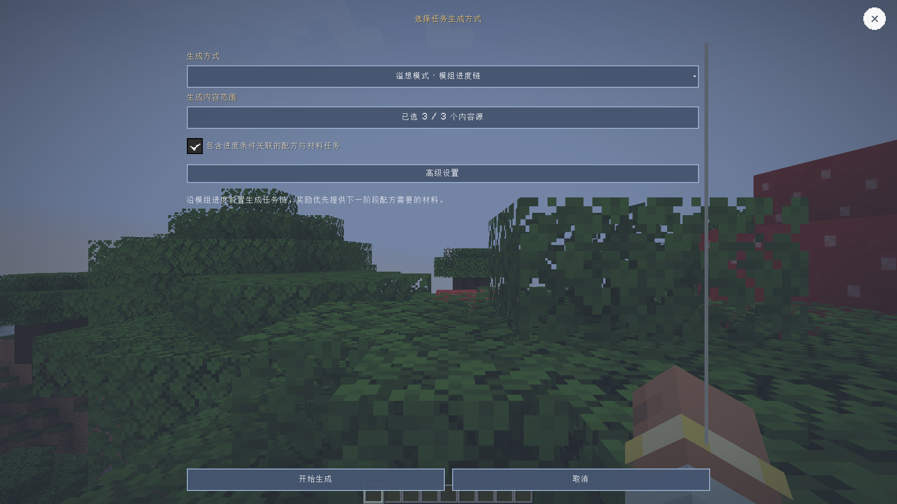
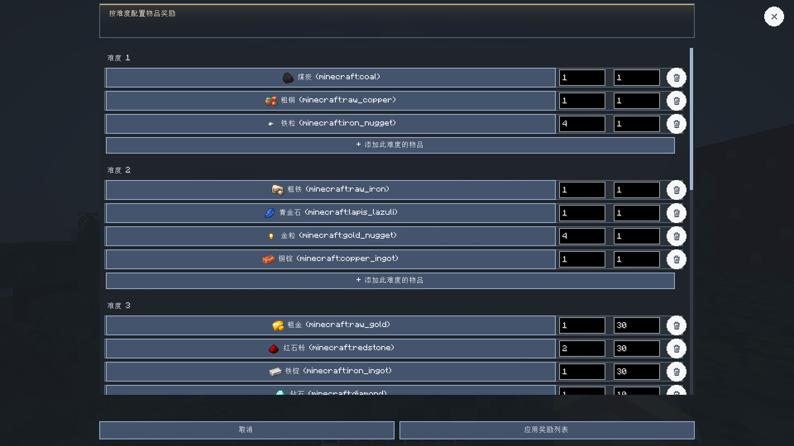
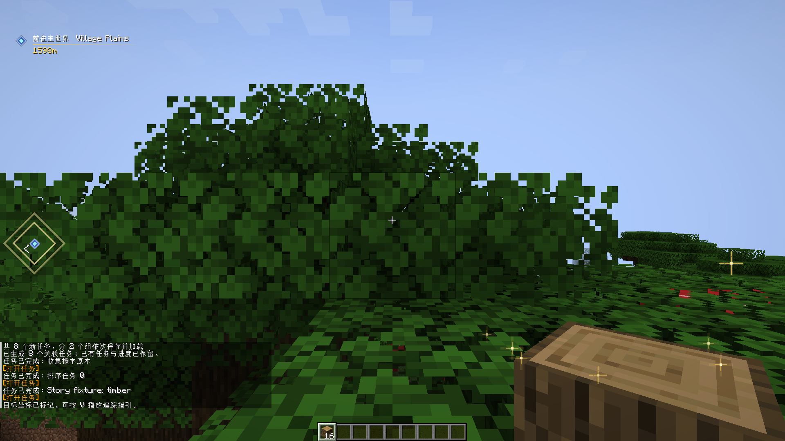

# Xero Quest Journal 0.2.5

**简体中文** | [English](#english)

## 更新内容

- 自动逸闻按游戏日新增 1–4 条结构探索条目。每条逸闻先生成可追踪的抵达目标；下一游戏日为同一条目追加后续记录与关联任务。
- 村庄后续目标要求找到村庄钟并敲响三次；其他结构会生成相关物品收集目标。逸闻、任务、章节和调度游标共同保存，避免每日重复生成。
- 自动生成范围支持多选模组；难度奖励支持分级加权战利品、高级倍率及逐项调整。
- 完成条件物品详情、奖励编辑、任务列表滚动和拾取/追踪提示继续完善。
- 客户端回归使用 1920×1080 窗口；自动检查截图尺寸，小布局覆盖通过调整 GUI 缩放模拟。

## 下载与兼容

从 [GitHub 0.2.5 Release](https://github.com/XTDPotato/xero_quest_journal/releases/tag/v0.2.5)
选择与 Minecraft 版本和加载器匹配的单个 JAR。Release 附有四平台 JAR、分类合集 ZIP 和 `SHA256SUMS.txt`。

| Minecraft | 加载器 | Java |
| --- | --- | --- |
| 1.20.1 | Forge 47.3.0 | 17 |
| 1.20.1 | Fabric | 17 |
| 1.21.1 | NeoForge 21.1.233 | 21 |
| 1.21.1 | Fabric | 21 |

26.1–26.3 尚未完成完整迁移，本版本不提供这些目标的安装包。多人游戏的客户端和服务端需使用相匹配的版本。

## 界面截图

以下截图来自实际客户端，分辨率均为 1920×1080。

## 验证

构建命令、四平台产物、打包器校验和 SHA-256 见[0.2.5 发布验证记录](../release-verification-0.2.5.md)。
每日逸闻的 1080p 客户端回归覆盖批次数量、首日抵达记录、次日续篇、村庄敲钟/物品收集条件、
关联前置、当日幂等及调度状态保存恢复。

## English

### Changes

- Daily anecdote generation adds 1–4 structure-exploration entries per in-game day.
  Each entry starts with a trackable arrival objective; the next game day appends a follow-up record and linked task to that same entry.
- Village follow-ups require ringing the village bell three times. Other structures produce a related item-acquisition objective.
  Anecdotes, tasks, chapter membership and the scheduler cursor persist together to avoid duplicate daily batches.
- Generation scopes support multi-select mod namespaces. Difficulty rewards support weighted loot tiers,
  advanced multipliers and per-item editing.
- Objective item inspection, reward editing, journal scrolling, and pickup/tracking notices receive further fixes.
- Client regressions use a 1920×1080 window and assert screenshot dimensions. Compact-layout coverage changes GUI scale without lowering render resolution.

### Downloads And Compatibility

Choose one JAR matching both Minecraft and loader from the
[GitHub 0.2.5 Release](https://github.com/XTDPotato/xero_quest_journal/releases/tag/v0.2.5).
The release includes four supported JARs, an organized bundle ZIP and `SHA256SUMS.txt`.

| Minecraft | Loader | Java |
| --- | --- | --- |
| 1.20.1 | Forge 47.3.0 | 17 |
| 1.20.1 | Fabric | 17 |
| 1.21.1 | NeoForge 21.1.233 | 21 |
| 1.21.1 | Fabric | 21 |

The 26.1–26.3 migrations remain incomplete and have no installable artifacts in this release.
Multiplayer clients and servers must use matching builds.

### Screenshots

All images are actual client captures at 1920×1080.

### Verification

Build commands, production artifacts, packaging checks and SHA-256 hashes are recorded in the
[0.2.5 verification report](../release-verification-0.2.5.md). The 1080p client regression covers
daily batch size, first-day arrival records, next-day follow-ups, village bell/item conditions,
prerequisite linking, same-day idempotence and scheduler save/load.
