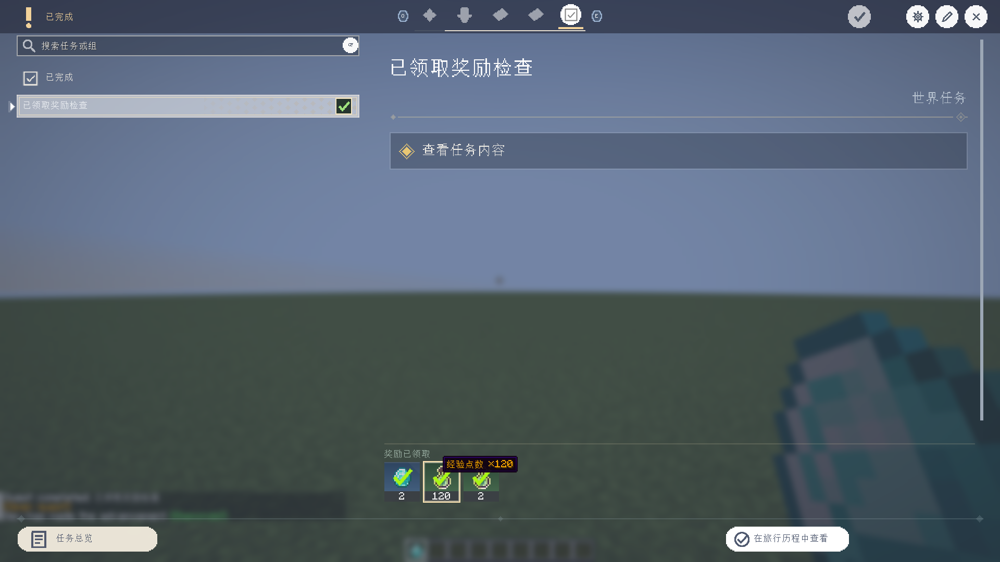

# Xero Quest Journal 0.2.6

**简体中文** | [English](#english)

## 更新内容

- 自动生成任务的经验点数和经验等级奖励显示经验之瓶图标；悬浮奖励卡时显示本地化名称与准确数量，例如“经验点数 ×2”。
- 点击或检查经验奖励时，详情显示正确的奖励类型、数量和说明，不再落入通用“物品”详情。
- 任务列表 tooltip 遇到内嵌战利品表时展开为可读奖励名称与数量，不显示 `inline` JSON、`weight` 等原始字段。
- 修复任务详情滚动容器的裁剪状态可能泄漏到物品 tooltip，造成提示缺字、混色或被截断的问题。

## 下载与兼容

从 [GitHub 0.2.6 Release](https://github.com/XTDPotato/xero_quest_journal/releases/tag/v0.2.6)
选择与 Minecraft 版本和加载器匹配的单个 JAR。Release 提供四个平台独立 JAR、分类合集 ZIP 与 `SHA256SUMS.txt`。

| Minecraft | 加载器 | Java |
| --- | --- | --- |
| 1.20.1 | Forge 47.3.0 | 17 |
| 1.20.1 | Fabric | 17 |
| 1.21.1 | NeoForge 21.1.233 | 21 |
| 1.21.1 | Fabric | 21 |

26.1–26.3 尚未完成完整迁移，本版本不提供对应安装包。多人游戏客户端与服务端需使用匹配版本。

## 界面截图

截图由 NeoForge 1.21.1 实际客户端捕获，分辨率为 1920×1080。

## 验证

- `compileJava compileSmokeJava`：通过。
- `runClient -PrewardInspectionTest`：通过，验证已领取奖励详情、物品 tooltip、经验点数/等级图标与数量、战利品/自选奖励查看，以及查看后返回原界面。
- 新增 tooltip 截图回归强制检查 1920×1080。
- 四平台独立生产构建与资产哈希记录见[发布验证报告](../release-verification-0.2.6.md)。

## English

### Changes

- Automatically generated experience-point and experience-level rewards use the experience-bottle icon.
  Hovering a reward card shows its localized type and exact amount, such as “Experience points ×2”.
- Inspecting an experience reward now shows its correct type, amount and explanation instead of generic item details.
- Inline loot-table rewards in task-row tooltips expand into readable reward names and amounts; raw `inline` JSON and `weight` fields are no longer exposed.
- Fixed leaked scissor state from task-detail scroll containers that clipped, recolored or truncated item tooltips.

### Downloads And Compatibility

Choose a single JAR matching both Minecraft and loader from the
[GitHub 0.2.6 Release](https://github.com/XTDPotato/xero_quest_journal/releases/tag/v0.2.6).
It contains four platform JARs, an organized bundle ZIP and `SHA256SUMS.txt`.

| Minecraft | Loader | Java |
| --- | --- | --- |
| 1.20.1 | Forge 47.3.0 | 17 |
| 1.20.1 | Fabric | 17 |
| 1.21.1 | NeoForge 21.1.233 | 21 |
| 1.21.1 | Fabric | 21 |

The 26.1–26.3 migrations remain incomplete and have no installable artifacts.
Multiplayer clients and servers must use matching builds.

### Screenshot

Captured from a NeoForge 1.21.1 client at 1920×1080.

### Verification

- `compileJava compileSmokeJava`: passed.
- `runClient -PrewardInspectionTest`: passed, covering claimed-reward inspection, item tooltips,
  experience points/levels icons and amounts, loot/choice inspection, and returning to the parent screen.
- Screenshot regression asserts 1920×1080 dimensions.
- Four production builds and artifact hashes are recorded in the
  [release verification report](../release-verification-0.2.6.md).
