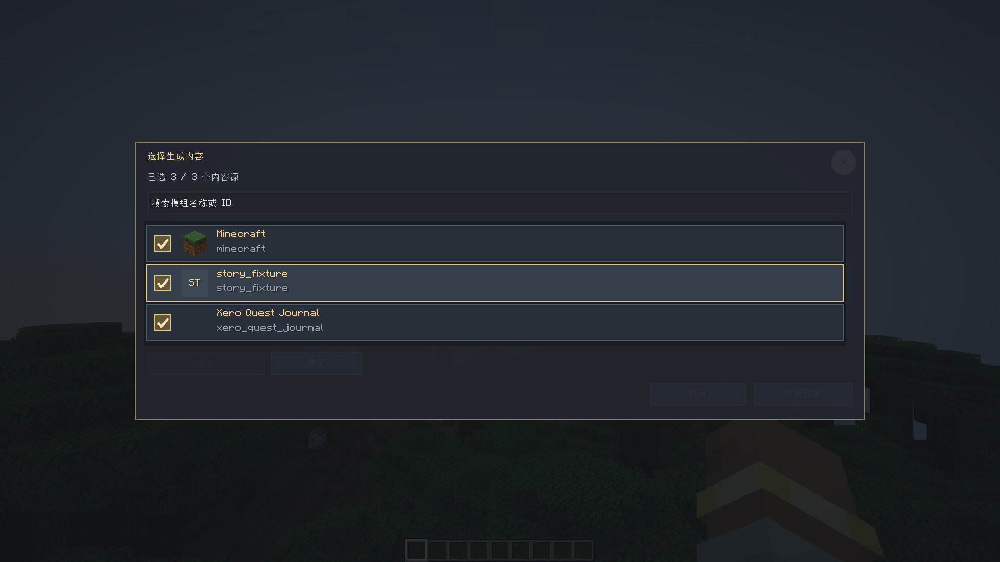
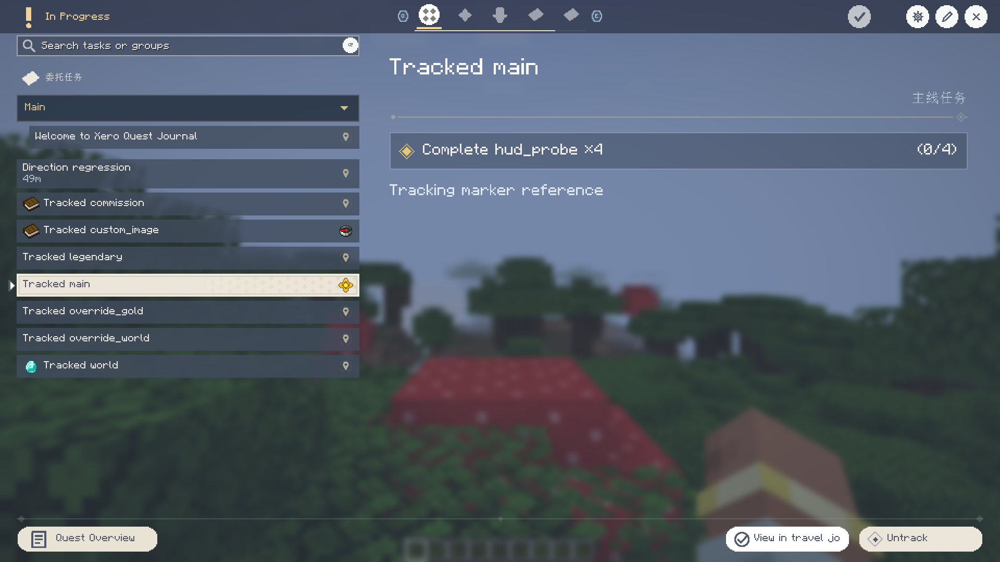

# Xero Quest Journal 0.2.7

**简体中文** | [English](#english)

## 更新内容

- 修复溢想模式生成的空奖励、重复内嵌战利品表和历史 JSON 奖励；任务奖励编辑器隐藏空物品行，正确识别战利品表名称与图标。
- 奖励表格改为响应式 8–12 列，列表模式更紧凑并保持多条奖励同时可见；战利品表奖励可从编辑对话框直接打开详情。
- 结构探索任务按维度进度设置前置，避免过早暴露下界或末地目标；日更逸闻保持每天生成 1–4 条。
- 获取物品条件会在未手动追踪任务时继续累计；拾取提示与可完成的获取目标关联，背包内容变化会刷新持有条件快照。
- 坐标指引支持水面、水下与斜向最短路线，过滤被方块遮挡的路线标记；目标标记随距离缩放。任务追踪 HUD 在物品栏打开时保持显示。
- 任务界面新增 `F` 快速追踪/取消追踪，`W/S` 切换任务时播放详情切换动画；任务行间隙会选择最近一行。
- 成功追踪坐标任务后，可在 Xaero 世界地图或 JourneyMap 创建任务航点并打开地图。没有地图模组时保持正常追踪；取消追踪不会触发地图操作。

## 下载与兼容

从 [GitHub 0.2.7 Release](https://github.com/XTDPotato/xero_quest_journal/releases/tag/v0.2.7)
下载与 Minecraft 版本和加载器匹配的单个 JAR。Release 附带四个平台安装包、分类合集 ZIP 和 `SHA256SUMS.txt`。

| Minecraft | 加载器 | Java |
| --- | --- | --- |
| 1.20.1 | Forge 47.3.0 | 17 |
| 1.20.1 | Fabric | 17 |
| 1.21.1 | NeoForge 21.1.233 | 21 |
| 1.21.1 | Fabric | 21 |

多人游戏客户端与服务端需使用匹配版本。26.1–26.3 尚未完成完整迁移，本版本不提供相应安装包。
JourneyMap 是可选集成；NeoForge 1.21.1、Fabric 1.21.1 与 Forge 1.20.1 带有航点桥接，
Fabric 1.20.1 保持普通追踪降级。不安装 Xaero 世界地图或 JourneyMap 时，核心模组不依赖其运行。

## 界面截图

以下图片由实际客户端在 1920×1080 分辨率捕获。

## 验证

构建与客户端回归的具体命令、结果、JAR 哈希见[发布验证报告](../release-verification-0.2.7.md)。

## English

### Changes

- Fixed empty and duplicate inline-loot rewards in generated stories, plus legacy JSON rewards.
  The reward editor now hides blank item rows and resolves loot-table names and icons.
- Made the reward table responsive with 8–12 columns. The compact list mode keeps multiple
  rewards visible, and loot-table details can be opened from the edit dialog.
- Gated Nether and End exploration tasks behind dimension progression. Daily anecdote generation
  remains at one to four entries per in-game day.
- Item-acquisition objectives now progress even when they are not manually tracked. Pickup notices
  are tied to eligible objectives, and inventory changes invalidate carried-item snapshots.
- Improved coordinate guidance over water, underwater and along diagonal shortest paths.
  Occluded route markers are filtered, target markers scale with distance, and the tracking HUD
  stays visible while the inventory is open.
- Added `F` to quickly track/untrack the selected task. `W/S` switches tasks with a detail
  transition, and clicking the spacing between rows selects the nearest task.
- Tracking a coordinate task can create a named waypoint in Xaero World Map or JourneyMap and
  open the map. JourneyMap remains optional; untracking does not open a map.

### Downloads And Compatibility

Download a single JAR matching both the Minecraft version and loader from the
[GitHub 0.2.7 Release](https://github.com/XTDPotato/xero_quest_journal/releases/tag/v0.2.7).
The release includes four platform JARs, an organized ZIP and `SHA256SUMS.txt`.

| Minecraft | Loader | Java |
| --- | --- | --- |
| 1.20.1 | Forge 47.3.0 | 17 |
| 1.20.1 | Fabric | 17 |
| 1.21.1 | NeoForge 21.1.233 | 21 |
| 1.21.1 | Fabric | 21 |

Client and server builds must match in multiplayer. The 26.1–26.3 migrations are incomplete and
have no installable artifacts. JourneyMap is optional. Waypoint integration is included for
NeoForge 1.21.1, Fabric 1.21.1 and Forge 1.20.1; Fabric 1.20.1 uses the standard tracking fallback.

### Screenshots

Captured from real clients at 1920×1080.

### Verification

Build and client regression commands, results and JAR hashes are recorded in the
[release verification report](../release-verification-0.2.7.md).
