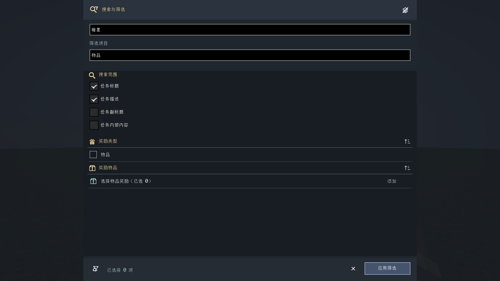
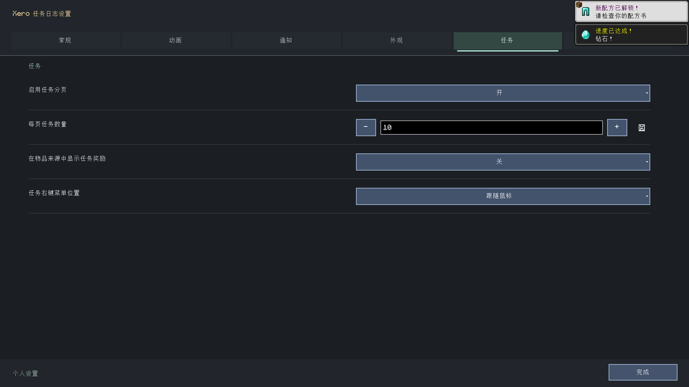
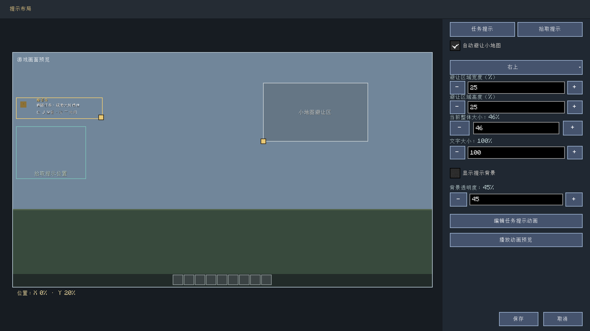
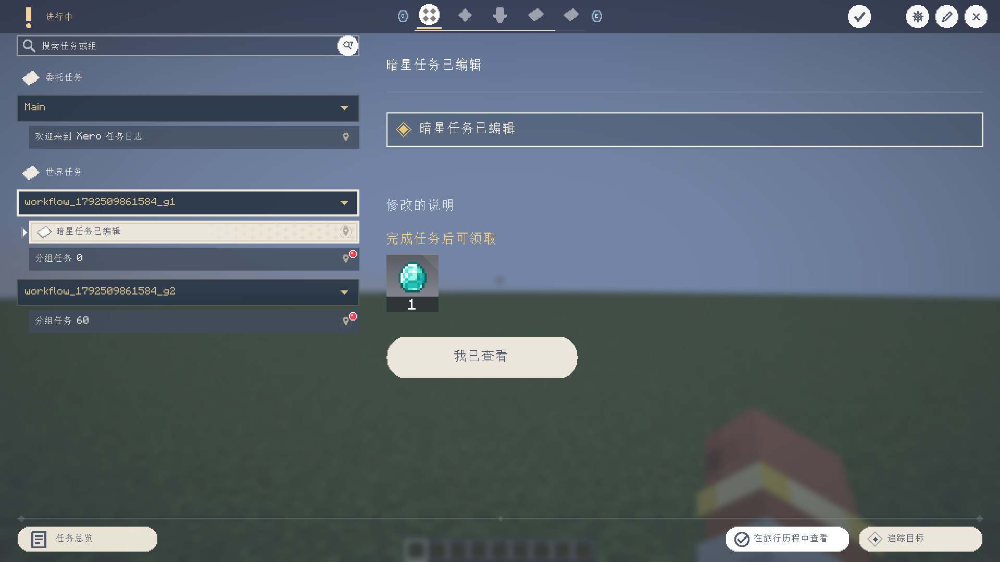

# 搜索筛选与任务解锁图

**简体中文** | [English](en/task-search-and-unlock-graph.md) · [文档中心](README.md)

本文记录本地开发中的改动；GitHub 上已有的 0.2.2 发布包不包含这些新改动。

## 搜索与筛选

点击任务搜索框旁的“放大镜与漏斗”按钮，打开统一面板。
上方是任务搜索文字和筛选项搜索，下方在同一滚动区域内依次排列搜索范围、
分类、任务组、状态、模板、奖励类型/物品、完成条件类型/目标。
不再从搜索设置跳转到另一张筛选页面。

- 搜索范围支持标题、描述、副标题、任务内部内容，默认启用标题和描述。
- 同一类筛选选中多项时满足其中任意一项即可，不同类之间必须同时满足。
- “筛选项目”输入框只过滤可选项目，支持名称、ID 与可用的拼音索引。
- 物品、目标选择器用于添加具体筛选值；返回后保留当前筛选草稿和滚动位置。
- 长列表平滑滚动，可拖动右侧滚动条。超出视口的选项不会遮挡固定工具栏。
- 底部漏斗清除图标清空筛选；“应用并关闭”保存范围和筛选并返回任务列表。
- 各筛选分区可单独折叠；顶部折叠按钮一键折叠或展开全部分区，已选值不会丢失。
- 底部取消图标或 Esc 放弃草稿并恢复原搜索文字，点击外侧不会自动关闭。



## 图标含义

| 入口 | 图标 |
| --- | --- |
| 展开/隐藏任务控件列表 | 叠放图层 / 带斜线的图层 |
| 从编辑状态进入预览 | 眼睛 |
| 搜索范围与筛选 | 放大镜与漏斗 |
| 清空筛选 | 带清除箭头的漏斗 |
| 解锁图任务列表 | 列表 |
| 解锁图多选 | 勾选列表，开启后保留选中状态 |
| 关闭窗口 | 统一关闭图标 |

悬浮按钮可查看具体操作提示。隐藏控件列表不会关闭任务界面。

## 解锁图布局与前置

顶部搜索使用 120ms 防抖和后台拼音索引，输入时保留已有结果；较早查询的结果不会覆盖最新输入。
支持任务标题、ID、描述、所属组和章节名称。左侧复用任务界面的分类、任务组、图标与行布局，
只绘制可见行及少量缓冲行。任务组的折叠记录与外面的任务界面共享；搜索期间临时展开匹配组，
清空搜索后恢复原折叠记录。选中任务后，底部展示名称、所属组与章节；移除已解锁总进度条，压缩底部高度。


任务属性弹窗按任务画布与内容自适应尺寸；长内容在面板内平滑滚动，不再留下宽大的空白区域。
奖励区留在底部，避免随正文滚出视口。


默认按任务组分行；没有任务组时按任务类型分行。
每行按前置深度从右向左排列，超长组会延续到下一行。
已有手动位置保留；点击“按任务组排列”图层按钮才重新整理画布。
整理、连线、前置模式切换均可撤销/重做，最终使用保存按钮写入定义。
任务抽屉的滑入/滑出保留画布位置，不再推着任务节点移动；重建工具栏时保留零偏移，
自动适配只在首次打开或主动点击适配按钮时执行。

选中任务后，顶部可切换“完成全部前置任务”或“完成任意前置任务”。
多选状态下应用到所选任务。新建/旧版任务默认使用全部前置。
任务属性页也可修改该设置；自环、循环和无效任务引用仍由服务端拒绝。

左键双击节点或右键选择“打开任务”可直接打开对应任务，即使该任务尚未解锁。
返回后保留解锁图草稿与视野。右键“属性”内展示实际任务界面、完成条件和底部奖励，
长内容可平滑滚动，也可以从属性页打开任务。

JSON 对应字段为：

```json
{
  "completionPolicy": {
    "prerequisiteMode": "any"
  }
}
```

上述片段仅展示相关字段，合并到现有任务定义即可。
XML/HTML 定义在任务根标签设置，例如 `<quest id="example" prerequisite-mode="any">…</quest>`；
`all` 表示全部。无前置时保持任务原有默认解锁开关，显式锁定/解锁仍有优先级。

右下角缩略图随主画布滚轮同步缩放、跟随当前位置居中，显示附近任务和当前可见区域的黄色矩形。
任务点和视野框采用同一等比映射，保留当前画布的宽高比；
任务点与主图使用同一状态规则和颜色：绿色可进行、黄色已完成、红色未解锁。
预览收录所有任务，不按主画布可见范围或旧点位分箱删除任务；
密集重叠区域保存全部状态并采用彩色交错像素，底部统计和悬浮提示展示三个状态的总数量。
范围外的任务以方向箭头和状态色提示，悬浮显示各方向数量。
点缩略图上方的“查看全部”图标可切换完整总览，再次点击或滚动鼠标恢复同步缩放。
完整总览包含全部任务；密集区域因屏幕像素有限会重叠，数量统计仍完整。
任务状态变化后刷新颜色缓存；静止时复用栅格化结果。
点击或拖动可以快速定位。拖动期间不显示缩略图 tooltip；指针靠近边缘时持续移动映射，
可超出任务范围连续导航，不再卡在边界。松开后保留当前位置，不会再次跳回居中；
主动滚轮缩放、适配或平移画布后恢复跟随映射。
完整总览也包含当前视野，移动到任务范围以外时仍能看到视野框。


绘制只处理视口内的节点和连线，文字和缩略图点位使用缓存。
缩小时保留可读标题；普通连线使用静态折线，仅选中连线播放流动效果。
工具按钮圆形背景、节点表面/文字/端口、网格和连线分批提交，减少大量微小绘制调用。
1202 任务的 1080p 实测及条件见 [性能测量](#性能测量)。

## 模板与目标行

任务目标行在玩家模式悬浮时显示白色边框，点击仍打开完成条件详情。
编辑任务属性或保存独立布局时保留模板控件及分隔线，不回写其他任务使用的共享模板。
模板内已有奖励控件时，不再额外增加第二份底部奖励。

无模板任务也使用同一套可编辑控件，进入编辑和预览时保留目标矩形背景、菱形进度、
类型文字和装饰分隔线；旧自动布局缺失这些控件时会补齐。网格位于面板背景上方、
任务控件下方，工具栏网格按钮可开关显示。


## 领取、提示与分页

- 列表领取按钮保留红色圆形背景，缩小后与同栏图标对齐；完整按下并在按钮内松开才领取。
- 单项领取成功后切换到已完成分类并选中该任务。W/S 切换上一个/下一个任务，输入文字时保留文本操作。
- 新任务提示默认 J 打开对应任务，~ 关闭当前一条；V 继续用于坐标追踪。右上角全部已读也清除待播放的新任务提示。
- 状态 toast 绘制在奖励物品和勾选标记上方。
- 设置 → 通知 → 可视化提示布局可分别调节两类提示文字字号（50–200%），字号不随整体尺寸缩小；长任务名/物品名会按提示可用宽度裁切，图标右侧保留独立间距。
- 小地图避让区域在预览中可拖动角落手柄调整宽高，也可用 5–50% 数字控件精确调整；自动避让依据此尺寸保留区域。编辑器顶部栏已压缩，底部不再铺固定背景。
- 设置 → 任务 → 每页任务数量，可输入 10–1000，默认 50；点击保存后由服务端持久化，需要任务管理权限。服务端 `config.json` 对应 `tasksPerPage`。
- 本次网络协议为 13，服务端与客户端使用相同构建更新。通知预览使用可视化布局编辑器，移除设置内无法显示的单独预览按钮。
- 拾取提示使用紧凑尺寸，与当前追踪任务的获取、持有、提交物品条件关联；成功提交后显示实际提交数量，失败提交和无关物品不提示。每条新增提示独立入场，最多保留最新四条。详见[生成、模板与提示布局](generation-and-template-library.md)。







## 验证

```powershell
.\gradlew.bat runClient -PtaskWorkflowTest --offline --console=plain
.\gradlew.bat runClient -PunlockGraphTest --offline --console=plain
.\gradlew.bat runClient -PgenerationTest --offline --console=plain
```

真实 NeoForge 1.21.1 客户端检查属性编辑/保存/重开、控件保留、目标行白边像素、
共享模板不变、奖励去重、全部/任意前置、撤销/重做、可见区域裁剪、
缩略图比例/拖动，以及统一搜索面板的中文、英文和小窗口布局。
解锁图专项另外覆盖连线操作、循环拒绝及 1200 个节点布局边界。
任务界面回归还覆盖搜索取消/折叠、原生编辑控件、网格开关、领取后的选中任务、W/S、
双击跳转与属性预览、J/~ 和提示队列、toast 遮挡像素，以及分页 10/1000、越界拒绝和网络编解码。
这不是全部功能或所有加载器的交互测试。
生成专项还覆盖 2000 个任务的后台拼音搜索、过期结果丢弃、共享折叠、选中任务元信息、
缩略图边缘连续移动/松开不跳动，以及获取/提交提示。该次搜索输入处理约 0.045ms；这不是整帧耗时或最低帧率保证。

## 性能测量

```powershell
.\gradlew.bat runClient -PtaskWorkflowTest -PunlockGraphPerf --offline --console=plain
```

使用 Ryzen 9 9950X3D、RTX 5070 Ti、1920×1080、GUI 比例 2、NeoForge 1.21.1 开发客户端，
生成 1202 个任务，开启动画和一条选中连线动画。包含世界渲染；关闭垂直同步，
帧率设置为 260（原版对应无限制），测试结束恢复个人设置。
每个场景预热 5 秒、采样 10 秒，按真实帧间隔计算平均帧率和 P95/P99 帧耗时。
可附加 `-PunlockGraphProfile` 写出 JFR 采样，正式帧率记录关闭分析器。
性能测试包含自动平移/缩放；检测到人工拖动、点击或视野变化时立即取消自动测试，
保留当前视野和草稿，不自动保存或继续后续测试点击。该测试脚本不打包到正式 JAR。

未优化微小绘制调用时，三场景平均约 123–140 FPS；批量绘制后已超过 120 平均 FPS。
仍可能出现单帧低于 120 FPS，不能将平均值等同于任何机器、任何时刻的最低保证。
最新原始数据见 [性能 JSON](reference/unlock-graph-performance.json)。

2026-10-20 最终测量（关闭分析器）：

| 场景 | 平均 FPS | P99 帧耗时 | 1% low FPS |
| --- | --- | --- | --- |
| 静止 | 516.2 | 7.77ms | 110.4 |
| 平移 | 177.7 | 11.68ms | 80.0 |
| 连续缩放 | 172.7 | 11.73ms | 69.8 |

三场景平均均超过 120；平移和缩放的长帧尚未达到持续 120 的目标，仍需继续优化。
多轮结果会波动，保留最新一轮数据，不以较高的一轮代替最终结果。
