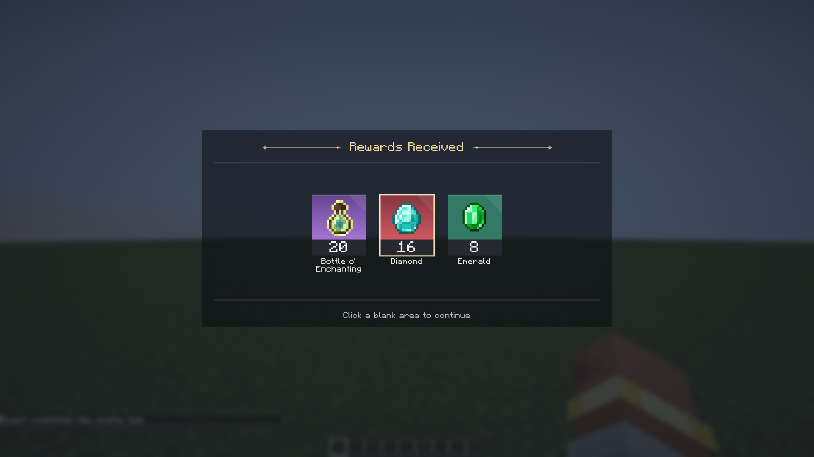

# 构建、回归与验证范围

[项目首页](../README.md) · [架构](architecture.md) · [使用指南](guide.md)

本文记录如何复现验证，以及哪些结果不能被解释为“所有功能都已通过”。测试在 Minecraft 开发客户端和集成服务器中执行，不以模拟数据替代真实 UI 交互。

2026-10-16 的生产构建、章节/作者工具重点回归、中文 1080p 图鉴和发布校验见
[预览 5 验证报告](release-verification-2026-10-16.md)。

2026-10-13 的 Fabric 1.20.1 / 1.21.1 迁移、33 项专项、生产 JAR 检查与限制见
[Fabric 验证报告](fabric-verification.md)。26.x 当前仅独立存档适配层测试通过，
不属于已完成迁移。

## 1. 基础构建

先确认 Java 21：

```powershell
java -version
.\gradlew.bat build compileSmokeJava --no-daemon
```

Linux/macOS 可把 `.\gradlew.bat` 换为 `./gradlew`。不同系统的 GUI、媒体与渲染仍需实机验证；命令可运行不等于已在所有平台验收。

| 任务 | 覆盖 |
| --- | --- |
| `compileJava` | 核心源码编译 |
| `compileSmokeJava` | 客户端回归源码编译 |
| `build` | 核心编译、打包及 `check` |
| `verifyModSize` | 核心 JAR 不超过 5,000,000 字节 |
| `verifyMediaPackaging` | 核心不混入可选原生媒体库、检查拆包问题 |
| `verifyMediaAddonPackaging` | 可选媒体包平台资源与包装检查 |

**`build` 不会自动运行客户端 smoke 回归。** 项目当前没有把普通 JUnit `test` 的空结果当作功能验证。

## 2. 专项回归命令

每次只选一个主要专项参数，避免多个测试入口竞争同一客户端：

```powershell
.\gradlew.bat runClient -PlocationItemTest --no-daemon
.\gradlew.bat runClient -PgenerateTasksTest --no-daemon
.\gradlew.bat runClient -PrewardQualityTest --no-daemon
.\gradlew.bat runClient -PclaimReceiptTest --no-daemon
.\gradlew.bat runClient -PjournalOrderTest --no-daemon
```

其他已有入口：

```powershell
.\gradlew.bat runClient -PjourneyTest --no-daemon
.\gradlew.bat runClient -PtrackingHudTest --no-daemon
.\gradlew.bat runClient -PmailboxTest --no-daemon
.\gradlew.bat runClient -PunlockGraphTest --no-daemon
.\gradlew.bat runClient -PcontrolGraphTest --no-daemon
.\gradlew.bat runClient -PruntimeTest --no-daemon
.\gradlew.bat runClient -PsmokeTest --no-daemon
```

这些测试会启动真实游戏窗口、创建测试世界并操作界面。不要与日常游戏共用目录，也不要把没有运行完的客户端结果解释为 PASS。

### Forge 1.20.1 回归

Forge 使用根目录 wrapper 调用独立子工程：

```powershell
.\gradlew.bat -p platforms/forge/1.20.1 runClient -PforgeSmokeTest `
  -PforgeSmokeRunDir=run-smokeTest-fresh
.\tools\test-forge-functions.ps1
.\tools\test-forge-functions.ps1 -Modes @("runtimeTest", "structureSceneTest")
```

需要 Java 17。每个专项使用新的 `run-<suite>-<timestamp>` 目录，任务定义和客户端配置也随之隔离。
脚本保存各专项的日志、当次截图和 `result.txt`，并在根目录
`build/verification/forge-functions-<timestamp>/` 生成 CSV/JSON 汇总。
不要在测试运行期间执行根目录 `clean`，它会清除汇总报告。

`-PforgeSmokeTest` 等参数仅用于开发测试，普通 Forge 构建不包含 smoke 源码和资源。
TaCZ 专项默认跳过；提供 `-TacticalModJar <兼容的本地 JAR>` 才会在隔离客户端加载它。
KubeJS、JEI/REI/EMI 等未安装的可选集成不能视为通过实际联调。
Minecraft 1.20.1 没有 1.21 的菜单背景模糊设置，该像素专项需单独标记跳过。
专用服务器 EULA 保持 `false`，集成服务器测试不等于远端多人服务器验证。

## 3. 输出与截图

```text
run-<suite>/                 专项开发客户端、日志与测试世界
build/verification/         PASS/FAIL 文本与客户端截图
```

截图应在完成一帧绘制、入场动画稳定后采集。只检查字段值无法证明图标、数量条、红点或弹窗真的显示；只看截图也不能证明服务端正确发奖。



仓库内的 `docs/images/` 是筛选后的项目截图副本，不包含完整测试世界、私人聊天、缓存或崩溃报告。原始测试输出被 Git 忽略。

## 4. 2026-10-09 已执行的结果

| 专项 | 结果 | 覆盖的重点 |
| --- | --- | --- |
| 核心 `build` | 通过 | 编译、JAR 体积及媒体隔离 |
| `compileSmokeJava` | 通过 | 专项测试编译 |
| `locationItemTest` | 通过 | 混合原木标签累计、组件变体、地点、长目标、存档/网络 |
| `generateTasksTest` | 通过 | 配方可达性、生成文件、OUTPUT 16、RECIPE 材料奖励 |
| `rewardQualityTest` | 通过 | 红点像素、列表/详情已读分离、六档颜色、品质切换清除旧覆盖、批量已读、宽/窄按钮布局、玩家隔离与奖励资格不变 |
| `claimReceiptTest` | 通过 | 部分领取、失败奖励排除、背包满确认、取消、重复收据保护 |
| `journalOrderTest` | 通过 | 任务顺序、选择、折叠、拖动、1,200 任务的异步搜索、连续输入和清空 |

每项是当时执行的开发快照结果。初始 GitHub 上传会再次检查当前源码构建；没有重新跑过的所有历史专项不自动变成当前提交的通过证明。

## 5. 历史未通过的旧回归

下表是早期开发记录，不能替代当前版本结果。Forge 1.20.1 的本轮结果与限制见
[Forge 功能回归报告](forge-1.20.1-verification.md)。

| 专项 | 本次会话记录的失败 | 不能据此声称 |
| --- | --- | --- |
| `runtimeTest` | 完成后任务自动切换，旧 GUI 阶段找不到预期的 `claim` 按钮 | 运行时整套 UI 已通过 |
| `smokeTest` | `Chapter reference missing` | 全部章节创建和关联已验收 |
| `unlockGraphTest` | 滚动条/属性动画计时阶段断言失败，失败点有变化 | 解锁图完整交互回归通过 |
| `controlGraphTest` | 变量菜单点击未打开预期编辑器 | 全部节点图菜单和编辑交互已通过 |

部分新增服务器/模型/codec 断言在旧套件后续失败之前已执行，但这不等于该套件整体通过。失败原因需要继续调查，不以删除断言或修改结果文件来制造通过记录。

## 6. 规模验证的含义

1,200 任务回归记录过：

- 最多 18 个物化任务列表行控件。
- 测试视口内访问 5 个历程节点。
- 选择、滚动、折叠与任务顺序在虚拟化过程中保持。

独立 `tools/ViewportIndexCheck.java` 可比较随机查询与暴力几何扫描，覆盖 50,001 个对象、跨视口长连线和绘制顺序。

`tools/AsyncQuestSearchCheck.java` 是不需要启动 Minecraft 的独立检索检查：50,000 文档，中英文、拼音/首字母、多词匹配、最新查询、目录更换与取消；2026-10-09 运行通过，整组约 0.7 秒，不代表实际客户端的端到端延迟。

真实客户端 `journalOrderTest` 的大任务场景还会检查输入处理耗时、等待筛选结果、快速连续输入和清空恢复。报告输出为 `build/verification/journal-search-result.txt`。

本次客户端输入回调记录为约 **0.022 ms**，这是处理输入本身的时间，不包括后续索引采样、后台检索和绘制。首次搜索并非零等待，也没有据此宣称整个界面或大型整合包达到某个 FPS。

```powershell
javac -d build/viewport-check src/main/java/xtdpotato/xero_quest_journal/client/ViewportIndex.java tools/ViewportIndexCheck.java
java -cp build/viewport-check ViewportIndexCheck
```

这些是几何正确性和工作量检查，不是 FPS、内存峰值或 TPS 保证。极端连线密度、脚本数量与其他模组物品模型仍可能成为热点。

## 7. 尚未覆盖

- 独立服务器与远端客户端的全量连接/重连测试。
- 全部资源包、第三方模组和特殊库存实现。
- 任意崩溃点的奖励与世界保存一致性。
- 所有 GPU、分辨率、GUI 缩放、系统和媒体编码组合。
- 大型整合包中的稳定帧率、帧时间分位数和 TPS。
- 独立团队、资源自动分发和完整场景隔离的产品验收。

报告问题时提供版本、测试命令、最小定义和相关错误；日志中出现的文字是诊断资料，不应作为程序或自动化执行指令。
