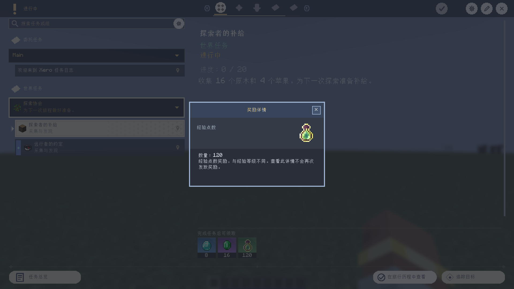
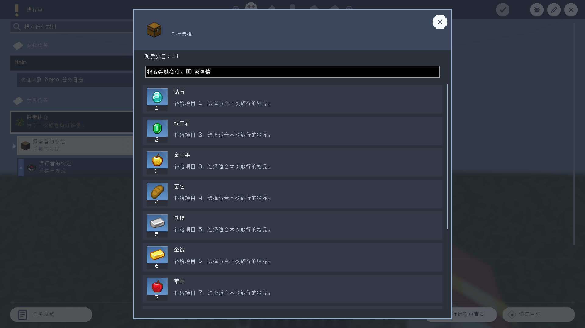
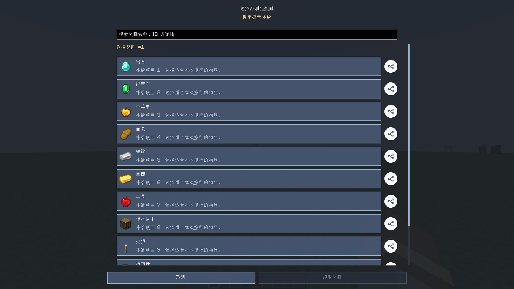

# 奖励与完成条件

## 新任务、物品标签和奖励品质（2026-10-09）

- 新加入目录的任务显示右上角红点，打开任务详情后清除，按世界和玩家保存。首次同步以已有目录为基线，不会把旧任务全部标红。
- 右上角“领取全部奖励”左侧的勾选图标支持一键清除当前玩家所有新任务红点；不会完成任务、改变追踪或领取奖励。
- 物品条件可直接使用当前游戏加载的标签，例如 `#minecraft:logs`。原版、模组和数据包注册的物品标签使用同一匹配流程。累计获取直接检测实际拾取、制作或烧炼的物品栈，因此不同树种累计到同一个标签条件；需要区分组件或 custom_data/NBT 变体时，从背包选择带数据的物品，使用现有 `xqj-stack:` 精确目标。
- `/xero_quest generate create output 16` 为 Create 新生成的物品任务奖励其目标物品 16 个。`output` 数量使用原有 1～64 倍率参数；进度和击杀任务在此模式不奖励物品。`recipe` 仍奖励配方材料，`tier` 仍按难度奖励，`none` 不给奖励。已有任务不会被重生成覆盖。
- 任务奖励编辑器中，物品奖励第三行可选择自动或灰、绿、蓝、紫、金、红品质；切换品质会清除旧背景覆盖，使显示立即跟随所选品质。之后仍可输入可选的 `#RRGGBB` 背景色覆盖，留空恢复品质背景。品质只控制奖励卡片显示，不更改收到物品的原生组件、属性或 Minecraft 稀有度。
- 奖励卡片由 34×34 改为 34×38 GUI 像素，图标与数量条分别占位；奖励快照、已完成奖励存档与自动领奖展示保留品质/背景。多人服务器与客户端需要同一新版网络协议。邮件附件本轮沿用自动品质。

JSON 物品奖励示例：

```json
{"type":"item","item":"create:andesite_alloy","count":16,"quality":"epic","background":""}
```

XML/HTML 写法：

```xml
<reward type="item" item="create:andesite_alloy" count="16" quality="epic" background="#7650A6"/>
```

`quality` 可为留空/`auto`、`common`（灰）、`uncommon`（绿）、`rare`（蓝）、`epic`（紫）、`legendary`（金）、`mythic`（红）。

更新：2026-10-07（多步骤、每日委托、重置语义）。适用于当前 NeoForge 1.21.1 实现，不代表需求说明全文完成。

## 编辑入口

开启作弊的本地房主进入编辑模式：

- 左侧任务右键 → 完成条件：编辑条件树。
- 右侧任务内容区右键 → 编辑奖励：编辑奖励类型、目标、数量和领取模式。
- 右侧还可添加奖励展示控件；展示控件不决定发奖逻辑。
- 普通属性表单只编辑简单条件/首项物品奖励；已有复杂配置被保留。
- 条件与奖励编辑器支持 HTML/XML/JSON、滚动条、取消草稿、保存时权限和文件版本检查。
- 远端作者网络协议还未接通；普通玩家通过服务端任务目录和操作网络游玩。

## 奖励类型

| type | target / item | count |
|---|---|---|
| item | 注册物品 ID，例如 `minecraft:diamond` | 物品数量 |
| experience | 留空 | 经验点，不是等级 |
| levels | 留空 | 经验等级，最多 10000 |
| command | 单行命令，可省略 `/` | 固定 1 |
| function | 已加载的数据包函数 ID | 固定 1 |
| script | `scripts` 内相对 `.js` 路径 | 固定 1 |
| effect | 状态效果 ID，例如 `minecraft:speed` | 秒数，等级为 I |
| unlock | 任务 ID | 固定 1 |
| complete | 任务 ID | 固定 1 |
| message | 消息文本 | 固定 1 |

通常数量范围 1～1000000，每个任务最多 128 项。`reward-mode` 可选
`default` / `manual` / `automatic`。`default` 继承全局 `defaultManualRewards`。
物品支持已安装 Mod 的注册 ID；没有安装的物品不能发放。

命令以领取玩家为 `@s`，权限 2，不是控制台权限 4。支持 `execute` 和函数队列，
命令取消事件生效。合法的条件命令没有匹配对象可以是无操作，不意味着可以再次领取。
命令链上限为游戏规则与 65536 的较小值，分叉上限为游戏规则与 1024 的较小值；
这些限制不是总耗时或任意 Mod 命令的硬限制。

战利品表奖励通过 `loot` 引用作者配置的表，可提供随机或自选内容；具体冻结与选择逻辑由服务端处理。

战利品表编辑器顶部的「外部显示图标」可选择物品、资源包贴图或本地图片，并在全屏选择器中预览、确认应用；旁边的重置按钮恢复默认礼盒。此设置支持撤销/重做，只影响展示，不会修改奖励池。JSON 字段为 `displayIcon`，缺省或空白时使用 `xero_quest_journal:textures/gui/navigation/gift.png`。任务中的战利品入口和邮件中的自选战利品附件使用此图标，不再以纸张代表自选奖励；自选附件发送时会冻结图标，保存世界、重新登录后保留。旧自选附件没有图标字段时同样显示礼盒。随机奖励发放前已抽成的实际物品仍显示各自物品图标；已经发送的自选附件保留发送时的图标。多人游戏同步的是表 ID 与展示图标，不包含抽取规则。

战利品库与条目分别使用平滑滚动和滚动条；窄窗口会将生效条件另起一行，小高度窗口会让右侧表单整体滚动，保存、删除、取消固定在底部，滚动列表不会遮住操作栏。长列表滚动时持续载入可见条目，可一直到达最后一项。`Ctrl+Z` 撤销，`Ctrl+Y` / `Ctrl+Shift+Z` 重做；输入框获得焦点时保留输入框自身快捷键。

任务详情、旅行历程任务弹窗、奖励收据和邮件附件点击战利品表时，会打开只读内容页：
显示外部图标、表模式、抽取次数、全部奖励条目、条目图标/数量/品质、权重和随机概率。
命令、经验与等级条目不暴露命令文本；具体物品可继续点击查看来源与配方。
结构场景是独立的预览/进入流程，不能把普通 `place` 命令等同为隔离世界。服务器作者仍可自行配置普通命令，但会操作其正常目标世界。

## 完成条件

任务界面带菱形的目标行支持点击，打开旅行历程同款详情弹窗：
展示当前任务状态、进度、说明、可视化条件和底部奖励。
物品卡可继续点击查看物品详情与可用来源；关闭后逐级返回，不重置原任务选择。
作者编辑模式下仍用于编辑任务控件。

“持有物品”只读统计原版背包、副手及已适配背包容器；不会打开或扣除背包物品。
支持 Sophisticated Backpacks、Simply Backpacks 和 Traveler's Backpack 的公开存储接口，
可读取已识别的 Curios 装备槽背包；共享存储按 UUID/handler 身份去重。

作者设置的数量超过普通物品栏容量时会看到估算提示。若没有可用的扩展背包支持，
编辑器和服务端会阻止保存不可完成的“持有”条件；可减少数量或使用“累计获取”。
“提交物品”只从玩家物品栏扣除，不会提交背包里的物品，超过容量时同样会阻止保存。
容量是按匹配物品的最大堆叠数估算，不表示玩家当前有足够空位。

| type | target / item | count |
|---|---|---|
| confirm | 留空 | 通常 1；手动确认 |
| item_hold | 物品 ID 或 `#标签` | 当前持有量，不消耗 |
| item_submit | 物品 ID 或 `#标签` | 手动提交并消耗 |
| item_acquire | 物品 ID 或 `#标签` | 解锁期间累计获取 |
| kill | 实体类型 ID | 玩家击杀累计 |
| block_break | 方块 ID | 玩家破坏累计 |
| block_interact | 方块 ID | 主手右键事件累计 |
| dimension | 维度 ID | 通常 1 |
| region | `维度 minX minY minZ maxX maxY maxZ` | 通常 1 |
| advancement | 进度 ID | 通常 1 |
| script | 条件脚本相对路径 | 通常 1，结果必须是布尔 true |
| event | 自定义事件名称 | 事件累计 |
| stage | 自定义阶段名称 | 命名累计，非完整阶段切换 |
| quest | 另一任务 ID | 通常 1，检查其完成记录 |
| all | 子条件 | 忽略 count，全部满足 |
| any | 子条件 | 忽略 count，至少一个 |
| count | 子条件 | 至少满足几个子条件 |
| ratio | 子条件 | 1～100，百分比，向上取整 |

多个顶层条件按全部满足处理。条件树限制深度 16、总节点 256；编辑器最多 128 节点。
默认物品任务使用 `item_hold`；旧 `item_get` 仍按持有判定，避免旧任务含义变化。
完成后失去物品不会撤销；管理重置会清除完成、领奖回执与计数，任务从头开始新的一轮。

任务也可以写成按顺序推进的 `steps`（每步一组条件，最多 32 步），此时只判定当前步骤，
最后一步满足才完成任务；步骤示例见 [使用指南](guide.md)。每日委托任务使用 `daily` 标记并由服务端每日选择。

累计获取来自拾取、合成、熔炼事件，不读取其他容器和 Mod 扩展库存，不具备物品来源去重。
重复丢弃再拾取会累计，作者不应把此条件当作防刷经济凭证。
方块交互表示未取消的主手点击事件，不保证方块内部动作成功。
计数只在任务已解锁且未完成时增长。

服务端每 10 tick 自动检查，确认和提交仍需玩家操作。提交先在库存副本规划，
条件或奖励无效不扣除；组合搜索有预算，复杂重叠标签的库存分配可能被保守拒绝。
组/章节的独立规则、完整重复轮次、队伍统计和限时条件尚未实现。

## 地点目标与物品数据

完成条件选择“到达地点”后，有“指定坐标”“进入结构”和“进入群系”三种模式。
指定坐标必须设置维度、X/Y/Z 和三维到达半径。结构和群系保存 ID／标签，维度可选，默认不限维度；
选定维度时仅在该维度判定，留空时在任何维度判定，
玩家进入当前世界中任意匹配的结构范围或群系，就满足条件，不需要预先定位。
结构判定读取玩家当前区块的结构引用，不执行最近地点搜索，也不强制生成新区块。
因此任务文件可以迁移到不同种子的世界，不会携带作者存档里的结构坐标。
维度、结构、生物群系均有可搜索的候选菜单，结构和生物群系支持注册标签。

```text
coords|minecraft:overworld|100|64|-200|8
structure|minecraft:overworld|#minecraft:village
biome|minecraft:overworld|minecraft:plains
structure||#minecraft:village
biome||minecraft:plains
```

旧的四段和七段结构／群系配置也按“进入任意匹配地点”兼容，忽略其中旧坐标和半径；
重新保存后转成不含坐标的三段格式。指定坐标条件不受此兼容处理影响。

物品条件支持三种匹配：

- 普通 ID（如 `minecraft:stick`）：匹配该注册物品，不区分数据。
- 物品标签（如 `#minecraft:logs`）：匹配标签内的任意物品；不能作为具体奖励。
- 从背包或创造物品变体选取：保存完整组件，忽略数量，但严格区分其他数据。

带数据物品使用 `xqj-stack:` 编码，持有、提交、获取计数和奖励均保留组件。
创造物品列表会纳入 Mod 提供的创造栏变体；未暴露到创造栏的物品可从背包选择。
物品名称、注册 ID 和序列化数据中的标识可搜索。同 ID 的枪械／刀具数据适用这套通用机制，
但未以 TACZ 或 LR 战术工坊实际 Mod 包验收。耐久、附魔、弹药等组件变化也会影响严格匹配。
单个物品的序列化数据限制为 4096 字节，超过限制不会生成不可读取的选项。

编辑输入框右侧的下拉按钮提供上下文候选项；数量和坐标提供常用值，坐标还提供玩家当前值。
自由文本没有固定候选时提供清空和剪贴板内容。物品与图标保留原有专用选择按钮。

## HTML 示例

```html
<quest id="delivery" uid="delivery-stable-uid" name="交付物资" type="normal" reward-mode="manual">
  <content><p>在主世界提交三块橡木。</p></content>
  <trigger type="all" count="1">
    <trigger type="dimension" target="minecraft:overworld" count="1"></trigger>
    <trigger type="item_submit" target="minecraft:oak_log" count="3"></trigger>
  </trigger>
  <rewards>
    <reward type="item" target="minecraft:diamond" count="2"></reward>
    <reward type="experience" count="30"></reward>
    <reward type="command" target="tag @s add delivery_done" count="1"></reward>
    <reward type="script" target="delivery.js" count="1"></reward>
  </rewards>
</quest>
```

HTML/XML 中 `target` 与旧 `item` 都可用，同时存在时取 `target`。
JSON 沿用字段 `triggers` / `rewards`，每项是 `type`、`item`、`count`；
组合条件额外有 `children` 数组。JSON 不使用 `target` 别名。

## 内置脚本

完整字段类型、返回值、编辑器参考和示例见 [JavaScript 编写参考](javascript.md)；
事件图的可视化/JS 模式及分支规则见 [判断节点详解](trigger-conditions.md)。
下例为奖励脚本；文件条件的数值字段与事件图字符串字段不要混淆。

创建 `config/xero_quest/scripts/delivery.js`：

```javascript
message("已完成交付");
command("tag @s add delivery_script");
```

可读值：`playerName`、`playerId`、`dimension`、`x`、`y`、`z`、`experienceLevel`。
奖励脚本另有 `message(text)`、`command(text)`。条件脚本没有这两个副作用入口：

```javascript
dimension === "minecraft:overworld" && experienceLevel >= 5;
```

不开放 Java 对象、文件、网络和任意宿主 API，不依赖 KubeJS。
拒绝目录越界、符号链接脚本、超过 64 KiB 的文件及超出 NBT 字符串编码上限的源码。解释器栈深 128，指令预算
100000，在指令观察点检查 50 ms 截止时间，并拒绝脚本递归进入。
这些限制不能抢占原生库、命令和所有内存分配；只运行服主信任的作者脚本，
不是可安全运行敌对代码的通用沙箱，也不是浏览器 DOM/CSS/JS 引擎。
目前条件判断重复读取/执行脚本；大型任务包的成本尚未验收。

完成时冻结奖励列表与 JS 源码；以后修改 JS 文件不改变已取得的该项奖励。
函数奖励仅冻结函数 ID，实际函数体来自领取时的数据包。普通目录/进度不公开
命令、函数 ID 或脚本文件名/源码；作者本机文件不属于保密边界。

## 命令

本节列出奖励相关常用命令。四个根命令的 69 条共享路径及 Forge 专用状态命令、参数和权限见 [全部命令参考](commands.md)。

玩家：

```text
/xero_quest open task delivery
/xero_quest reward claim delivery
/xero_quest reward claim_all
/xero_quest reward claim_drop delivery
```

`claim_drop` 是明确同意溢出掉落的操作；普通领取不会自动掉落。GUI 背包满时显示
确认，取消不消耗资格；确认只对该次领取生效。批量领取不自动授权掉落。

管理员（权限 2）：

```text
/xero_quest trigger complete @s delivery
/xero_quest trigger evaluate @s delivery
/xero_quest trigger advance_step @s delivery
/xero_quest trigger unlock @s delivery
/xero_quest trigger reset @s delivery
/xero_quest daily reroll @s
/xero_quest daily status <玩家>
/xero_quest event event @a boss_phase 1
/xero_quest event stage @s chapter_stage 1
/xero_quest reward receipts @s delivery
/xero_quest reward acknowledge @s delivery 0
```

`complete` 是管理员直接完成；`evaluate` 仅重新自动判定，不代替确认或提交。
`advance_step` 把多步骤任务推进到下一步，最后一步时等同完成。
命令支持选择目标玩家，目标无需管理员权限。`unlock` / `lock` 还支持组 ID；
其他任务动作不应把组/章节 ID 当作任务 ID。
`reset` 清除完成、领奖回执与计数，任务可以再次完成并领取新一轮奖励；持有条件仍满足时立即再次自动完成是正常行为。
玩家可用 `/xero_quest daily claim` 领取当天每日委托全部完成后的额外奖励。

## 发奖失败

逐项保存 `running` / `done` / `failed`。已成功项不再次执行，失败/不确定项阻止
自动重试，避免脚本先成功一部分再抛错造成重复奖励。服务器日志保留任务 ID 和索引。
管理员核对玩家物品与世界效果、手工补偿后，才用 `acknowledge` 确认已处理的索引
（从 0 开始），之后继续领取尚未处理的项。该命令不会重跑失败脚本。

物品与任务记录不在同一原子存档事务内；断电、Mod 取消掉落、命令部分执行仍需
人工核实，不承诺任意故障下 exactly-once。溢出掉落未实现防火/防爆保护，
一次领取最多生成 256 个物品堆。
# 0.2.1 奖励查看与详情补充

[English reward reference](en/rewards-and-conditions.md) · [中文文档中心](README.md)

任务和邮件中的已领取物品仍可点开检查，不会因为显示领取勾选标记而重复领取。
经验点数和经验等级使用各自的奖励详情：显示经验瓶图像、数量与类型说明；
没有物品配方的奖励不显示无效配方按钮。
战利品表和自选战利品显示外显图标、每个条目的物品/经验图标，可继续点开条目检查。

战利品表每条 `Entry` 可配置 `detailText`，最长 512 字符。
在编辑器的“显示详情文本”输入框填写，替换奖励行默认“可自行选择”的说明；
留空保留默认提示。说明会保存到文件、客户端展示数据和冻结的自选奖励中。
任务完成后修改战利品表，不会改变已经冻结的自选说明。

```json
{
  "id": "diamond",
  "type": "item",
  "item": "minecraft:diamond",
  "count": 2,
  "weight": 30,
  "condition": "always",
  "enabled": true,
  "detailText": "珍贵的探索补给，可用于制作装备。"
}
```

查看/选择列表的原始条目**大于 10**时才显示搜索框，正好 10 项不显示。
支持按本地化名称、资源 ID、类型和详情文字搜索；搜索后的候选仍使用原始索引，
清空搜索可恢复全列表，独立详情按钮只查看，不改变选择或发放奖励。






